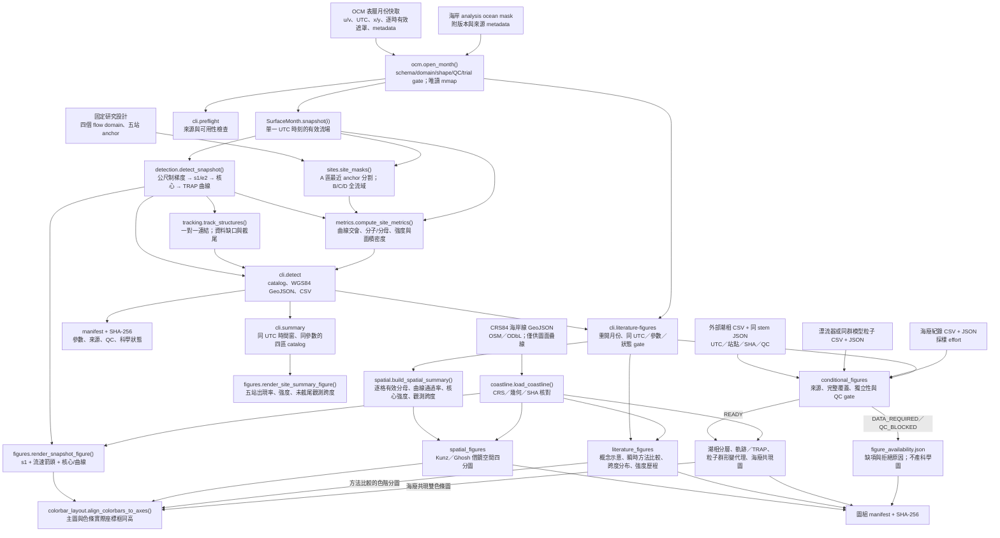

# TRAPs 模組流程與成果圖文獻對照

查核日期：2026-09-23。此文件對照目前程式、四區四時刻 `PILOT_ONLY` [海岸線與等高色條版試算圖組](../../outputs/_archive/pilot/literature_figures_four_area_4frames_v5_colorbar/figure_availability.json)，以及 [`data/literature/manifest.json`](../../data/literature/manifest.json) 已標記的文獻頁面。圖型借鏡研究問題與資訊安排，不複製原論文版面或將別處觀測當成本區結果。圖組的 coastline provenance 僅證明圖面所用向量邊界；數值有效海域另由 analysis sidecar 決定。

## 模組與資料流程圖

`src/traps/models.py` 定義檢出參數、單時刻結果與曲線資料結構；`src/traps/cli.py` 負責呼叫上述模組、輸出與來源檢查，`src/traps/__main__.py` 是命令列入口。`render` 可依 catalog 重繪摘要，或讀取指定快照重新檢出並繪製單時刻圖。

**兩條海岸資料路徑：**GeoJSON 只在成果圖的經緯度軸或由快照換算的公尺軸畫陸地輪廓；上游 `analysis_ocean_mask` 才決定有效海域與數值微分支撐。圖面疊線不改流場域、站點分割、檢出或統計分母。GeoJSON 的檔案雜湊、來源與授權見[資料說明](../../data/taiwan_exact_coastline/README.md)。

**色條版面：**在 `aspect='equal'` 地圖完成實際 axes 佈局後，色條對齊所屬主圖的上下邊界；海廢共現圖的兩條色條同屬一張主圖。此步驟只改繪圖幾何，參考相鄰 OCM-SVD 專案的[版面方法](COLORBAR_ALIGNMENT_PLAN.md)，不改色階、資料或圖上科學狀態。

**統計與物理邊界：**A 區的兩站分割只用於站點統計，不裁切 `detection` 的流場或曲線。C 區顯示為「南灣」，上游 `houwan_nmmba_cache_v3` ID 與邊界維持原狀。`mask_static.npy` 僅代表網格支撐，正式檢出另需有 metadata 的海岸 sidecar。基本 TRAP 檢出只需表層流速；波浪不作輸入，粒子與觀測資料走獨立的條件圖介面。試算資料必須明示 `--allow-trial-pilot`，產物標為 `PILOT_ONLY`；概念示意標為 `CONCEPT_ONLY`。

## 現有圖面與參考文獻逐項對照

下列檔案皆屬 2025-01-01 四時刻本機工程試算；它們檢查圖型與程式流程，不能用於正式時空結論。

| 文獻紅框與圖型 | 實作與試算成果 | 科學界線／尚缺條件 |
| --- | --- | --- |
| **C1：Kunz 等（2024）圖 2**，單時刻 `s1`、速度、核心與曲線 | [A 區單時刻海岸線圖](../../outputs/_archive/pilot/snapshot_a_20250101_t0100_v5_colorbar/snapshot_000000.png)；`figures.py`。 | 局部公尺軸、核心密集；海岸線為 OpenStreetMap 視覺疊線，跨圖色階與參數敏感度仍待正式資料決定。 |
| **A3：Serra 與 Haller（2016）圖 10**，吸引骨架、流線、短期變形對照 | [瞬時方法三分圖](../../outputs/_archive/pilot/literature_figures_four_area_4frames_v5_colorbar/northeast_taiwan_common_cache_v3/method_comparison.png) 已呈現 TRAP、Eulerian 流線與散度；`conditional_figures.py` 已有同一模型粒子群凸包面積比圖介面。 | 流線不是粒子路徑，散度不是變形梯度；粒子群圖需 metadata `patch_id`、至少三粒子與兩個共同 UTC 時刻，目前 `DATA_REQUIRED`。凸包面積比只是形變代理，不是 FTLE。 |
| **B1：Serra 等（2020）圖 2**，法向吸引與沿線輸送機制 | [本專案原創概念示意](../../outputs/_archive/pilot/literature_figures_four_area_4frames_v5_colorbar/mechanism.png)。 | 標 `CONCEPT_ONLY`，箭頭沒有 OCM 數值與觀測意義。 |
| **C2：Kunz 等（2024）圖 4；D1：Ghosh 等（2021）圖 2**，空間分布與通過頻率 | [A 區空間四分圖](../../outputs/_archive/pilot/literature_figures_four_area_4frames_v5_colorbar/northeast_taiwan_common_cache_v3/spatial_summary.png)；四區均已產出逐格有效分母、平均核心吸引、曲線通過率與未截尾觀測跨度。 | 同時刻重疊曲線每格只計一次；零分母留空。Ghosh 使用 FTLE/LCS，本圖僅借鏡分圖形式。四時刻不能稱長期熱區或出現日數。 |
| **C3：Kunz 等（2024）圖 5**，壽命分布與生命週期 | [A 區觀測跨度分布](../../outputs/_archive/pilot/literature_figures_four_area_4frames_v5_colorbar/northeast_taiwan_common_cache_v3/observed_span_distribution.png)與[強度歷程](../../outputs/_archive/pilot/literature_figures_four_area_4frames_v5_colorbar/northeast_taiwan_common_cache_v3/lifecycle_intensity.png)；完整／截尾分開。 | `duration_seconds` 僅首末檢出跨度，0 小時是解析度不足，非精確物理壽命；跨月份 track 接續仍缺。 |
| **B2–B5：Serra 等（2020）圖 4–5／表 1–2；C4–C5：Kunz 等（2024）圖 9–10**，漂流器、距 TRAP 距離與停留／相對運動 | `conditional_figures.py` 已有漂流器／模型粒子 CSV gate、距離、門檻內停留與距離變化率圖介面。 | 尚無獨立漂流器；本次 [availability](../../outputs/_archive/pilot/literature_figures_four_area_4frames_v5_colorbar/figure_availability.json) 記 `DATA_REQUIRED`。共用 OCM 的模型粒子只作內部比較；距離變化率不是完整相對速度。 |
| **D1：Ghosh 等（2021）觀測空間對照**，歷史海廢紀錄疊圖 | `conditional_figures.py` 已有附採樣 effort 的海廢 CSV gate 與空間疊圖介面。 | 尚無對齊 UTC 且通過 QC 的紀錄，`DATA_REQUIRED`；只做時空共現，不推論來源或因果。 |
| **D3–D4：Ghosh 等（2021）圖 3、5**，漲退潮及大／小潮分圖 | `conditional_figures.py` 已有五站×UTC 完整覆蓋 gate、四組分層出現率（分子／分母）圖介面。 | 尚無本研究確認的潮相標籤，`DATA_REQUIRED`；Ghosh 的物理量是 LCS，分圖形式可借鏡，數值不可等同。 |

[五站三欄摘要](../../outputs/_archive/pilot/literature_figures_four_area_4frames_v5_colorbar/five_site_summary.png)依本專案四區五站設計呈現出現率分子／分母、平均吸引強度與未截尾 track 首末檢出跨度；它是工程摘要，不是獨立觀測驗證。A–D 的方法與空間圖均已目視核對 CRS84 海岸輪廓與等高色條，且 [manifest](../../outputs/_archive/pilot/literature_figures_four_area_4frames_v5_colorbar/manifest.json) 的 27 個 artifact SHA-256 全部相符。四區科學摘要 JSON、五站摘要及概念示意與前版位元組一致；Matplotlib 自動刻度可按新色條高度調整顯示密度，色階上下限未改。所有條件資料皆需 UTF-8 CSV 與同 stem JSON metadata，詳見 [README](../../README.md#條件資料介面與圖型啟用)。

## 圖面完成的必要條件

1. **正式模型成果圖：**取得 2024–2025 完整且通過 QC 的 OCM 月份、海岸 sidecar、速度單位確認；固定參數與跨圖色階，補逐格空間分布與有效分母，並檢查多時刻／跨月份追蹤。
2. **分層圖：**先以可信 UTC 時間與潮位資料建立潮相、大／小潮標籤，再各自計算有效快照分子與分母；季節分層同理。
3. **獨立驗證圖：**另取得有時間、位置、漂流物型態及 QC 的表層觀測，才可做漂流器至 TRAP 距離、停留時間或海廢紀錄對照；共用流場的 SVD 與 Lagrangian 結果只能作機制比較。

正式圖說須清楚標示資料期間、UTC、區域與站點、單位、檢出參數、海岸／缺值處理、分子與分母，以及 `PILOT_ONLY` 或其他科學狀態。不能將檢出曲線直接稱為實測海廢濃度、長期聚集或污染來源。
