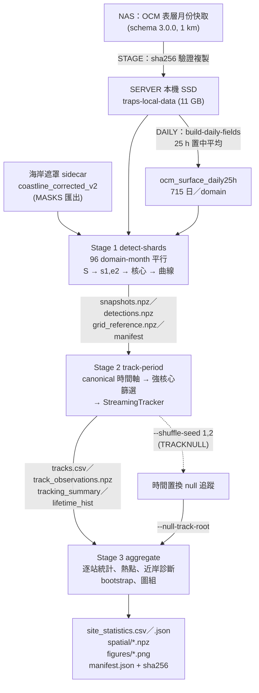

# TRAPs 實作方式報告：表層瞬態吸引剖面之檢出、追蹤與統計方法

> 文件性質：方法與實作報告（可獨立引用）。研究成果數值與解讀見姊妹文件〈[02_TRAPs_執行成果報告](02_TRAPs_執行成果報告.md)〉。
> 程式版本：commit `99c31518646b14948b81afdd7fd83d4674112feb`（`git_dirty = false`，見兩次 aggregate 的 `manifest.json`）。
> 科學狀態：`MODEL_ONLY`，所有結果為「表層短期吸引潛勢」，不是海廢濃度、滯留時間或污染來源。

## 摘要

本報告說明「工項 2：瞬態吸引剖面（Transient Attracting Profiles, TRAPs）」在本專案 `TRAPs` 中的實作方式。方法依 Serra 與 Haller（2016）的客觀歐拉相干結構（OECS）理論、Serra 等（2020）的 TRAP 演算法，以及 Kunz 等（2024）的空間分布與壽命分析流程：由表層流速計算應變率張量 $\mathbf{S}$，取其最小特徵值 $s_1$ 的負局部極小值為 TRAP 核心，並自核心沿與最強壓縮方向正交的特徵向量 $\mathbf{e}_2$ 積分出骨架曲線。

資料為 CWA-OCM／SCHISM 表層流場，預處理成 1 km 規則公尺網格（schema 3.0.0），涵蓋四個流場區域與五個研究站，期間 2024-01 至 2025-12，共 96 個 domain-month 全數通過標準檢查。流場以兩種產品獨立分析：逐時產品（`param_id = r1_hourly`）與 25 小時置中平均的去潮汐日產品（`param_id = d1_daily25h`）。每個研究站獨立統計，不做跨站比較。

壽命分析採用「只追蹤各站最強的前 10% 核心」並一律對照「時間置換 null」報告；此設計源自一項發現：追蹤全部核心時，壽命大多可由隨機串接解釋。追蹤門檻由門檻掃描決定（逐時：核心 2 km、曲線 4 km；日產品：核心 5 km、曲線 10 km）。近岸診斷顯示，核心在距非海域格點約 2–3 km 內無法被偵測，並以 10 km 近岸帶區分近岸型與近岸外 track。

軟體為三階段、可平行、可續跑、帶 SHA-256 溯源的管線（`detect-shards` → `track-period` → `aggregate`），另有 `build-daily-fields`。全套測試 254 項（`pytest --collect-only`）。本專案沒有獨立的漂流器或海廢觀測資料，因此未進行 Serra 等（2020）圖 4a–c 型式的實測驗證。

## 1. 工作項目要求與對應

需求來源為 `data/工項2.pdf` 第 27–28 頁「二、瞬態吸引剖面（TRAPs）理論」。下表將每項要求對應到實作模組與輸出。

| 編號 | 工項 2 要求（摘要） | 實作模組 | 輸出／證據 |
| --- | --- | --- | --- |
| R1 | 提取表層二維流速 $\mathbf{v}=(u,v)$，以有限差分求偏導數，建構應變率矩陣 $\mathbf{S}$（式 5） | `ocm.py`（唯讀讀取）、`detection.py::_compute_strain` | 每快照 `s1`、`s2`、$\mathbf{e}_2$（儲存於 shard 的核心與曲線，場本身不落地） |
| R2 | 求解 $\det(\mathbf{S}-\lambda\mathbf{I})=0$，取 $\lambda_{\min}=\min(\lambda_1,\lambda_2)$ | `detection.py`（2×2 對稱矩陣封閉解） | `core_s1_sinv` 欄位（`detections.npz`） |
| R3 | $\lambda_{\min}<0$ 且為局部極小值之格點為 TRAP 核心 | `detection.py::_find_core_candidates`、`refine_core_quadratic` | 核心位置（格點與次網格）、強度 |
| R4 | 自核心沿特徵向量積分曲線，得 TRAP 骨架 | `detection.py::_integrate_branch` | 曲線點列、停止原因、`curve_pass_cells` |
| R5 | 分析 5 個指定地點 TRAP 的空間分布 | `sites.py`、`aggregate.py`、`aggregate_figures.py` | `spatial/<site>/spatial_*.npz`；`spatial`、`hotspots`、`seasonal`、`track_density` 圖 |
| R6 | 分析 TRAP 的生命週期 | `tracking.py`、`period.py::run_track_period`、`aggregate.py` | `tracks.csv`、`lifetime` 圖、`long_tracks` 圖、壽命欄位與 null 對照 |
| R7 | 定量評估形成聚集熱區的「頻率」 | `aggregate.py` | 強核心出現率、曲線通過格點比例、熱點面積與平均通過頻率 |
| R8 | 定量評估形成聚集熱區的「強度」 | `aggregate.py` | $s_1$ 統計（平均、中位、p10，day⁻¹）、各站強核心門檻 |

關於 R4 的方向：需求 PDF 寫「沿著代表拉伸方向的特徵向量 $\mathbf{e}_{\max}$ 積分」。本實作沿 $\mathbf{e}_2$ 積分，其為較大特徵值 $s_2$ 對應的特徵向量，即拉伸方向，並與最強壓縮方向（$\mathbf{e}_1$，對應 $s_1$）處處正交。兩者敘述一致。

## 2. 資料與前處理

### 2.1 流場資料

輸入為 CWA-OCM／SCHISM 的表層速度 `u_surface_mps`、`v_surface_mps`，已由上游預處理成 1 km 規則公尺網格（`x_m`、`y_m`，schema 3.0.0）。四個流場區域（`configs/study_design.json`）與五個研究站如下。

| 流場區域 | `flow_domain_id` | 研究站（`study_site_id`） |
| --- | --- | --- |
| A | `northeast_taiwan_common_cache_v3` | 貢寮（`gongliao`）、龜山島西側（`guishan`） |
| B | `hsinchu_cache_v3` | 新竹外海（`hsinchu`） |
| C | `houwan_nmmba_cache_v3`（顯示名稱：南灣） | 南灣（`nanwan`） |
| D | `lienchiang_common_cache_v3` | 連江（`lienchiang`） |

A 區兩站共用同一流場，以兩個 anchor 的公尺距離做互斥最近 anchor 分割（tie 歸貢寮），只決定統計歸屬，不裁切流場微分或曲線積分。B、C、D 各站使用完整流場區域的分析海域。期間 2024-01 至 2025-12，4 個區域 × 24 個月 = 96 個 domain-month，依專案記錄全數為標準（standard）等級、狀態 ready。

### 2.2 正式時間軸與缺口

依專案記錄，逐時正式時間軸共 17,196 列，月份交界有 72 個重複 UTC 時刻；`sort_and_deduplicate_prefer_last`（串接月份、依 UTC 穩定排序、重複者保留較晚月份）後為 17,124 個唯一 UTC 時刻。缺漏 420 個小時，其中 48 個缺口長於 1 小時，最長 50 小時。缺口一律不內插、不補值，只記錄；追蹤與統計以缺口截尾處理（見第 4、5 節）。此契約與姊妹專案 `OCM-SVD-Analysis`、`Lagrangian-Ensemble-Backtracking` 相同。

### 2.3 海岸遮罩

分析海域遮罩採 SERVER 上 `coastline_corrected_v2` 版本（OSM 精確海岸線；與專案 GeoJSON 同一 SHA-256），由 `scripts/export_ocean_masks.py` 逐位元匯出為 `analysis_ocean_mask_coastline_corrected_v2.npy` 及 metadata sidecar。`mask_static.npy` 僅代表網格支撐，不等於陸地遮罩；正式 `detect` 與 `detect-shards` 會拒絕缺 sidecar 的輸入。專案內的 GeoJSON（© OpenStreetMap contributors／ODbL）只供圖面疊加海岸線，不影響數值。

### 2.4 資料落地

依專案記錄，資料由 NAS 複製到 SERVER 本機 SSD（`/home/mustlab/Workspace/traps-local-data`，11 GB，SHA-256 逐檔核對），沿用 LBT 專案「本機優先、NAS 只當來源」的慣例（`scripts/stage_ocm_surface_local.py`）。

### 2.5 去潮汐日產品（25 小時置中平均）

逐時表層流以潮汐為主，而 Kunz 等（2024）使用逐日快照。`build-daily-fields`（`daily_fields.py`）由逐時資料建立同 schema 的日產品（`cache_kind = derived_daily_mean`）。對每個 UTC 日，目標時刻 $T_d$ 為當日 12:00 UTC，視窗為正式逐時時間軸上 $|t-T_d|\le 12$ h 的樣本（即當日 00:00 至隔日 00:00，含兩端，可跨月讀取鄰月）：

$$
\bar{\mathbf{u}}(\mathbf{x},T_d)=\frac{1}{N_d}\sum_{t_k\in W_d}\mathbf{u}(\mathbf{x},t_k),\qquad W_d=\{t_k:\ |t_k-T_d|\le 12\ \mathrm{h}\}
$$

$N_d$ 為視窗內實際存在的小時數。規則：

1. $N_d\ge 23$，否則該日整日省略（不補值）。專案記錄中每個 domain 有 715 日，另 16 日省略。
2. 格點僅在視窗內「所有實際存在的小時」皆有效時才有效（嚴格規則，使微分不混用不同樣本集合），無效處為 NaN。
3. `grid/`（含海岸遮罩 sidecar）原樣複製，來源逐時資料從不被修改；`--resume` 只在濾波參數、來源與陣列 SHA-256 皆相符時略過。

**潮汐抑制的理由。** 25 點（$N=25$、$\Delta t=1$ h）等權滑動平均對週期 $T$ 的正弦訊號，振幅響應（保留比例）的解析式為

$$
H(T)=\left|\frac{\sin(\pi N\Delta t/T)}{N\,\sin(\pi\Delta t/T)}\right|
$$

下表為此式的解析計算值（濾波器的解析響應，非對模型資料的實測；以 Python 直接計算）：

| 訊號 | 週期 $T$ (h) | 振幅響應 $H(T)$ |
| --- | --- | --- |
| M2 | 12.4206 | 0.0064 |
| S2 | 12.0000 | 0.0400 |
| N2 | 12.6583 | 0.0128 |
| K1 | 23.9345 | 0.0426 |
| O1 | 25.8193 | 0.0328 |
| P1 | 24.0659 | 0.0374 |
| 3 日週期 | 72 | 0.8134 |
| 7 日週期 | 168 | 0.9640 |

六個主要分潮的振幅被壓到約 0.6%–4.3%，而 3 日與 7 日週期分別保留約 81% 與 96%，所以日產品保留天尺度變動、抑制潮汐。25 小時平均仍不是理想低通：響應在分潮頻率附近不為零，殘留的日潮與非潮汐高頻訊號可能不為零，相關資訊寫入各月 `metadata.json` 的 `derived_from.filter`。

## 3. TRAP 計算方法

### 3.1 速度梯度與應變率張量

在公尺座標下以中心差分求偏導數（格距 $\Delta x,\Delta y$ 取該格兩側座標差，約 1 km）：

$$
\frac{\partial u}{\partial x}\approx\frac{u_{i,j+1}-u_{i,j-1}}{x_{j+1}-x_{j-1}},\quad
\frac{\partial u}{\partial y}\approx\frac{u_{i+1,j}-u_{i-1,j}}{y_{i+1}-y_{i-1}}
$$

$v$ 同理。應變率張量為速度梯度的對稱部分，對應需求 PDF 式 (5)：

$$
\mathbf{S}=\tfrac12\left(\nabla\mathbf{v}+\nabla\mathbf{v}^{\mathsf T}\right)=
\begin{pmatrix}
\dfrac{\partial u}{\partial x} & \dfrac12\left(\dfrac{\partial v}{\partial x}+\dfrac{\partial u}{\partial y}\right)\\[2mm]
\dfrac12\left(\dfrac{\partial v}{\partial x}+\dfrac{\partial u}{\partial y}\right) & \dfrac{\partial v}{\partial y}
\end{pmatrix}
=\begin{pmatrix}a & b\\ b & d\end{pmatrix}
$$

單位為 s⁻¹；成果表以 day⁻¹ 表示，換算為乘以 86,400。

**遮罩安全規則。** 中心點與其四個正交鄰點只要有一格無效（陸地、缺值、非有限值），該點不產生導數。這是保守的 fail-closed 設計：不把海岸或缺值當成 0，也避免曲線穿過遮罩缺口。預設不做空間平滑（`smoothing_radius_cells = 0`，程式保留有遮罩保護的圖擴散選項，本次未使用）。

### 3.2 特徵值與特徵向量（封閉解）

對稱 $2\times2$ 矩陣的特徵值有封閉解：

$$
s_{1,2}=\frac{a+d}{2}\mp\sqrt{\left(\frac{a-d}{2}\right)^2+b^2},\qquad s_1\le s_2
$$

$s_1$ 為最強壓縮率（最小特徵值，即需求中的 $\lambda_{\min}$），$s_2$ 為最強拉伸率。特徵值間距 $s_2-s_1=2\sqrt{((a-d)/2)^2+b^2}$ 低於 $10^{-12}$ s⁻¹ 的格點視為方向退化，不參與檢出。$s_2$ 對應的單位特徵向量為

$$
\mathbf{e}_2=\frac{(b,\ s_2-a)}{\|(b,\ s_2-a)\|},\quad\text{若 }\|(b,s_2-a)\|\text{ 過小則改用 }\frac{(s_2-d,\ b)}{\|(s_2-d,\ b)\|}
$$

（兩種寫法取範數較大者，以穩定取得軸向特徵向量）。$\mathbf{e}_1\perp\mathbf{e}_2$ 為壓縮方向。

### 3.3 核心定義

格點 $(i,j)$ 為 TRAP 核心候選，需同時滿足：

1. $s_1(i,j)<s_{\min}=-10^{-8}\ \mathrm{s^{-1}}$（負值且有最小量值）；
2. 以 $3\times3$ 鄰域（`local_min_radius_cells = 1`）全部導數有效，且 $s_1(i,j)$ 為鄰域最小值，並至少有一個嚴格較高的鄰點（避免整片常數區被當作核心）。

**次網格定位。** 為避免核心恆落在 1 km 格點而使位移被格距量化，對核心格點的 $3\times3$ 有效鄰域做二次曲面最小平方擬合（`quadratic_3x3`）：

$$
s_1(\xi,\eta)\approx c_0+c_1\xi+c_2\eta+c_3\xi^2+c_4\xi\eta+c_5\eta^2
$$

$\xi,\eta$ 為以格距無因次化的偏移（9 個樣本、6 個參數）。駐點由 $\mathbf{H}\mathbf{p}=-\mathbf{g}$ 求得，其中 $\mathbf{H}=\begin{pmatrix}2c_3&c_4\\c_4&2c_5\end{pmatrix}$，$\mathbf{g}=(c_1,c_2)^{\mathsf T}$。只有 $\mathbf{H}$ 正定（$2c_3>0$ 且 $\det\mathbf{H}>0$）且偏移每軸不超過 0.5 格時才接受，否則保留格點並標記 `refined = False`。曲線積分自細化後的位置起算；強度 $s_1$ 仍取格點值。

### 3.4 積分曲線

自核心位置 $\mathbf{x}_0$ 向 $\pm\mathbf{e}_2$ 兩個方向各積分一條分支，求解

$$
\frac{d\mathbf{x}}{d\sigma}=\pm\,\mathbf{e}_2\big(\mathbf{x}(\sigma)\big),\qquad \mathbf{x}(0)=\mathbf{x}_0
$$

$\sigma$ 為弧長。實作要點：

- **積分格式**：二階中點法（RK2）。步長取半格距（約 500 m）；即使使用者指定較大步長也切成不超過半格的子步，避免跨過一列無效格點。
- **場採樣**：在目標位置所在格的四個角點做雙線性內插 $s_1$ 與 $\mathbf{e}_2$；四個角點必須全部導數有效，否則停止（`invalid_mask`）。
- **符號連續性**：特徵向量只定義到正負號。採樣時以第一個角點為參考，將與其內積為負的角點向量反號後才做加權平均；沿曲線前進時，再把新切向量反號到與前一步切向量夾角不大於 90°（`_oriented_tangent`）。如此 $\mathbf{e}_2$ 的任意正負號不影響曲線。
- **輸出方向**：反向分支反轉後接上正向分支，曲線固定為「反向端 → 核心 → 正向端」。

**停止準則**（任一成立即停止該分支，並記錄原因於 `STOP_REASON_CODES`）：

| 代碼 | 條件 |
| --- | --- |
| `invalid_mask` | 採樣點的角點含無效導數（海岸、缺值、鄰近邊界） |
| `outside_flow_domain` | 超出網格範圍 |
| `curvature_limit` | 相鄰切向量轉角超過 `max_turn_angle_deg = 90°` |
| `s1_threshold` | $s_1\ge 0$（不再壓縮） |
| `relative_strength_threshold` | $|s_1|<0.30\,|s_{1,\mathrm{core}}|$（相對強度，見 3.5 表） |
| `s1_not_monotonic` | $s_1$ 較前一點更負（自核心向外應單調回升） |
| `max_curve_length` | 單一分支弧長達 20 km |
| `max_integration_steps` | 達 2000 步 |
| `invalid_step`、`zero_step` | 步長無效或位移為零 |

曲線合格條件為至少 3 個點（`min_curve_points = 3`）。每條曲線同時記錄弧長、平均 $s_1$、兩端停止原因。曲線經過的格點集合以半格距加密取最近格點（`curve_pass_cells`），供統計使用。

### 3.5 檢出參數（取自兩次執行的 manifest，逐時與日產品相同）

| 參數 | 值 | 說明 |
| --- | --- | --- |
| `min_core_s1_sinv` | $-1\times10^{-8}$ s⁻¹ | 核心最小量值 |
| `min_eigenvalue_gap_sinv` | $1\times10^{-12}$ s⁻¹ | 方向退化門檻 |
| `local_min_radius_cells` | 1 | $3\times3$ 局部極小值 |
| `local_min_tolerance_sinv` | $1\times10^{-12}$ s⁻¹ | 並列判定容許 |
| `core_min_separation_m` | 0 | 不另做核心間距去重 |
| `core_subgrid` | `quadratic_3x3`（`refine = true`） | 次網格核心 |
| `curve_s1_stop_sinv` | 0 | $s_1\ge0$ 即停 |
| `curve_min_relative_strength` | 0.3 | 相對核心強度下限 |
| `curve_monotonic_tolerance_sinv` | $1\times10^{-12}$ s⁻¹ | 單調性容許 |
| `max_curve_length_m` | 20,000 m（每分支） | 曲線最長約 40 km |
| `max_integration_steps` | 2000 | |
| `max_turn_angle_deg` | 90° | |
| `min_curve_points` | 3 | |
| `min_curve_length_m` | 0 | |
| `integration_step_m` | `null`（預設半格距） | |
| `smoothing_radius_cells` | 0（無平滑；`smoothing_method` 記為四鄰接圖擴散，未啟用） | |
| `min_coverage` | 0.95 | 有效快照的有效格點比例下限 |

`curve_min_relative_strength = 0.3` 為工程起始值，程式註解已明示不可直接沿用其他海域尺度。本專案未對此值及 `max_curve_length_m` 做系統性的敏感度分析，這是第 8 節列出的限制之一。

## 4. 時序追蹤與生命週期

### 4.1 追蹤對象

追蹤的是 Eulerian 幾何結構（核心加曲線），不是粒子、水團或廢棄物軌跡。

### 4.2 配對成本與門檻

對相鄰可用快照的候選配對 $(A,B)$，需同時通過兩個距離門檻：

$$
d_c=\|\mathbf{x}^{A}_{\mathrm{core}}-\mathbf{x}^{B}_{\mathrm{core}}\|\le D_c,\qquad
d_H=\max\Big\{\sup_{p\in\Gamma_A}\mathrm{dist}(p,\Gamma_B),\ \sup_{q\in\Gamma_B}\mathrm{dist}(q,\Gamma_A)\Big\}\le D_h
$$

$d_H$ 為兩條曲線（以 500 m 步長加密）的對稱 Hausdorff 距離。通過者的成本為

$$
C=\frac{d_c}{D_c}+\frac{d_H}{D_h}
$$

所有候選依 $(C,\text{track id},\text{detection index})$ 排序後貪婪一對一配對（確定性、可重現）。先以核心距離與時間差做 numpy 向量化預篩，只對通過者計算曲線距離。

| 產品 | $D_c$（核心） | $D_h$（曲線） | 名目步長 | 最大時間差 |
| --- | --- | --- | --- | --- |
| 逐時 `r1_hourly` | 2,000 m | 4,000 m | 3,600 s | 10,800 s（3 h） |
| 日產品 `d1_daily25h` | 5,000 m | 10,000 m | 86,400 s | 129,600 s（36 h） |

最多允許 1 個缺失時刻的 gap closing（`max_missing_frames = 1`）；缺失兩個以上時刻則截斷原 track，由後續檢出另建新 track。只追蹤合格（`is_qualified`）曲線。

### 4.3 截尾與壽命慣例

- **左截尾**：第一個觀測落在研究序列第一個時刻，或緊接資料缺口（前一幀不可用，或與前一幀時間差超過最大時間差）之後。
- **右截尾**：最後觀測因研究期結束、尾端資料缺口（`time_gap`／`data_gap`）而無法判斷是否持續。可用快照上「無檢出」或「無配對」則保留為非截尾的實際結束。
- 壽命統計只用未截尾 track（`track_n_uncensored`）；單時刻 track 的壽命為一個取樣間隔，不是 0。
- **壽命慣例**（沿用 Kunz 等 2024 的 eddy-census 慣例）：

$$
\text{壽命}=t_{\text{last}}-t_{\text{first}}+\Delta t
$$

$\Delta t$ 為名目取樣間隔（逐時 1 h，日產品 24 h）。`duration_seconds` 為首末觀測跨度，另行保留。

### 4.4 只追蹤各站強核心（`--track-strong-quantile 0.10`）

Pass 1 只讀欄位，以 `sites.site_masks` 依核心格點分站，母體為 canonical 且 `coverage_pass` 快照中、核心落在站內的合格核心；各站門檻 $\tau_{\mathrm{site}}$ 為該站核心 $s_1$ 的 10% 分位數（越負越強）。Pass 2 只讓 $s_1\le\tau_{\mathrm{site}}$ 的合格 detection 進入追蹤器，站外核心一律丟棄。門檻取自真實 canonical 集合，與 null 運行共用，且與 `aggregate --strong-quantile` 的強核心門檻位元相同。各站保留與丟棄數記於 manifest `track_core_filter`。壽命結果因此指「強核心結構（各站前 10%）」，而非全部 TRAP。

### 4.5 時間置換 null 模型

`track-period --shuffle-seed s` 保留 canonical 時間軸、可用性、coverage 與缺口，但把每個可用槽位的偵測換成「僅在可用快照之間置換」的另一個快照（`detection_keys` 仍指向真實來源）。置換打斷了真實的時間連續性，但保留每個快照的核心數、空間分布與強度，因此 null 追蹤到的壽命代表「近鄰、同等密度的不相干結構被追蹤門檻串接」所能達到的機會水準。manifest 記錄 `null_model = {type: time_shuffle, seed: s}`；`aggregate` 會拒絕以 null 作為真實輸入，並要求 null 與真實的偵測、追蹤設定及 `track_core_filter` 完全相同（僅 seed 不同）。本次使用 seed 1 與 2，所有壽命統計附兩個 seed 的平均作為對照，並計算

$$
\text{超額}_h=f^{\text{real}}_{\ge h}-\overline{f}^{\text{null}}_{\ge h},\qquad
\text{比值}_h=\frac{f^{\text{real}}_{\ge h}}{\overline{f}^{\text{null}}_{\ge h}}\ (\overline{f}^{\text{null}}_{\ge h}=0\text{ 時留空})
$$

$f_{\ge h}$ 為未截尾 track 中壽命不小於 $h$ 的比例。

### 4.6 為何改為強核心追蹤與門檻掃描

依專案記錄與 `docs/operations/SERVER_RUNBOOK.md`：

1. 日產品追蹤全部合格核心時，每個快照約 15 個核心／1000 km²，核心最近鄰間距僅數 km，而當時的追蹤門檻（核心 10 km、曲線 20 km）相近，壽命大多可由隨機串接解釋（Runbook 記載置換的壽命 p90 約 10 天、真實約 13 天）。
2. 因此改為只追蹤各站最強 10% 核心，並對各產品掃描追蹤門檻，選擇在隨機對照下仍有明顯「相干性」且樣本數足夠的門檻。
3. 以「壽命不小於 3 個時間步的比例，真實 ÷ 置換平均」作為相干性比值（`scripts/null_test_tracking.py`，單位為 domain），結果如下。

以下為專案記錄的門檻掃描輸出（`scripts/null_test_tracking.py`）。相干性比值＝壽命不小於 3 個時間步的比例，真實 ÷ 兩個置換 seed 的平均；**以流場區域（flow domain）為單位計算，A 區（NE）未拆成貢寮與龜山島西側**，追蹤對象為該 domain 的全部強核心（各站前 10% 合併）。

逐時產品（門檻＝核心／曲線，km）：

| 門檻 | NE（A） | 新竹（B） | 後灣／南灣（C） | 連江（D） |
| --- | --- | --- | --- | --- |
| 1／2 | 51.7 | 72.3 | 31.8 | 36.5 |
| **2／4（採用）** | 15.1 | 19.3 | 8.8 | 14.1 |
| 5／10 | 5.5 | 6.0 | 3.1 | 4.7 |

日產品（強核心；門檻＝核心／曲線，km）：

| 門檻 | NE（A） | 新竹（B） | 後灣／南灣（C） | 連江（D） |
| --- | --- | --- | --- | --- |
| 3／6 | 2.35 | 3.17 | 2.55 | 2.90 |
| **5／10（採用）** | 1.84 | 2.52 | 2.05 | 2.43 |
| 10／20 | 1.69 | 2.36 | 1.84 | 2.09 |

先前的日產品「全部核心（無強核心篩選）」測試：10／20 km 比值 1.12–1.15，5／10 km 為 1.22–1.34，3／6 km 為 1.80–2.10。比值接近 1 表示壽命與隨機串接無異，這是改為只追蹤強核心的原因。

選擇理由：逐時採 2 km（相干性高且樣本數充足）；日產品採 5 km（相干性與樣本數的平衡）。

上表的記錄值（逐時採用門檻約 8.8–19.3 倍；日產品約 1.84–2.52 倍）以 domain 為單位，與最終 `aggregate` 的逐站值（壽命 ≥3 h：8.9–31.5 倍；日產品 ≥72 h：1.8–2.5 倍，≥48 h：1.5–1.9 倍，≥168 h：3.8–11.3 倍，取自 `site_statistics.csv` 的 `ratio_track_frac_uncensored_ge_*`）單位不同（domain 與站、A 區是否拆分、domain 合併追蹤與逐站統計），數值不可逐項對照。日產品的相干性只有約 2 倍，是限制之一（第 8 節）。

## 5. 統計指標定義

所有指標逐站獨立計算，以站點分析區（`scope = site_area`）為範圍；任何門檻、熱點與色階只使用該站自己的資料，不跨站 pooled。分層（`stratum`）為 `all`、四季 `DJF`／`MAM`／`JJA`／`SON`，以及實際出現的年份（`2024`、`2025`）。

**有效快照。** canonical 時間軸上、該站分析區內有效格點比例不小於 `min_coverage`（0.95）的快照。令其數量為 $N$（逐時 17,124，日產品 715）。缺口時刻不在分母內，不以 0 取代。

**出現率。** 令 $\mathbb 1_k^{\mathrm{core}}$、$\mathbb 1_k^{\mathrm{strong}}$、$\mathbb 1_k^{\mathrm{curve}}$ 分別表示快照 $k$ 在站內是否至少有一個合格核心、強核心、曲線通過站內格點：

$$
r_{\mathrm{core}}=\frac1N\sum_k\mathbb 1_k^{\mathrm{core}},\quad
r_{\mathrm{strong}}=\frac1N\sum_k\mathbb 1_k^{\mathrm{strong}},\quad
r_{\mathrm{curve}}=\frac1N\sum_k\mathbb 1_k^{\mathrm{curve}}
$$

每個快照至多計一次，不重複計交會。

**強核心。** 站內強核心門檻 $\tau_{\mathrm{site}}$ 為該站、canonical 且通過覆蓋率的快照中全部合格核心 $s_1$ 的 10% 分位數；核心 $s_1\le\tau_{\mathrm{site}}$ 為強核心（以 s⁻¹ 計算，表中同時給 day⁻¹）。

**曲線通過格點比例。** 快照 $k$ 的曲線所經過的站內格點數除以站內格點數 $M$，再對 $N$ 個快照平均：

$$
\bar p=\frac1N\sum_k\frac{|\bigcup_{\Gamma\in\mathcal G_k}\mathrm{cells}(\Gamma)\cap\Omega_{\mathrm{site}}|}{M}
$$

（欄位 `mean_pass_cell_fraction`）。

**核心密度。** $\rho=\dfrac{\sum_k n_k}{N\cdot A_{\mathrm{site}}}\times1000$，$n_k$ 為快照 $k$ 站內合格核心數，$A_{\mathrm{site}}$ 為站內面積（km²），單位為個／1000 km²／快照（`core_density_per_1000km2_per_snapshot`，含全部合格核心，不限強核心）。

**核心強度。** 站內全部合格核心 $s_1$ 的平均、中位數與 p10（day⁻¹）。

**逐格曲線通過頻率與熱點。** 格點 $g$ 的曲線通過頻率 $F_g=n^{\mathrm{pass}}_g/n^{\mathrm{valid}}_g$（站外與無有效分母的格點為 NaN，不假裝為 0）。**熱點**為站內 $F_g$ 最高 10% 的格點（`hotspot_quantile = 0.9`），並要求 $F_g>0$；並列於門檻者全數納入，故格數可略多於 10%。輸出熱點門檻、格數、面積（km²）、熱點內平均 $F$、熱點內核心平均 $s_1$（day⁻¹，依核心數加權）、以及「該站強核心落在熱點格點的比例」。熱點為相對於該站自己分布的前 10%，不是絕對標準，且面積約為站內面積的 10%。圖面另將 4-連通格數小於 3 的小塊濾除（`hotspot_min_cells = 3`，僅作用於圖面與 npz 附加陣列，不影響統計欄位）。

**壽命分數與 null 超額。** 未截尾 track 中壽命不小於各門檻（逐時 3、6、12、24 h；日產品 48、72、168 h）的比例，連同 null 平均、超額與比值（見 4.5）。track 依其首個落在該站分析區內的觀測時間決定 stratum。

**傳播速度。** 對每條觀測數不少於 $n_{\min}$ 的 track，以最小平方對次網格核心位置作時間線性擬合：

$$
x(t)=x_0+c_x(t-\bar t),\quad y(t)=y_0+c_y(t-\bar t)
$$

取擬合速度 $(c_x,c_y)$（km/day）、殘差 RMS（m）與擬合位移 $\sqrt{c_x^2+c_y^2}\,(t_{\mathrm{last}}-t_{\mathrm{first}})$。$n_{\min}$ 依名目步長自動決定：步長小於 24 h 時 $\max(3,\lceil 6\,\mathrm{h}/\Delta t\rceil)+1$（逐時為 7），日產品為 3（manifest `propagation.min_observations`）。**靜止規則**：擬合位移小於 1 格距（逐時 manifest 記錄約 990.6–993.9 m）者判為靜止，不進入速度與方向統計。因此 `prop_speed_median_kmday` 等欄位只含移動 track；另報 `prop_stationary_frac`。此速度描述模型內 TRAP 核心（結構）的位移，不等於水體或漂浮物速度。

**近岸／近岸外分割。** 距岸距離為「點到最近非分析海域格點中心」的歐氏距離（以距離變換場雙線性取樣）。`coastal_buffer_km = 10`：核心距岸小於 10 km 為近岸核心；track 的核心平均距岸小於 10 km 為近岸型 track，其餘為近岸外。輸出：近岸帶內核心與強核心比例（`frac_cores_within_buffer`、`frac_strong_cores_within_buffer`）、長壽命 track 的近岸比例（`frac_long_tracks_within_buffer`，長壽命＝站內出生、未截尾、壽命不小於逐時 24 h／日產品 168 h）、近岸外強核心出現率（強核心門檻不變）、近岸外熱點（只在站內緩衝帶外格點重取分位數）、近岸型與近岸外各自的壽命分數及其 null。依專案記錄，核心不可能落在距非海域格點約 2.2–3 km 以內（檢出下限，因導數模板與局部極小值鄰域需要連續有效格點；診斷圖以灰帶標示站內最小核心距岸距離），故 10 km 緩衝才具檢驗力。

**日區塊 bootstrap 信賴區間。** 三個出現率與 `mean_pass_cell_fraction` 以「以日為區塊」的重抽樣（1000 次、種子 20260928）取 2.5%、97.5% 分位數為 95% 信賴區間，以反映同日快照的自相關。壽命分數、核心強度統計與傳播統計不附信賴區間。

## 6. 成果圖說明

每次 aggregate 為每站輸出 12 張圖（5 站 × 12 × 2 個產品 = 120 張），位於 `figures/<site_id>/site_<site_id>_<kind>.png`。圖面文字為繁體中文（Noto Sans CJK TC，字型 SHA-256 記於 manifest `font`），色階上下限為各站自己分析區的 2–98 百分位。下表中標「本專案收錄」者已複製到 `docs/reports/figures/`（逐時與日產品皆含；`seasonal`、`propagation` 僅日產品收錄）。

| 圖（`<kind>`） | 內容 | 文獻類比 | 收錄 |
| --- | --- | --- | --- |
| `spatial` | 站內 2×2：曲線通過頻率、核心頻率、平均核心 $s_1$（day⁻¹）、平均未截尾壽命；虛線為 10 km 近岸帶 | Kunz 等（2024）圖 4 | 是 |
| `hotspots` | 曲線通過頻率場，標出前 10% 熱點格點，疊加核心頻率前 10% 格點；標題與註腳列面積與格數 | Kunz 圖 4；Ghosh 等（2021）圖 2 型式（出現頻率圖） | 是 |
| `seasonal` | DJF／MAM／JJA／SON 曲線通過頻率小圖，以及強核心出現率與平均通過格點比例（含 95% CI） | 無直接對應（分層圖面） | 日產品 |
| `lifetime` | 左：壽命互補累積分布（CCDF；實線為未截尾、虛線含截尾、灰色為 null 與跨 seed 範圍）；右：壽命不小於 12 h（日產品 72 h）未截尾 track 的平均核心 $s_1$ 對正規化年齡 | Kunz 等（2024）圖 5 | 是 |
| `timeseries` | 逐日含強核心的有效快照比例與平均通過格點比例，30 日滑動平均，缺口以斷線呈現 | 無直接對應 | 否 |
| `example` | 代表 track 起始時刻的 $s_1$、抽稀速度箭頭、全部合格曲線（淡色）、代表曲線與核心（紅）、核心路徑，以及約 1/3、2/3 與最後觀測的曲線 | Kunz 等（2024）圖 2 | 是 |
| `example_coastal` | 同上，改取近岸型代表 track | Kunz 圖 2 | 否 |
| `method_comparison` | 同一快照的 (a) $s_1$＋TRAP、(b) 流線＋TRAP、(c) 水平散度＋TRAP | Serra 等（2020）圖 4d；Serra 與 Haller（2016）圖 10 | 否 |
| `long_tracks` | 站內出生、未截尾、壽命不小於 24 h（日產品 168 h）的核心路徑，依壽命著色，近岸型虛線、近岸外實線，註腳附 null 條數 | Kunz 圖 4b | 是 |
| `track_density` | 通過各格的不同 track 數（全部／長壽命） | Kunz 圖 4c | 否 |
| `propagation` | 移動 track 的核心傳播速度東向／北向分量直方圖與 16 扇區去向玫瑰圖，標示移動／靜止條數 | Kunz 圖 5c 類比 | 日產品 |
| `coastal_diagnostic` | (a) 核心距岸分布（全部／強核心／長壽命）及檢出下限；(b) 近岸外與近岸型壽命 CCDF 對照 null | 本專案原創診斷 | 是 |

原則：Serra 等（2020）圖 4a–c／表 1–2、Kunz 等（2024）圖 9–10 所需的漂流器與海廢觀測資料不存在於本專案，相關圖型未產製（資料 gate 見 `conditional_figures.py`，在缺資料時不製造圖面）。

## 7. 軟體架構與執行環境

### 7.1 管線

### 7.2 階段與模組

| 階段 | CLI／模式 | 主要模組 | 說明 |
| --- | --- | --- | --- |
| 資料讀取 | `STAGE`、`MASKS`、`PREPARE` | `ocm.py`、`ocean_mask.py`、`scripts/stage_ocm_surface_local.py`、`scripts/export_ocean_masks.py` | memory-map 唯讀，schema、來源與逐時遮罩 fail-closed 檢查 |
| 日產品 | `DAILY` → `build-daily-fields` | `daily_fields.py` | 25 h 置中平均，同 schema |
| 研究設計 | — | `sites.py`、`configs/study_design.json` | 四區五站、A 區最近 anchor 分割 |
| 階段 1 | `DETECT` → `detect-shards` | `detection.py`、`period.py`、`models.py` | 單一 domain-month，逐快照流式檢出，寫精簡 shard（shard schema `traps.period.shard.v2`） |
| 階段 2 | `TRACK`、`TRACKNULL` → `track-period` | `tracking.py`、`period.py` | 串接月份、去重、強核心篩選、串流追蹤、時間置換 null |
| 階段 3 | `AGGREGATE` → `aggregate` | `aggregate.py`、`aggregate_figures.py`、`example_figures.py`、`report_font.py`、`coastline.py`、`colorbar_layout.py` | 逐站統計、圖組（schema `traps.period.aggregate.v2`） |
| 對照腳本 | — | `scripts/null_test_tracking.py` | 真實與置換壽命比較、相干性比值 |
| 編排 | `SETUP`、`STATUS` 等 | `scripts/run_traps_server.sh` | 見 Runbook |

shard 內容：`snapshots.npz`（逐時 coverage 與 packbits 有效遮罩）、`detections.npz`（核心、曲線 ragged array、`curve_pass_cells`、停止原因整數碼、子網格核心、距岸距離）、`grid_reference.npz`（含距岸距離場）。

### 7.3 溯源、完整性與續跑

- 每個輸出目錄附 `manifest.json` 與 `manifest.sha256`，記錄所有 artifact 的 SHA-256、位元組數、輸入 shard／track manifest 的 SHA-256、`git_commit`、`git_dirty`、`param_id`、`state_label`、全部參數與字型。
- `aggregate` 重新核對每個 shard manifest 的 SHA-256，並檢查四個 domain 共用同一組 `param_id`、`detection_config`、`tracking_config`、`min_coverage`、`state_label`（拒絕 `PILOT_ONLY` 與正式資料混用）；拒絕以 null 為主要輸入。
- `_SUCCESS` 標記與 `--resume`：只在 `_SUCCESS` 通過 manifest artifact SHA-256 全部核對時略過重算，否則清除本命令已知檔案後重做。輸出目錄須為新目錄或空目錄。
- 範例圖會重開來源月份並重算起始快照，核對 SHA-256，重算核心與已存核心須相差不超過 1 格（兩次執行的 `recomputed_core_offset_cells` 記為 0）。

### 7.4 執行環境與耗時

| 項目 | 值 |
| --- | --- |
| 主機 | SERVER：Ubuntu 20.04、56 核、125 GB RAM |
| Python | 3.12（uv 管理，`uv.lock` 鎖定） |
| 部署 | git bundle → `/home/mustlab/Workspace/traps-repo`（commit 見上） |
| 結果位置 | `/home/mustlab/Workspace/traps-runs/runs/{r1_hourly,d1_daily25h}/aggregate_report`；已複製至 Mac 的 `outputs/server/…` |
| 逐時檢出 | 約 0.9–1.1 秒／快照／核；96 個 domain-month 於 32–40 個平行 worker 約 45 分鐘 |
| 強核心追蹤 | 約 1.5 分鐘 |
| aggregate | 逐時 398.6 秒（manifest `runtime_seconds`），日產品 145.9 秒 |
| 日產品全流程 | 約 10 分鐘（專案記錄） |
| 測試 | 254 項（`python3 -m pytest --collect-only -q`） |

## 8. 品質控管與限制

**品質控管。** 解析／合成流場單元測試（梯度、特徵值、方向、曲線）；遮罩安全微分；canonical 時間軸不內插；資料缺口與期間邊界截尾；shard、track、aggregate 三階段的 SHA-256 溯源；時間置換 null 的設定一致性檢查；範例圖的重算核心核對；圖面字型涵蓋檢查（缺合格 CJK 字型即失敗，不輸出方框字）。

**限制。**

1. **僅模型資料。** 無獨立漂流器或海廢觀測，未做 Serra 等（2020）型式驗證；SVD 與 TRAP 共用 OCM 強迫，也不構成獨立驗證。結果只能稱為「表層短期吸引潛勢」。
2. **壽命的機會成分。** 日產品壽命與 null 的相干性只有約 2 倍，2–3 天的壽命有相當部分來自機會；以強核心加 null 對照降低但未消除此問題。
3. **檢出下限與近岸鎖定。** 核心無法定位於距非海域格點約 2–3 km 內；強核心與長壽命 track 集中於近岸（10 km 帶內），多為近岸靜止型，應視為地形鎖定的應變場或邊界效應，而非漂移的收斂帶。
4. **參數敏感度。** 相對強度 0.3、曲線長度上限、平滑尺度、追蹤門檻僅做有限的門檻掃描，未做完整敏感度分析；且 1 km 網格與次網格擬合的結論不可直接與 Kunz 等（2024）的 0.1° 逐日分析相比。
5. **日產品濾波。** 25 h 平均不是理想低通。
6. **相對定義。** 強核心與熱點皆以各站自己的 10% 分位數定義，數值不可跨站比較其大小意義。
7. **出現率飽和。** 逐時與日產品中，各站的核心出現率與曲線出現率皆為 1.0（每個有效快照都有核心與曲線），故不具區辨力；有資訊的頻率指標為強核心出現率、曲線通過格點比例與熱點統計。
8. **傳播速度** 為模型內結構位移，且受 1 格靜止門檻與最少觀測數影響。
9. **近岸距離場上限。** 本次最終結果的 manifest 記錄 `coast_distance.cap_m = 30000`（距離場飽和於 30 km），而目前程式預設上限為 200 km（`COAST_DISTANCE_CAP_M`）；診斷圖距岸直方圖末端為「≥ 30 km」。10 km 近岸分割不受影響，但超過 30 km 的距離不可從這批結果解讀。

## 9. 參考文獻

- Serra, M. and Haller, G. (2016). Objective Eulerian coherent structures. *Chaos*, 26, 053110. https://doi.org/10.1063/1.4951720 （專案備查檔為 arXiv 作者預印本 v2，引用時應以期刊版為準。）
- Serra, M., et al. (2020). Search and rescue at sea aided by hidden flow structures. *Nature Communications*, 11, 2525. https://doi.org/10.1038/s41467-020-16281-x （CC BY 4.0。）
- Kunz, L., Griesel, A., Eden, C., Duran, R., and Sainte-Rose, B. (2024). Transient Attracting Profiles in the Great Pacific Garbage Patch. *Ocean Science*, 20, 1611–1630. https://doi.org/10.5194/os-20-1611-2024 （CC BY 4.0。）
- Ghosh, et al. (2021). Persistency of debris accumulation in tidal estuaries using Lagrangian coherent structures（題名取自 `data/literature/README.md`；`manifest.json` 無作者與期刊欄位，故僅附 DOI）. https://doi.org/10.1016/j.scitotenv.2021.146808 （僅參照圖面呈現，使用 backward FTLE／LCS，非 TRAP；作者稿 CC BY-NC-ND 4.0。）

文獻備查檔、紅框導讀與 SHA-256 見 [`data/literature/README.md`](../../data/literature/README.md)。

## 附錄：相關檔案

- 需求：[`data/工項2.pdf`](../../data/工項2.pdf)（第 27–28 頁）
- SERVER 操作：[`docs/operations/SERVER_RUNBOOK.md`](../operations/SERVER_RUNBOOK.md)
- 專案說明：[`README.md`](../../README.md)
- 研究設計快照：[`configs/study_design.json`](../../configs/study_design.json)
- 成果報告：[`02_TRAPs_執行成果報告.md`](02_TRAPs_執行成果報告.md)
