# TRAPs 執行成果報告：2024–2025 年五站表層短期吸引潛勢

> 文件性質：執行成果報告（可獨立引用）。方法、公式與參數見姊妹文件〈[01_TRAPs_實作方式報告](01_TRAPs_實作方式報告.md)〉。
> 科學狀態：`MODEL_ONLY`（`state_label = READY`）。所有結果為模型內「表層短期吸引潛勢」，不是海廢濃度、滯留時間、海底廢聚集或污染來源。
> 數值來源：`site_statistics.csv／.json` 與 `manifest.json`（唯讀最終結果）；本文數值自這些檔案複製並依需要四捨五入，未自行推算新數值。各站彼此獨立分析，不做跨站排序或比較。

## 摘要

主要發現（細節與限制見各節）：

1. **完成度**：4 個流場區域 × 24 個月 = 96 個 domain-month 全數完成偵測、追蹤與彙整；逐時產品 17,124 個有效快照、日產品 715 個有效快照（每站皆為全部 canonical 快照）。
2. **頻率**：各站的核心出現率與曲線出現率在兩個產品中皆為 100%（每個有效快照都至少有一個核心與一條曲線），因此不具區辨力。有資訊的頻率指標是「強核心出現率」與「曲線通過格點比例」：逐時強核心出現率介於 95.3%–100%，日產品介於 97.8%–100%；每個快照中，曲線通過各站分析區格點的平均比例約為 9.97%–15.5%（逐時）與 12.2%–15.9%（日產品）。
3. **強度**：各站強核心門檻（站內核心 $s_1$ 的 10% 分位數）逐時介於 -2.98 至 -14.85 day⁻¹，日產品介於 -2.00 至 -5.89 day⁻¹；此門檻為各站自己的相對定義，數值大小不作跨站比較。日產品量值小於逐時，與 25 h 平均抑制潮汐及高頻應變一致。
4. **生命週期（逐時）**：強核心結構的壽命中位數為 1 小時（五站皆是），p90 為 3–4 小時；壽命不小於 24 小時者僅占未截尾 track 的 0.00074%–0.15%，但在 3 小時以上的各門檻都超出時間置換 null（逐時壽命 ≥3 h 的真實÷null 比值，各站介於 8.94–31.5 倍）。
5. **生命週期（日產品）**：壽命中位數 24–48 小時（1–2 天），p90 96–168 小時（4–7 天）；壽命 ≥7 天（168 h）的比例為 3.79%–10.4%，高於 null 的 0.33%–2.8%（比值 3.77–11.3 倍）；但壽命 ≥48 h 與 ≥72 h 的比值僅約 1.5–2.5 倍，2–3 天壽命有相當部分可由機會解釋。
6. **近岸鎖定**：各站強核心落在 10 km 近岸帶的比例（逐時 51.4%–90%；日產品 35.5%–90.2%）在每一站都高於該站全部核心的近岸比例。日產品長壽命（≥7 天）track 多數位於近岸帶（各站 32.4%–98.1%），但龜山島西側僅約 32.4%，因此「長壽命者多在近岸」並非每站成立。
7. **穩健性**：近岸外與近岸型的長壽命比例在日產品各站皆超出 null；逐時 ≥24 h 的樣本數極少（各站出生的未截尾長壽命 track 為 16、16、20、243、1 條，依序為貢寮、龜山島西側、新竹外海、南灣、連江）；其中貢寮、龜山島西側、新竹外海、連江的樣本數不足（≤20 條），不宜解讀。
8. **限制**：僅有模型資料，無獨立漂流器或海廢觀測；近岸 2–3 km 內存在檢出下限；日產品壽命的相干性只有約 2 倍。詳見第 9 節。

## 1. 執行資訊

| 項目 | 逐時產品 | 日產品（25 h 去潮汐） |
| --- | --- | --- |
| `param_id` | `r1_hourly` | `d1_daily25h` |
| 分析期間 | 2024-01 至 2025-12（UTC） | 2024-01 至 2025-12（UTC） |
| domain-month | 4 × 24 = 96，全數標準等級、ready（專案記錄） | 同左（由逐時產品衍生） |
| 有效快照數（每站） | 17,124（17,196 列去除 72 個月交界重複 UTC；缺漏 420 小時，含 48 個 >1 h 缺口，最長 50 h；不補值；專案記錄） | 715 日（每 domain 另有 16 日因視窗小時數 <23 而省略；專案記錄） |
| 追蹤門檻（核心／曲線） | 2 km／4 km | 5 km／10 km |
| 追蹤最大時間差 | 3 h | 36 h |
| 強核心篩選（追蹤與統計） | 各站前 10% 核心 | 各站前 10% 核心 |
| 時間置換 null | seed 1、2 | seed 1、2 |
| 壽命門檻 | 3, 6, 12, 24 h | 48, 72, 168 h |
| 長壽命 track 定義 | 未截尾、站內出生、壽命 ≥ 24 h | 未截尾、站內出生、壽命 ≥ 168 h（7 天） |
| 近岸緩衝帶 | 10 km | 10 km |
| 傳播速度最少觀測數 | 7（自動：步長 <24 h） | 3（日產品） |
| 熱點分位數／bootstrap | 前 10%／1000 次（種子 20260928） | 前 10%／1000 次（種子 20260928） |
| 程式版本 `git_commit` | `99c31518646b14948b81afdd7fd83d4674112feb`（`git_dirty = false`） | `99c31518646b14948b81afdd7fd83d4674112feb`（`git_dirty = false`） |
| aggregate 完成時間（`created_at_utc`） | 2026-09-29T10:40:54+00:00 | 2026-09-29T10:34:14+00:00 |
| aggregate 耗時 | 398.6 秒 | 145.9 秒 |
| manifest schema／套件版本 | `traps.period.aggregate.v2`／0.1.0 | `traps.period.aggregate.v2`／0.1.0 |
| `site_statistics.csv` SHA-256 | `e297120e9a9d25e0d5c562a11d98f7f2525e1ab38ccf0ff13ce036725871dd8d` | `167846a1daf06aa93e5bc5819a81b5fd45b844d6606285de6f38c1fdfbf954c8` |
| `site_statistics.json` SHA-256 | `0874567f9bc7122efe679e0bfbfe31882431de6a671854d6b0772bbc6ba49a40` | `5419a8cc7e6f44b8e09d2d19847de563bece60c4320c3111b8ea36a045f755fc` |
| SERVER 結果路徑 | `/home/mustlab/Workspace/traps-runs/runs/r1_hourly/aggregate_report` | `/home/mustlab/Workspace/traps-runs/runs/d1_daily25h/aggregate_report` |
| Mac 副本 | `outputs/server/r1_hourly/aggregate_report` | `outputs/server/d1_daily25h/aggregate_report` |

執行環境：SERVER（Ubuntu 20.04、56 核、125 GB RAM、Python 3.12 經 uv）；程式以 git bundle 部署於 `/home/mustlab/Workspace/traps-repo`，輸入資料複製於 `/home/mustlab/Workspace/traps-local-data`（11 GB，SHA-256 核對）。專案記錄的耗時：逐時偵測 96 個 domain-month 約 45 分鐘（32–40 個平行 worker）、強核心追蹤約 1.5 分鐘、aggregate 約 6 分鐘；日產品全流程約 10 分鐘。

追蹤的各站強核心門檻與保留數（取自 manifest `track_core_filter`）：

| 站 | 逐時：門檻 (day⁻¹)／合格核心數／保留數 | 日產品：門檻 (day⁻¹)／合格核心數／保留數 |
| --- | --- | --- |
| 貢寮（gongliao） | -14.85／1,469,434／146,944 | -4.47／77,790／7,779 |
| 龜山島西側（guishan） | -13.43／968,760／96,879 | -5.89／43,714／4,372 |
| 新竹外海（hsinchu） | -2.98／3,528,213／352,822 | -2.00／145,111／14,512 |
| 南灣（nanwan） | -8.45／3,584,375／358,445 | -4.86／158,037／15,804 |
| 連江（lienchiang） | -6.32／2,737,928／273,793 | -2.55／105,108／10,511 |

## 2. 閱讀說明

- 各站「分析區」：B、C、D 為完整流場區域的分析海域；A 區貢寮與龜山島西側依最近 anchor 互斥分割。各站有自己的分母、門檻與色階，彼此獨立，本文不比較站與站的大小。
- **出現率**以有效快照為分母；**強核心**＝該站核心 $s_1$ 的最強 10%；**熱點**＝該站曲線通過頻率最高的 10% 格點（相對定義）。
- **壽命**僅指各站強核心結構（前 10%）的未截尾 track，慣例為「末次觀測時間－首次觀測時間＋一個取樣間隔」。**超額**＝真實比例－null 比例（兩個 seed 平均）；**比值**＝真實÷null。
- 括號內 [ , ] 為日區塊 bootstrap 95% 信賴區間（僅出現率與通過格點比例有）。
- 傳播速度為模型內 TRAP 核心的位移，不是水體或漂浮物速度；只含「移動」track（擬合位移 ≥ 1 格）。逐時要求至少 7 個觀測、日產品至少 3 個，兩者樣本數不可直接對照。
- 逐時產品含潮汐，日產品為 25 h 平均去潮汐；兩者尺度不同，結果是兩個獨立的分析，不是同一量的兩次重複。

## 3. 貢寮（`gongliao`，流場區域 A）

### 關鍵統計

| 指標 | 逐時 `r1_hourly` | 日產品 `d1_daily25h` |
| --- | --- | --- |
| 站點分析區面積 (km²) | 6852.5 | 6852.5 |
| 有效快照數 | 17,124 | 715 |
| 強核心門檻 (day⁻¹；s⁻¹) | -14.85；-1.719e-04 | -4.47；-5.175e-05 |
| 強核心出現率（分子／分母；95% CI） | 99.05%（16,961／17,124）[98.77%, 99.31%] | 100%（715／715）[100%, 100%] |
| 核心出現率／曲線出現率 | 100%／100%（無區辨力） | 100%／100%（無區辨力） |
| 曲線通過格點比例（95% CI） | 9.969% [9.931%, 10.01%] | 13.33% [13.22%, 13.45%] |
| 核心密度（個／1000 km²／快照） | 12.52 | 15.88 |
| 合格核心總數 | 1,469,434 | 77,790 |
| 核心 $s_1$ 中位數／p10 (day⁻¹) | -3.60／-14.85 | -1.31／-4.47 |
| 熱點面積 km²（格數） | 688.05（698） | 703.97（714） |
| 熱點門檻（曲線通過頻率）／熱點內平均頻率 | 0.1519／0.1831 | 0.2196／0.2815 |
| 熱點內平均核心 $s_1$ (day⁻¹) | -7.23 | -2.43 |
| 熱點內強核心比例（占該站強核心） | 34.45% | 49.27% |
| 熱點面積位於 10 km 近岸帶比例 | 31.96% | 25.35% |
| 近岸外熱點格數／平均通過頻率 | 531／0.1768 | 533／0.2753 |
| 全部核心位於 10 km 近岸帶比例 | 28.17% | 23.73% |
| 強核心位於 10 km 近岸帶比例 | 66.34% | 65.48% |
| 近岸外強核心出現率 | 80.69% | 94.55% |
| 強核心 track 數（全部／未截尾） | 99,858／99,595 | 3,252／2,926 |
| 壽命 平均／中位數／p90 | 1.48／1／3 h | 55.73／24／120 h |
| null 壽命中位數／p90 (h) | 1／1 | 24／72 |
| 長壽命 track（未截尾、站內出生）數；其位於近岸帶比例 | 16；0%（樣本數不足，不宜解讀） | 177；72.88% |

### 壽命分數：真實 vs 時間置換 null

**逐時**（未截尾 track 中壽命不小於門檻者的比例；null 為兩個 seed 平均）

| 門檻 | 真實 | null | 超額 | 比值 | 近岸外 真實／null／超額 | 近岸型 真實／null／超額 |
| --- | --- | --- | --- | --- | --- | --- |
| ≥ 3 h | 11.3% | 1.09% | 10.2% | 10.3× | 8.37%／0.359%／8.01% | 12.8%／1.49%／11.4% |
| ≥ 6 h | 0.826% | 0.0129% | 0.813% | 64.1× | 1.23%／0%／1.23% | 0.602%／0.0199%／0.582% |
| ≥ 12 h | 0.0592% | 0% | 0.0592% | —（null 為 0，無比值） | 0.164%／0%／0.164% | 0.00156%／0%／0.00156% |
| ≥ 24 h（樣本數不足，不宜解讀） | 0.0161% | 0% | 0.0161% | —（null 為 0，無比值） | 0.0451%／0%／0.0451% | 0%／0%／0% |

未截尾 track 數：真實 99,595（近岸外 35,447、近岸型 64,148）；null 平均 135,718（近岸外 47,850、近岸型 87,868）。

**日產品**（未截尾 track 中壽命不小於門檻者的比例；null 為兩個 seed 平均）

| 門檻 | 真實 | null | 超額 | 比值 | 近岸外 真實／null／超額 | 近岸型 真實／null／超額 |
| --- | --- | --- | --- | --- | --- | --- |
| ≥ 48 h（2 天） | 42.8% | 27.7% | 15.1% | 1.55× | 31.9%／19.3%／12.6% | 49.1%／32.9%／16.1% |
| ≥ 72 h（3 天） | 23.4% | 12.9% | 10.5% | 1.82× | 15%／9.01%／5.98% | 28.2%／15.3%／12.9% |
| ≥ 168 h（7 天） | 6.08% | 1.13% | 4.95% | 5.37× | 4.52%／0.881%／3.64% | 6.97%／1.29%／5.68% |

未截尾 track 數：真實 2,926（近岸外 1,061、近岸型 1,865）；null 平均 4,587（近岸外 1,760、近岸型 2,828）。

### 傳播速度（核心位移）

| 指標 | 逐時 | 日產品 |
| --- | --- | --- |
| 已擬合 track 數（移動／靜止） | 409（315／94） | 792（555／237） |
| 靜止比例 | 22.98% | 29.92% |
| 速度中位數／p90 (km/day)，僅移動 track | 7.879／16.41 | 0.718／2.095 |
| 東向／北向分量中位數 (km/day) | 2.29／-0.974 | 0.0452／-0.0136 |
| 位置擬合殘差 RMS 中位數 (m) | 679.5 | 744 |

### 季節分層

| 季節 | 逐時：快照數／強核心出現率／曲線通過格點比例 [95% CI] | 日產品：快照數／強核心出現率／曲線通過格點比例 [95% CI] |
| --- | --- | --- |
| DJF | 4,284／98.55%／10.03% [9.959%, 10.1%] | 179／100%／14.61% [14.42%, 14.82%] |
| MAM | 4,238／99.39%／10.05% [9.973%, 10.14%] | 177／100%／13.59% [13.37%, 13.81%] |
| JJA | 4,364／99.34%／9.797% [9.737%, 9.868%] | 182／100%／12.41% [12.21%, 12.59%] |
| SON | 4,238／98.91%／10% [9.929%, 10.08%] | 177／100%／12.72% [12.51%, 12.94%] |

季節觀察（僅描述分層數值；季節分層僅涵蓋兩個年度，不能推論氣候季節性或年際變異）：

- 逐時：曲線通過格點比例以 MAM 最大（10.1%）、JJA 最小（9.8%），兩者的 95% CI 不重疊。 強核心出現率以 DJF 最低（98.55%），其餘季節為 MAM 99.39%、JJA 99.34%、SON 98.91%。
- 日產品：曲線通過格點比例以 DJF 最大（14.6%）、JJA 最小（12.4%），兩者的 95% CI 不重疊。 四季強核心出現率皆不低於 99%。

### 成果圖

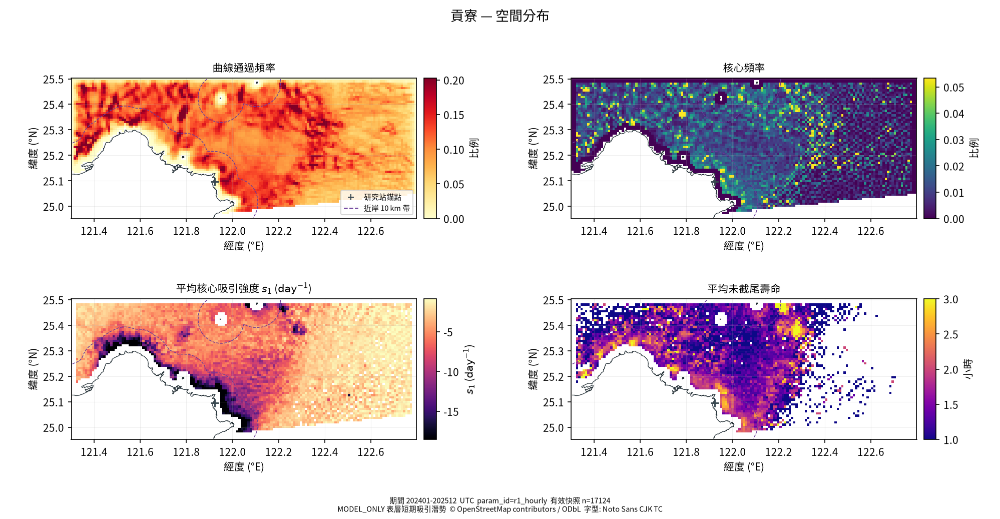

*圖 3-1　逐時 貢寮：曲線通過頻率、核心頻率、平均核心 $s_1$、平均未截尾壽命（2×2）。有效快照 n = 17,124；色階為本站 2–98 百分位；虛線為 10 km 近岸帶。*

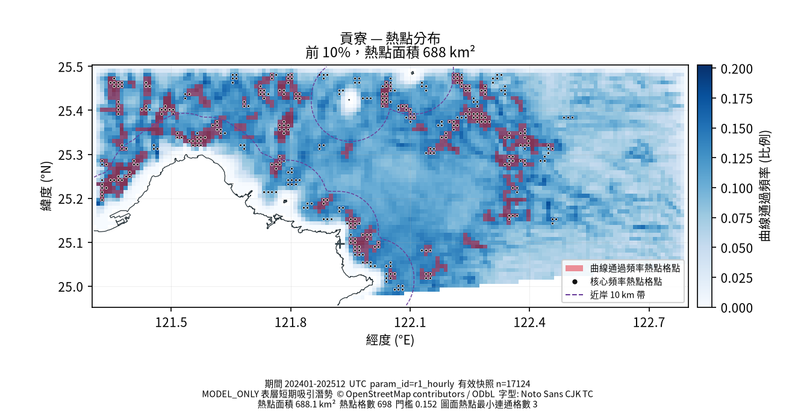

*圖 3-2　逐時 貢寮：曲線通過頻率前 10% 熱點（698 格，688.1 km²，門檻 0.152）。*

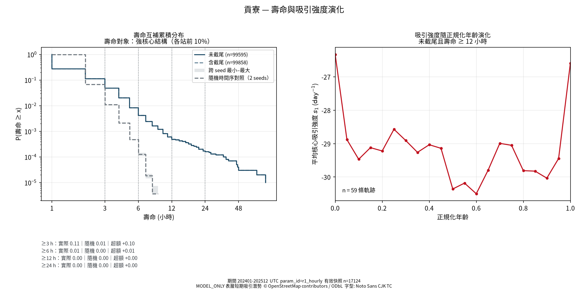

*圖 3-3　逐時 貢寮：強核心結構壽命 CCDF（實線未截尾 n = 99,595，灰虛線為時間置換 null）與壽命 ≥12 h track 的平均 $s_1$ 隨正規化年齡演化。*

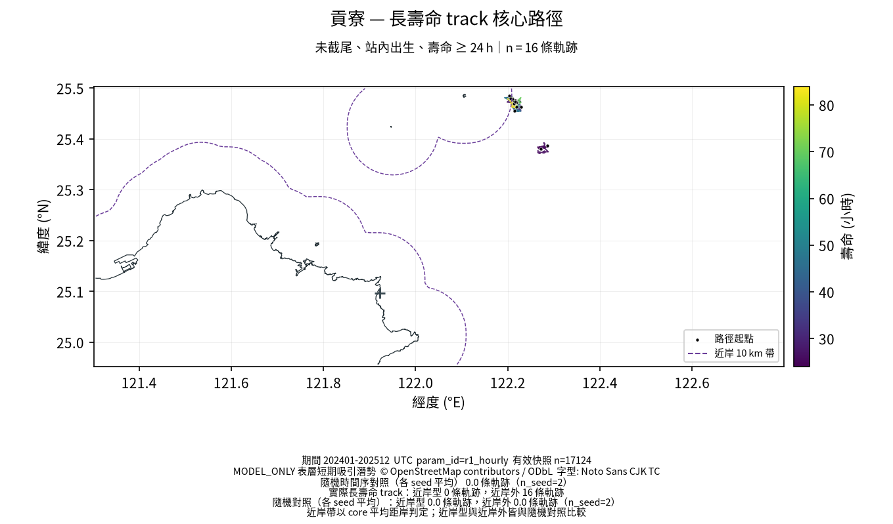

*圖 3-4　逐時 貢寮：未截尾、站內出生、壽命 ≥24 h 的核心路徑，共 16 條（近岸型 0、近岸外 16）；null 各 seed 平均 0 條。（樣本數不足，不宜解讀）*

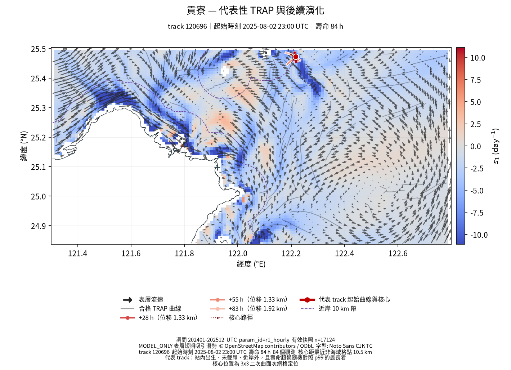

*圖 3-5　逐時 貢寮：代表性 TRAP（track 120696，起始 2025-08-02 23:00 UTC，壽命 84 h，84 個觀測，核心平均距岸 10.5 km；選取準則 `offshore_exceeds_null`）。*

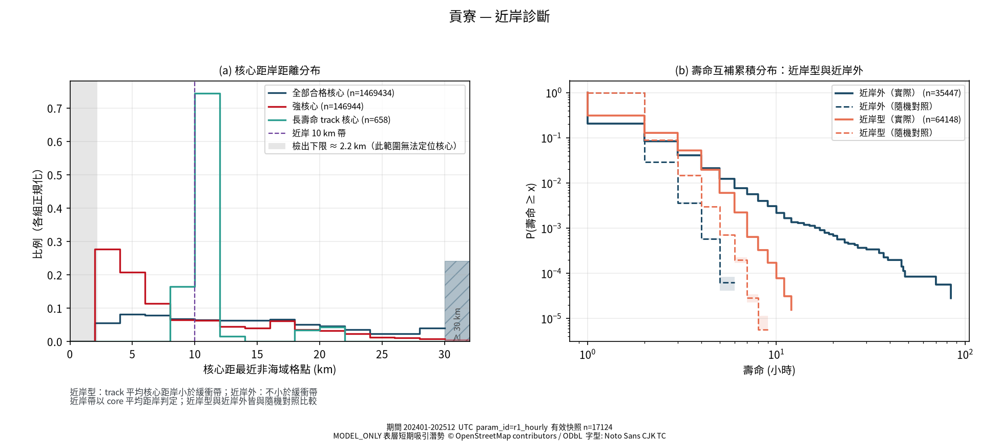

*圖 3-6　逐時 貢寮：(a) 核心距岸分布；(b) 近岸外與近岸型壽命 CCDF 對照 null。距岸距離場於 30 km 飽和。*

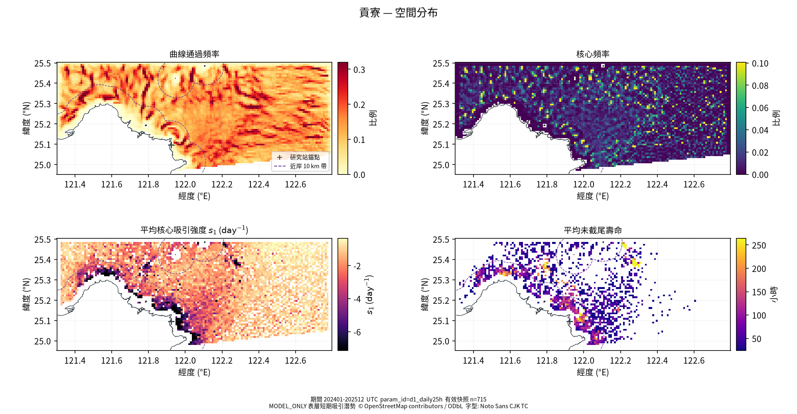

*圖 3-7　日產品 貢寮：空間分布（同圖 3-1 的版面）。有效快照 n = 715。*

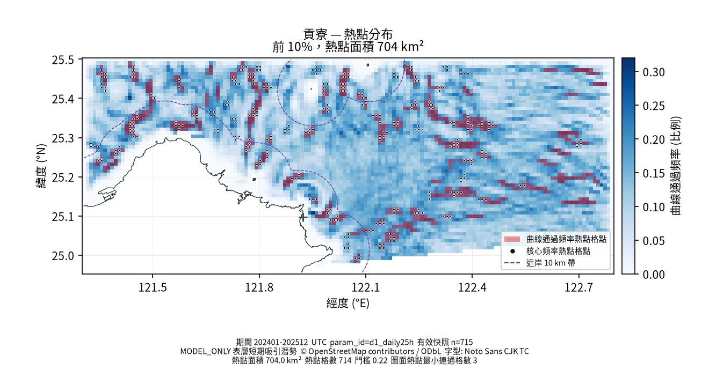

*圖 3-8　日產品 貢寮：熱點分布（714 格，704 km²，門檻 0.22）。*

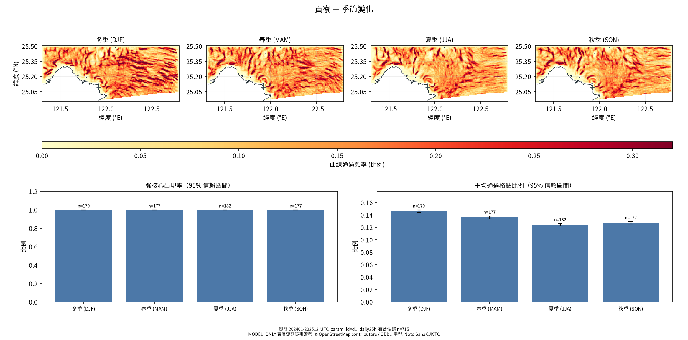

*圖 3-9　日產品 貢寮：四季曲線通過頻率與強核心出現率、平均通過格點比例（含 95% CI）。*

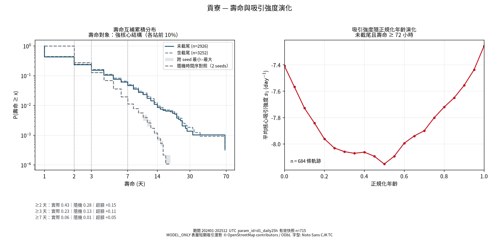

*圖 3-10　日產品 貢寮：壽命 CCDF（未截尾 n = 2,926）與壽命 ≥72 h track 的平均 $s_1$ 隨正規化年齡演化。*

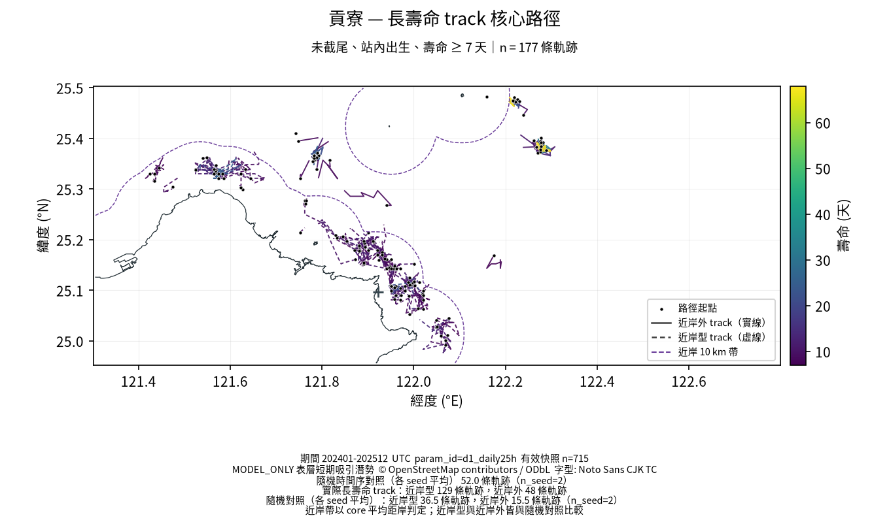

*圖 3-11　日產品 貢寮：壽命 ≥168 h（7 天）的核心路徑，共 177 條（近岸型 129、近岸外 48）；null 各 seed 平均 52 條（近岸型 36.5、近岸外 15.5）。*

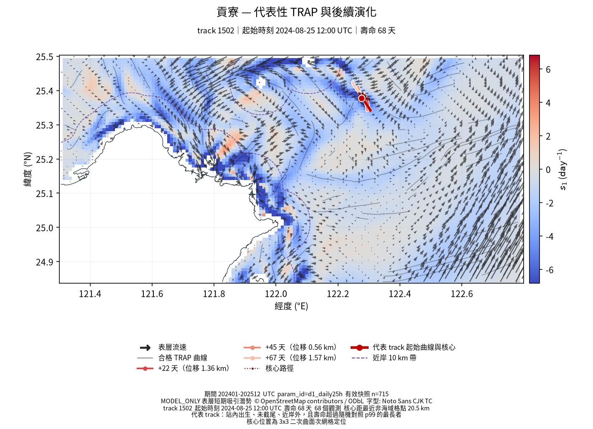

*圖 3-12　日產品 貢寮：代表性 TRAP（track 1502，起始 2024-08-25 12:00 UTC，壽命 1632 h，68 個觀測，核心平均距岸 20.5 km；null p99 壽命 168 h）。*

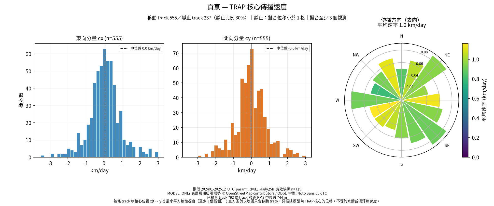

*圖 3-13　日產品 貢寮：移動 track 555 條、靜止 237 條的核心傳播速度分量直方圖與去向玫瑰圖（僅描述結構位移）。*

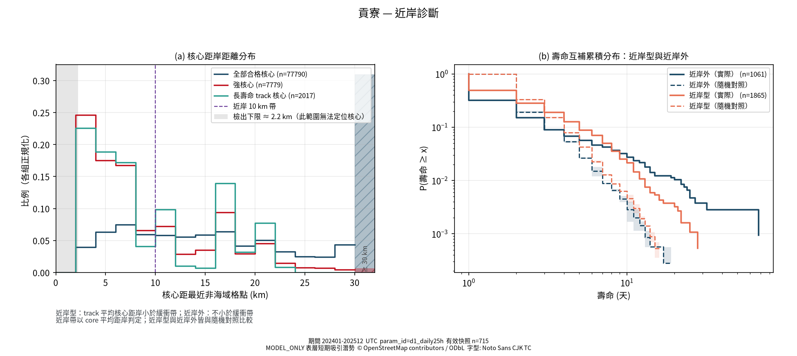

*圖 3-14　日產品 貢寮：近岸診斷（距岸分布與近岸外／近岸型壽命對照 null）。*

### 解讀

頻率：兩個產品中每個有效快照都有核心與曲線，強核心出現率為 99.05%（逐時）與 100%（日產品）；曲線通過格點比例平均為 9.97%（逐時）與 13.3%（日產品）。熱點約占站內面積的前 10%（逐時 688.1 km²、日產品 704 km²），其中 32%（逐時）與 25.4%（日產品）的面積位於 10 km 近岸帶。強度與近岸：強核心中有 66.3%（逐時）與 65.5%（日產品）位於近岸帶，高於全部核心的 28.2% 與 23.7%。

生命週期：逐時強核心結構壽命中位數 1 h、p90 3 h；壽命 ≥3 h 的比例為 11.3%，null 為 1.09%（10.3×）。壽命 ≥24 h 的未截尾 track 共 16 條，其中位於近岸帶者占 0%（樣本數不足，不宜解讀）。日產品壽命中位數 24 h、p90 120 h；壽命 ≥72 h 為 23.4%（null 12.9%，1.82×），≥168 h 為 6.08%（null 1.13%，5.37×）。日產品 ≥168 h 的長壽命 track 有 177 條，近岸帶占 72.9%；近岸外 ≥168 h 比例為 4.52%（null 0.881%），近岸型為 6.97%（null 1.29%）。

逐時 ≥24 h 的 16 條長壽命 track 全部被歸為近岸外；其中代表 track 的核心平均距岸為 10.5 km，接近 10 km 分割線，近岸／近岸外的歸類對緩衝帶寬度敏感（此類長壽命 track 樣本數不足時不宜解讀）。 傳播：逐時移動 track 的核心位移速度中位數 7.88 km/day（靜止 23%），日產品 0.718 km/day（靜止 29.9%）；位置擬合殘差 RMS 中位數分別為 680 m 與 744 m，皆小於 1 個格距。

上述為模型流場的診斷，未經獨立觀測驗證；不代表該站實際的海廢聚集頻率或濃度。

## 4. 龜山島西側（`guishan`，流場區域 A）

### 關鍵統計

| 指標 | 逐時 `r1_hourly` | 日產品 `d1_daily25h` |
| --- | --- | --- |
| 站點分析區面積 (km²) | 4330.7 | 4330.7 |
| 有效快照數 | 17,124 | 715 |
| 強核心門檻 (day⁻¹；s⁻¹) | -13.43；-1.554e-04 | -5.89；-6.814e-05 |
| 強核心出現率（分子／分母；95% CI） | 95.32%（16,323／17,124）[94.53%, 95.99%] | 99.02%（708／715）[98.32%, 99.58%] |
| 核心出現率／曲線出現率 | 100%／100%（無區辨力） | 100%／100%（無區辨力） |
| 曲線通過格點比例（95% CI） | 10.97% [10.9%, 11.04%] | 13.45% [13.32%, 13.58%] |
| 核心密度（個／1000 km²／快照） | 13.06 | 14.12 |
| 合格核心總數 | 968,760 | 43,714 |
| 核心 $s_1$ 中位數／p10 (day⁻¹) | -2.67／-13.43 | -1.29／-5.89 |
| 熱點面積 km²（格數） | 433.76（438） | 440.65（445） |
| 熱點門檻（曲線通過頻率）／熱點內平均頻率 | 0.1706／0.2124 | 0.2252／0.3039 |
| 熱點內平均核心 $s_1$ (day⁻¹) | -5.67 | -2.75 |
| 熱點內強核心比例（占該站強核心） | 34.45% | 56.31% |
| 熱點面積位於 10 km 近岸帶比例 | 10.73% | 7.192% |
| 近岸外熱點格數／平均通過頻率 | 368／0.2174 | 374／0.3133 |
| 全部核心位於 10 km 近岸帶比例 | 20.92% | 16.26% |
| 強核心位於 10 km 近岸帶比例 | 51.44% | 35.52% |
| 近岸外強核心出現率 | 80.79% | 94.27% |
| 強核心 track 數（全部／未截尾） | 55,797／55,647 | 1,761／1,576 |
| 壽命 平均／中位數／p90 | 1.747／1／3 h | 56.07／24／96 h |
| null 壽命中位數／p90 (h) | 1／1 | 24／72 |
| 長壽命 track（未截尾、站內出生）數；其位於近岸帶比例 | 16；0%（樣本數不足，不宜解讀） | 74；32.43% |

### 壽命分數：真實 vs 時間置換 null

**逐時**（未截尾 track 中壽命不小於門檻者的比例；null 為兩個 seed 平均）

| 門檻 | 真實 | null | 超額 | 比值 | 近岸外 真實／null／超額 | 近岸型 真實／null／超額 |
| --- | --- | --- | --- | --- | --- | --- |
| ≥ 3 h | 17% | 0.54% | 16.5% | 31.5× | 17.8%／0.806%／17% | 16.3%／0.295%／16% |
| ≥ 6 h | 2.34% | 0.00383% | 2.33% | 611× | 2.96%／0.00683%／2.95% | 1.79%／0.00105%／1.79% |
| ≥ 12 h | 0.23% | 0% | 0.23% | —（null 為 0，無比值） | 0.422%／0%／0.422% | 0.0608%／0%／0.0608% |
| ≥ 24 h（樣本數不足，不宜解讀） | 0.0288% | 0% | 0.0288% | —（null 為 0，無比值） | 0.0614%／0%／0.0614% | 0%／0%／0% |

未截尾 track 數：真實 55,647（近岸外 26,052、近岸型 29,595）；null 平均 91,462（近岸外 43,926、近岸型 47,536）。

**日產品**（未截尾 track 中壽命不小於門檻者的比例；null 為兩個 seed 平均）

| 門檻 | 真實 | null | 超額 | 比值 | 近岸外 真實／null／超額 | 近岸型 真實／null／超額 |
| --- | --- | --- | --- | --- | --- | --- |
| ≥ 48 h（2 天） | 42.2% | 28.1% | 14.1% | 1.5× | 44%／31.9%／12.1% | 40.1%／22.9%／17.2% |
| ≥ 72 h（3 天） | 22.3% | 11.7% | 10.7% | 1.92× | 25.2%／14.8%／10.5% | 18.9%／7.37%／11.6% |
| ≥ 168 h（7 天） | 4.76% | 0.704% | 4.06% | 6.76× | 5.87%／1.09%／4.78% | 3.45%／0.176%／3.28% |

未截尾 track 數：真實 1,576（近岸外 852、近岸型 724）；null 平均 2,698（近岸外 1,566、近岸型 1,132）。

### 傳播速度（核心位移）

| 指標 | 逐時 | 日產品 |
| --- | --- | --- |
| 已擬合 track 數（移動／靜止） | 776（635／141） | 424（285／139） |
| 靜止比例 | 18.17% | 32.78% |
| 速度中位數／p90 (km/day)，僅移動 track | 9.533／20.47 | 0.7523／2.051 |
| 東向／北向分量中位數 (km/day) | -1.38／-2.88 | 0.0427／0.00241 |
| 位置擬合殘差 RMS 中位數 (m) | 683.6 | 665.3 |

### 季節分層

| 季節 | 逐時：快照數／強核心出現率／曲線通過格點比例 [95% CI] | 日產品：快照數／強核心出現率／曲線通過格點比例 [95% CI] |
| --- | --- | --- |
| DJF | 4,284／89.33%／10.86% [10.73%, 11%] | 179／97.21%／13.61% [13.34%, 13.87%] |
| MAM | 4,238／94.45%／11.14% [10.98%, 11.3%] | 177／98.87%／13.78% [13.48%, 14.08%] |
| JJA | 4,364／98.97%／10.86% [10.74%, 10.99%] | 182／100%／13.27% [13.01%, 13.57%] |
| SON | 4,238／98.49%／11.02% [10.9%, 11.14%] | 177／100%／13.14% [12.9%, 13.37%] |

季節觀察（僅描述分層數值；季節分層僅涵蓋兩個年度，不能推論氣候季節性或年際變異）：

- 逐時：曲線通過格點比例以 MAM 最大（11.1%）、JJA 最小（10.9%），兩者的 95% CI 重疊，季節差異不顯著。 強核心出現率以 DJF 最低（89.33%），其餘季節為 MAM 94.45%、JJA 98.97%、SON 98.49%。
- 日產品：曲線通過格點比例以 MAM 最大（13.8%）、SON 最小（13.1%），兩者的 95% CI 不重疊。 強核心出現率以 DJF 最低（97.21%），其餘季節為 MAM 98.87%、JJA 100%、SON 100%。

### 成果圖

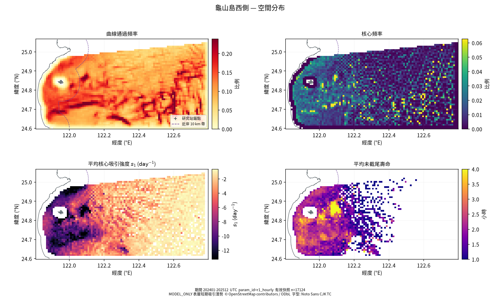

*圖 4-1　逐時 龜山島西側：曲線通過頻率、核心頻率、平均核心 $s_1$、平均未截尾壽命（2×2）。有效快照 n = 17,124；色階為本站 2–98 百分位；虛線為 10 km 近岸帶。*

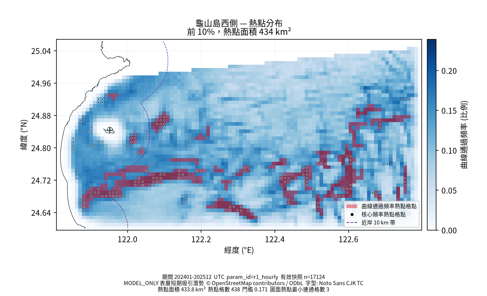

*圖 4-2　逐時 龜山島西側：曲線通過頻率前 10% 熱點（438 格，433.8 km²，門檻 0.171）。*

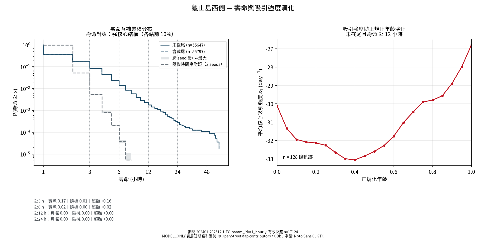

*圖 4-3　逐時 龜山島西側：強核心結構壽命 CCDF（實線未截尾 n = 55,647，灰虛線為時間置換 null）與壽命 ≥12 h track 的平均 $s_1$ 隨正規化年齡演化。*

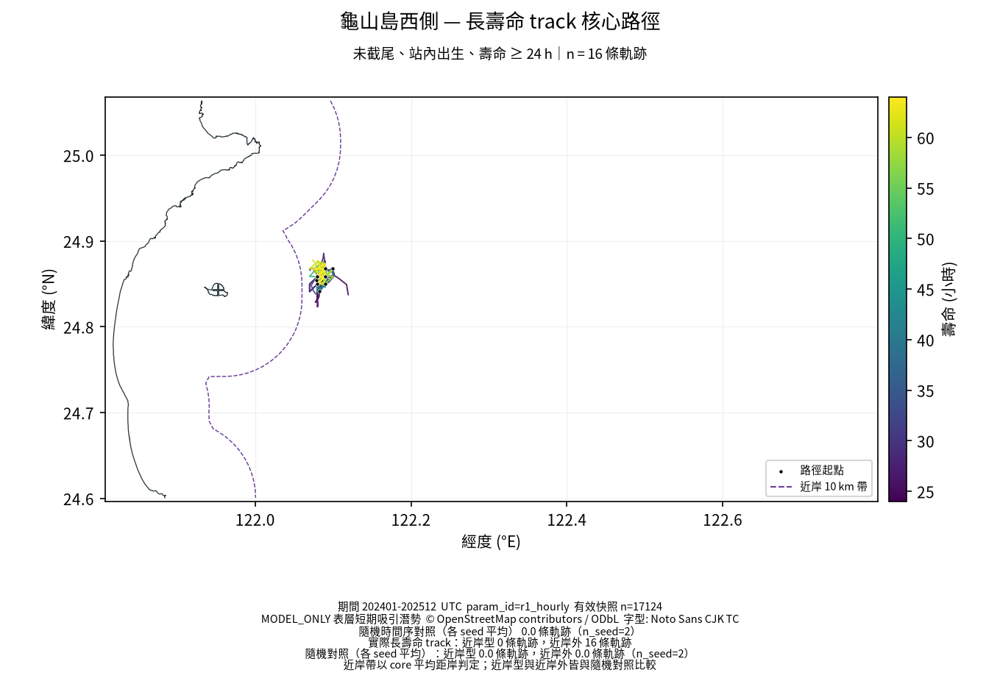

*圖 4-4　逐時 龜山島西側：未截尾、站內出生、壽命 ≥24 h 的核心路徑，共 16 條（近岸型 0、近岸外 16）；null 各 seed 平均 0 條。（樣本數不足，不宜解讀）*

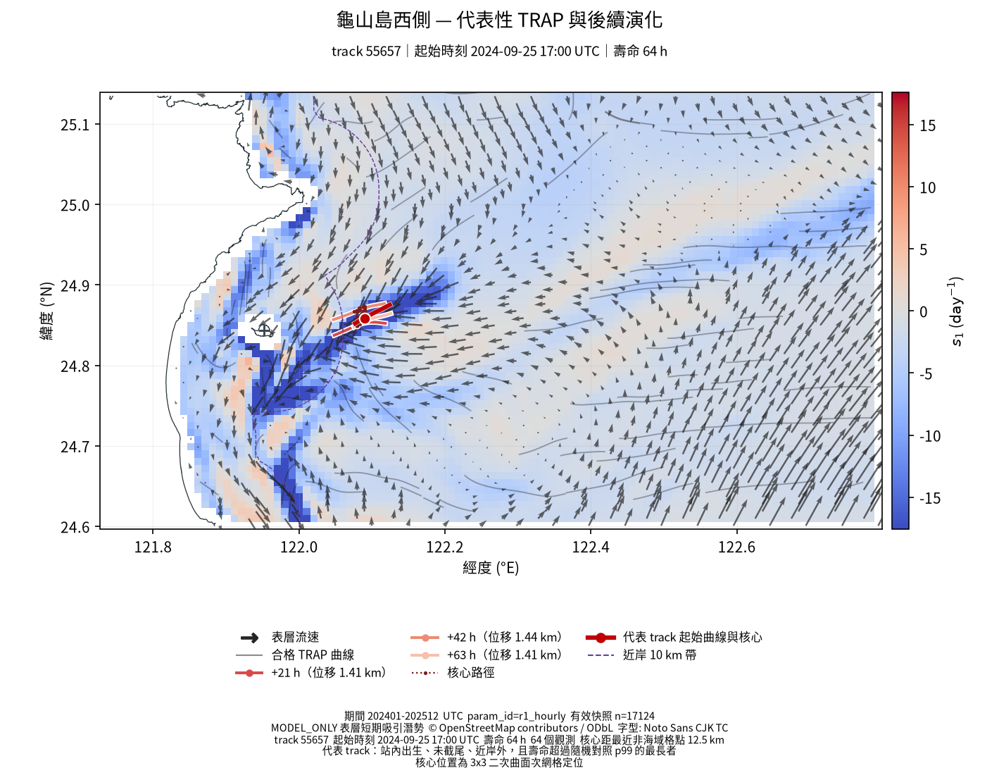

*圖 4-5　逐時 龜山島西側：代表性 TRAP（track 55657，起始 2024-09-25 17:00 UTC，壽命 64 h，64 個觀測，核心平均距岸 12.5 km；選取準則 `offshore_exceeds_null`）。*

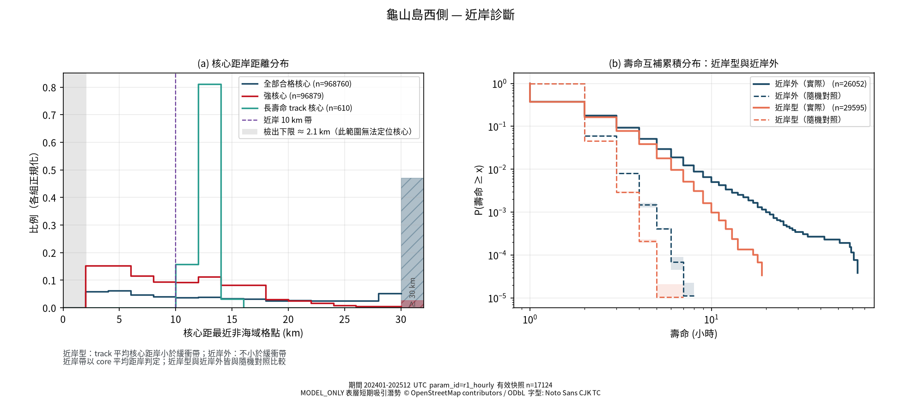

*圖 4-6　逐時 龜山島西側：(a) 核心距岸分布；(b) 近岸外與近岸型壽命 CCDF 對照 null。距岸距離場於 30 km 飽和。*

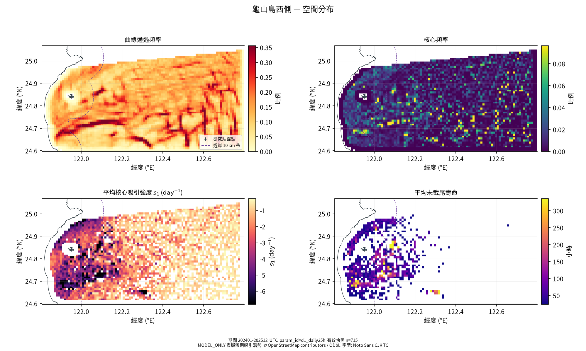

*圖 4-7　日產品 龜山島西側：空間分布（同圖 4-1 的版面）。有效快照 n = 715。*

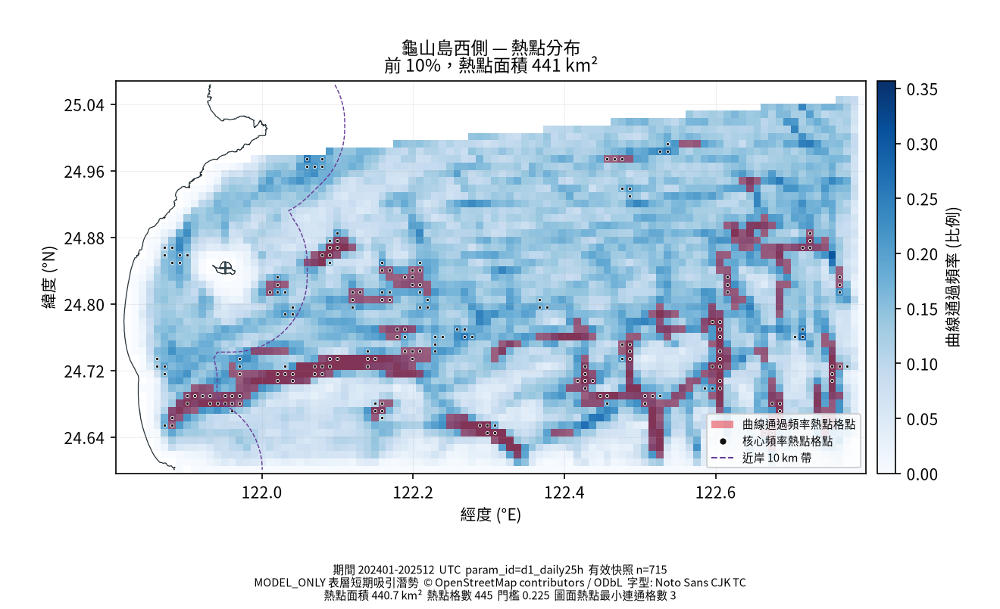

*圖 4-8　日產品 龜山島西側：熱點分布（445 格，440.7 km²，門檻 0.225）。*

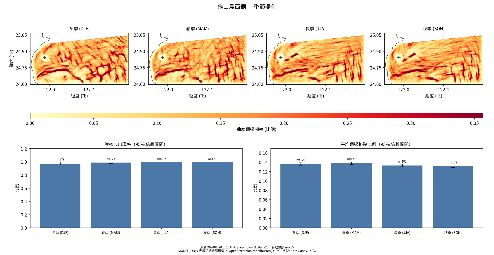

*圖 4-9　日產品 龜山島西側：四季曲線通過頻率與強核心出現率、平均通過格點比例（含 95% CI）。*

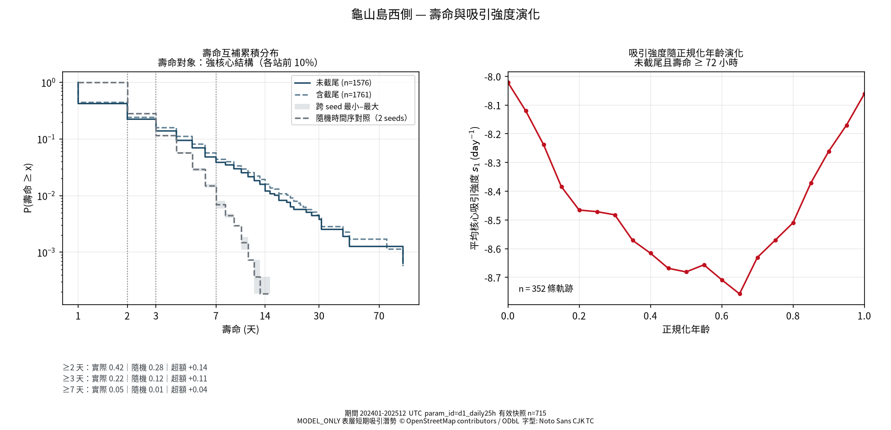

*圖 4-10　日產品 龜山島西側：壽命 CCDF（未截尾 n = 1,576）與壽命 ≥72 h track 的平均 $s_1$ 隨正規化年齡演化。*

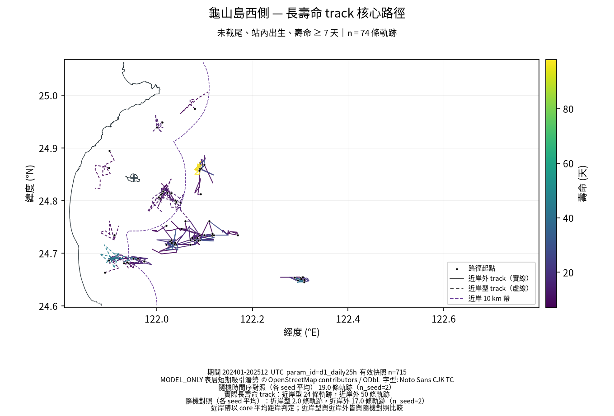

*圖 4-11　日產品 龜山島西側：壽命 ≥168 h（7 天）的核心路徑，共 74 條（近岸型 24、近岸外 50）；null 各 seed 平均 19 條（近岸型 2、近岸外 17）。*

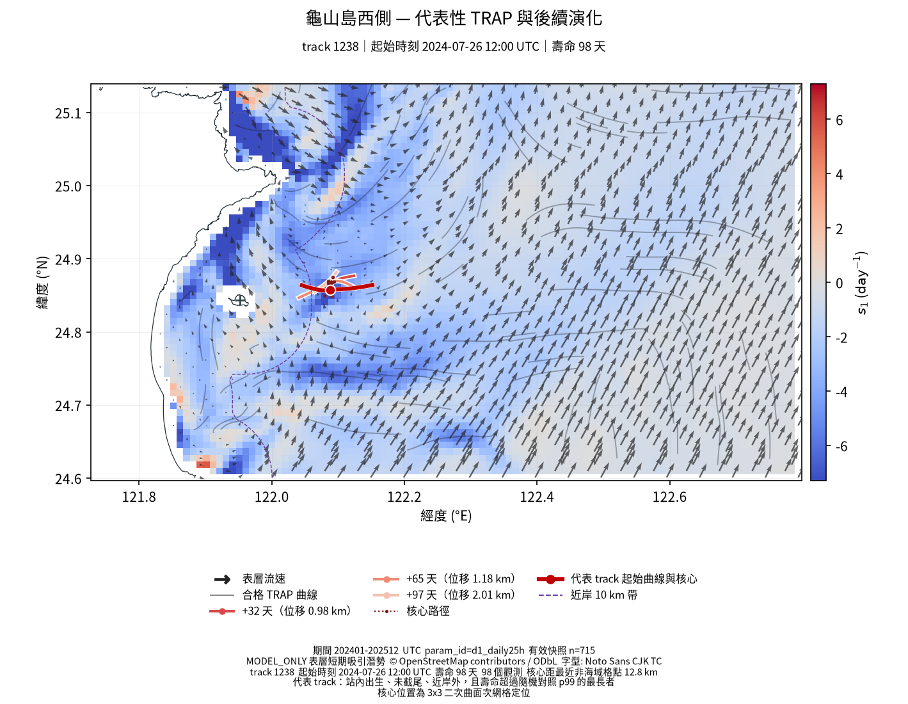

*圖 4-12　日產品 龜山島西側：代表性 TRAP（track 1238，起始 2024-07-26 12:00 UTC，壽命 2352 h，98 個觀測，核心平均距岸 12.8 km；null p99 壽命 144 h）。*

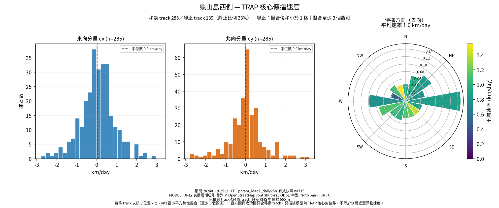

*圖 4-13　日產品 龜山島西側：移動 track 285 條、靜止 139 條的核心傳播速度分量直方圖與去向玫瑰圖（僅描述結構位移）。*

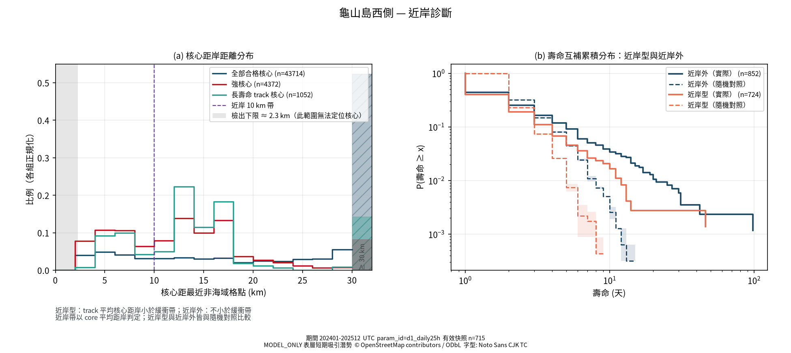

*圖 4-14　日產品 龜山島西側：近岸診斷（距岸分布與近岸外／近岸型壽命對照 null）。*

### 解讀

頻率：兩個產品中每個有效快照都有核心與曲線，強核心出現率為 95.32%（逐時）與 99.02%（日產品）；曲線通過格點比例平均為 11%（逐時）與 13.5%（日產品）。熱點約占站內面積的前 10%（逐時 433.8 km²、日產品 440.7 km²），其中 10.7%（逐時）與 7.19%（日產品）的面積位於 10 km 近岸帶。強度與近岸：強核心中有 51.4%（逐時）與 35.5%（日產品）位於近岸帶，高於全部核心的 20.9% 與 16.3%。

生命週期：逐時強核心結構壽命中位數 1 h、p90 3 h；壽命 ≥3 h 的比例為 17%，null 為 0.54%（31.5×）。壽命 ≥24 h 的未截尾 track 共 16 條，其中位於近岸帶者占 0%（樣本數不足，不宜解讀）。日產品壽命中位數 24 h、p90 96 h；壽命 ≥72 h 為 22.3%（null 11.7%，1.92×），≥168 h 為 4.76%（null 0.704%，6.76×）。日產品 ≥168 h 的長壽命 track 有 74 條，近岸帶占 32.4%；近岸外 ≥168 h 比例為 5.87%（null 1.09%），近岸型為 3.45%（null 0.176%）。

逐時 ≥24 h 的 16 條長壽命 track 全部被歸為近岸外；其中代表 track 的核心平均距岸為 12.5 km，接近 10 km 分割線，近岸／近岸外的歸類對緩衝帶寬度敏感（此類長壽命 track 樣本數不足時不宜解讀）。 日產品長壽命 track 位於近岸帶的比例僅 32.4%，多數在近岸帶外。 傳播：逐時移動 track 的核心位移速度中位數 9.53 km/day（靜止 18.2%），日產品 0.752 km/day（靜止 32.8%）；位置擬合殘差 RMS 中位數分別為 684 m 與 665 m，皆小於 1 個格距。

上述為模型流場的診斷，未經獨立觀測驗證；不代表該站實際的海廢聚集頻率或濃度。

## 5. 新竹外海（`hsinchu`，流場區域 B）

### 關鍵統計

| 指標 | 逐時 `r1_hourly` | 日產品 `d1_daily25h` |
| --- | --- | --- |
| 站點分析區面積 (km²) | 11738 | 11738 |
| 有效快照數 | 17,124 | 715 |
| 強核心門檻 (day⁻¹；s⁻¹) | -2.98；-3.449e-05 | -2.00；-2.319e-05 |
| 強核心出現率（分子／分母；95% CI） | 99.02%（16,957／17,124）[98.75%, 99.3%] | 97.76%（699／715）[96.64%, 98.74%] |
| 核心出現率／曲線出現率 | 100%／100%（無區辨力） | 100%／100%（無區辨力） |
| 曲線通過格點比例（95% CI） | 15.53% [15.42%, 15.64%] | 15.94% [15.82%, 16.06%] |
| 核心密度（個／1000 km²／快照） | 17.55 | 17.29 |
| 合格核心總數 | 3,528,213 | 145,111 |
| 核心 $s_1$ 中位數／p10 (day⁻¹) | -0.90／-2.98 | -0.70／-2.00 |
| 熱點面積 km²（格數） | 1175.8（1,190） | 1187.3（1,202） |
| 熱點門檻（曲線通過頻率）／熱點內平均頻率 | 0.2376／0.2861 | 0.2685／0.3392 |
| 熱點內平均核心 $s_1$ (day⁻¹) | -1.38 | -1.08 |
| 熱點內強核心比例（占該站強核心） | 26.15% | 40.88% |
| 熱點面積位於 10 km 近岸帶比例 | 14.79% | 16.22% |
| 近岸外熱點格數／平均通過頻率 | 1,059／0.2818 | 1,066／0.3306 |
| 全部核心位於 10 km 近岸帶比例 | 13.82% | 13.26% |
| 強核心位於 10 km 近岸帶比例 | 59.37% | 58.63% |
| 近岸外強核心出現率 | 79.13% | 76.64% |
| 強核心 track 數（全部／未截尾） | 167,536／166,998 | 7,114／6,543 |
| 壽命 平均／中位數／p90 | 2.105／1／4 h | 47.75／24／96 h |
| null 壽命中位數／p90 (h) | 1／1 | 24／48 |
| 長壽命 track（未截尾、站內出生）數；其位於近岸帶比例 | 20；90%（樣本數不足，不宜解讀） | 248；85.08% |

### 壽命分數：真實 vs 時間置換 null

**逐時**（未截尾 track 中壽命不小於門檻者的比例；null 為兩個 seed 平均）

| 門檻 | 真實 | null | 超額 | 比值 | 近岸外 真實／null／超額 | 近岸型 真實／null／超額 |
| --- | --- | --- | --- | --- | --- | --- |
| ≥ 3 h | 25% | 1.28% | 23.7% | 19.6× | 17.9%／0.0275%／17.9% | 31.5%／2.25%／29.3% |
| ≥ 6 h | 5.37% | 0.0136% | 5.36% | 394× | 2.91%／0%／2.91% | 7.64%／0.0243%／7.61% |
| ≥ 12 h | 0.481% | 0% | 0.481% | —（null 為 0，無比值） | 0.2%／0%／0.2% | 0.74%／0%／0.74% |
| ≥ 24 h（樣本數不足，不宜解讀） | 0.012% | 0% | 0.012% | —（null 為 0，無比值） | 0.0025%／0%／0.0025% | 0.0207%／0%／0.0207% |

未截尾 track 數：真實 166,998（近岸外 80,062、近岸型 86,936）；null 平均 322,902（近岸外 141,760、近岸型 181,143）。

**日產品**（未截尾 track 中壽命不小於門檻者的比例；null 為兩個 seed 平均）

| 門檻 | 真實 | null | 超額 | 比值 | 近岸外 真實／null／超額 | 近岸型 真實／null／超額 |
| --- | --- | --- | --- | --- | --- | --- |
| ≥ 48 h（2 天） | 38.8% | 20.7% | 18.1% | 1.87× | 28.7%／6.91%／21.8% | 51.3%／35.2%／16.1% |
| ≥ 72 h（3 天） | 19% | 7.65% | 11.3% | 2.48× | 10.8%／1.02%／9.73% | 29.3%／14.6%／14.7% |
| ≥ 168 h（7 天） | 3.79% | 0.335% | 3.46% | 11.3× | 1.02%／0.0288%／0.989% | 7.26%／0.656%／6.61% |

未截尾 track 數：真實 6,543（近岸外 3,637、近岸型 2,906）；null 平均 10,153（近岸外 5,198、近岸型 4,955）。

### 傳播速度（核心位移）

| 指標 | 逐時 | 日產品 |
| --- | --- | --- |
| 已擬合 track 數（移動／靜止） | 5,672（4,382／1,290） | 1,412（1,024／388） |
| 靜止比例 | 22.74% | 27.48% |
| 速度中位數／p90 (km/day)，僅移動 track | 7.827／15.97 | 0.9351／2.151 |
| 東向／北向分量中位數 (km/day) | 0／2.95 | 0.0156／0.026 |
| 位置擬合殘差 RMS 中位數 (m) | 536.3 | 763.1 |

### 季節分層

| 季節 | 逐時：快照數／強核心出現率／曲線通過格點比例 [95% CI] | 日產品：快照數／強核心出現率／曲線通過格點比例 [95% CI] |
| --- | --- | --- |
| DJF | 4,284／97.74%／16.42% [16.24%, 16.59%] | 179／92.74%／15.75% [15.52%, 15.96%] |
| MAM | 4,238／99.93%／15.57% [15.36%, 15.78%] | 177／100%／16.36% [16.09%, 16.61%] |
| JJA | 4,364／100%／14.53% [14.38%, 14.69%] | 182／100%／15.74% [15.52%, 15.96%] |
| SON | 4,238／98.42%／15.62% [15.38%, 15.84%] | 177／98.31%／15.91% [15.67%, 16.13%] |

季節觀察（僅描述分層數值；季節分層僅涵蓋兩個年度，不能推論氣候季節性或年際變異）：

- 逐時：曲線通過格點比例以 DJF 最大（16.4%）、JJA 最小（14.5%），兩者的 95% CI 不重疊。 強核心出現率以 DJF 最低（97.74%），其餘季節為 MAM 99.93%、JJA 100%、SON 98.42%。
- 日產品：曲線通過格點比例以 MAM 最大（16.4%）、JJA 最小（15.7%），兩者的 95% CI 不重疊。 強核心出現率以 DJF 最低（92.74%），其餘季節為 MAM 100%、JJA 100%、SON 98.31%。

### 成果圖

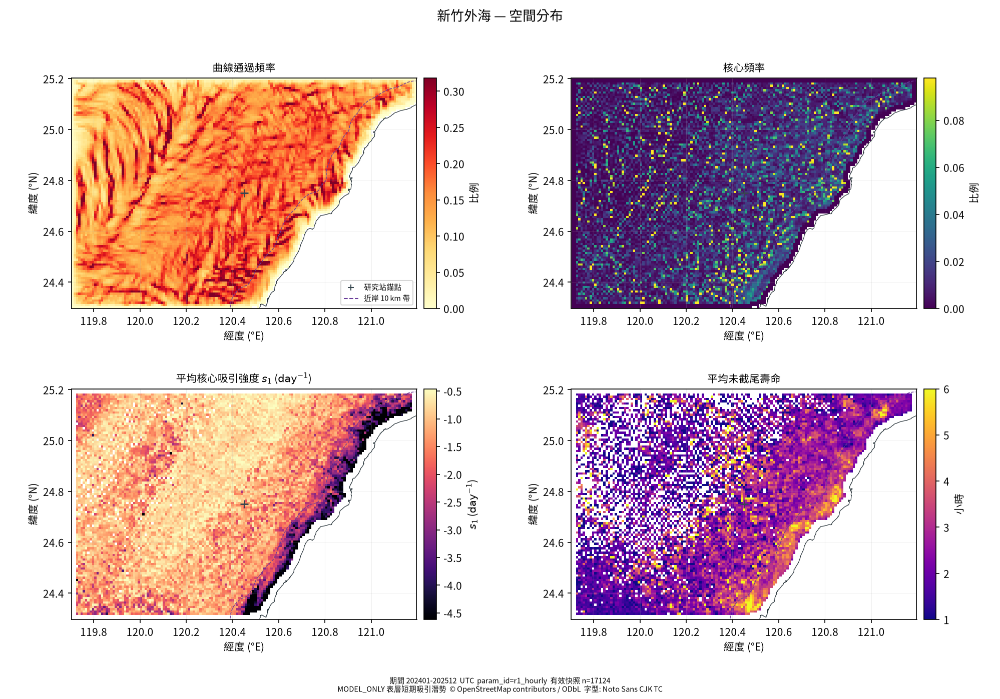

*圖 5-1　逐時 新竹外海：曲線通過頻率、核心頻率、平均核心 $s_1$、平均未截尾壽命（2×2）。有效快照 n = 17,124；色階為本站 2–98 百分位；虛線為 10 km 近岸帶。*

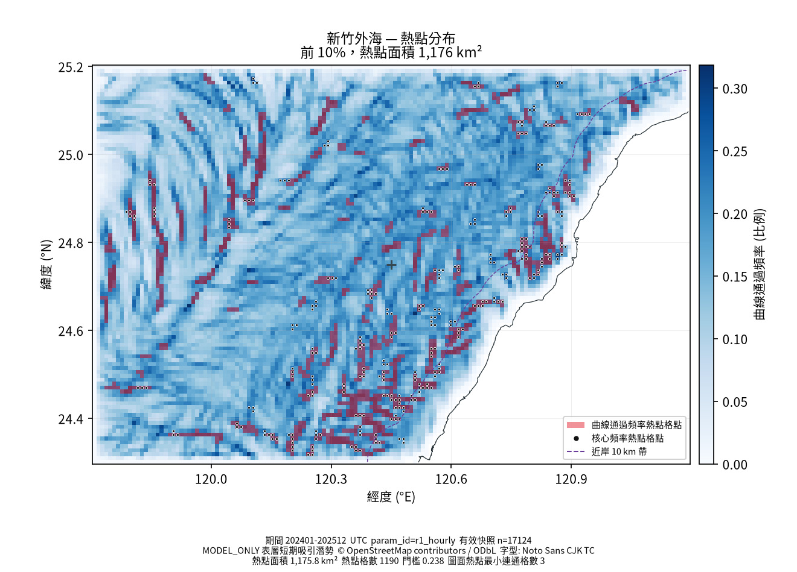

*圖 5-2　逐時 新竹外海：曲線通過頻率前 10% 熱點（1,190 格，1176 km²，門檻 0.238）。*

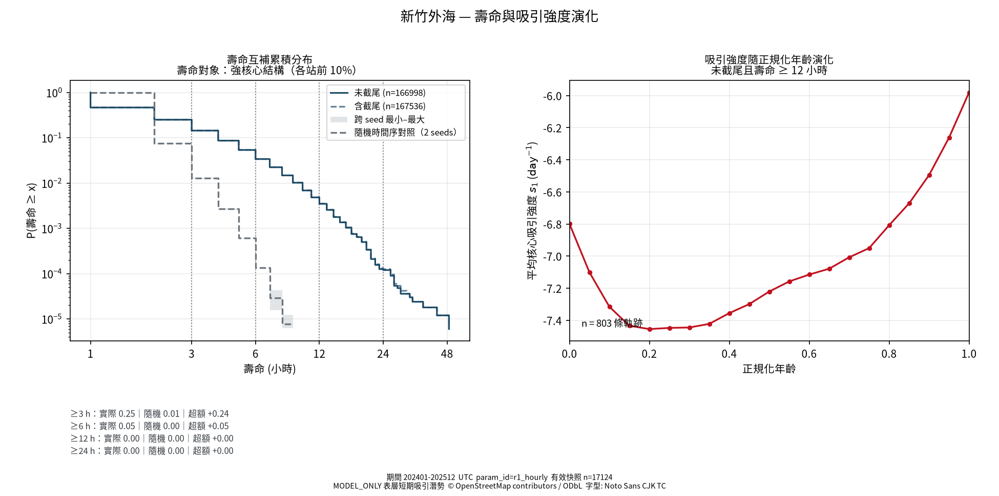

*圖 5-3　逐時 新竹外海：強核心結構壽命 CCDF（實線未截尾 n = 166,998，灰虛線為時間置換 null）與壽命 ≥12 h track 的平均 $s_1$ 隨正規化年齡演化。*

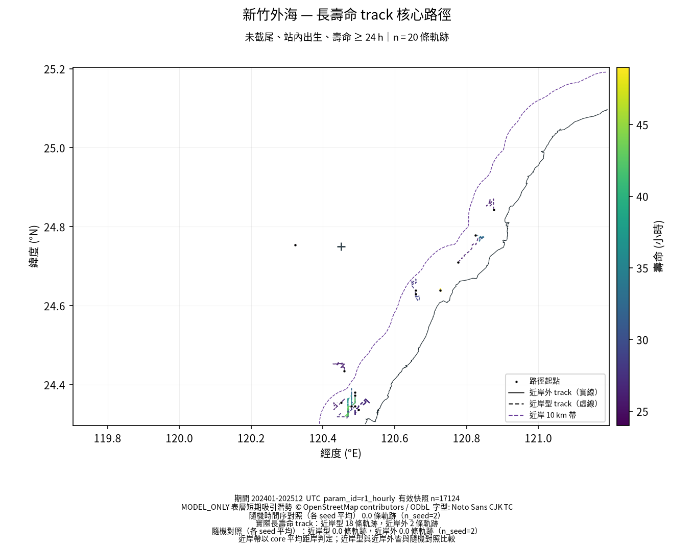

*圖 5-4　逐時 新竹外海：未截尾、站內出生、壽命 ≥24 h 的核心路徑，共 20 條（近岸型 18、近岸外 2）；null 各 seed 平均 0 條。（樣本數不足，不宜解讀）*

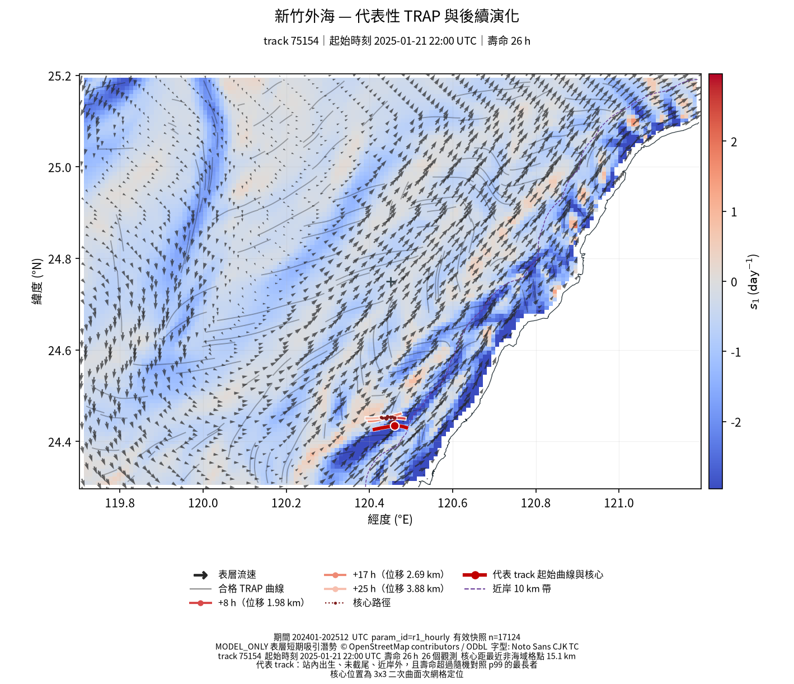

*圖 5-5　逐時 新竹外海：代表性 TRAP（track 75154，起始 2025-01-21 22:00 UTC，壽命 26 h，26 個觀測，核心平均距岸 15.1 km；選取準則 `offshore_exceeds_null`）。*

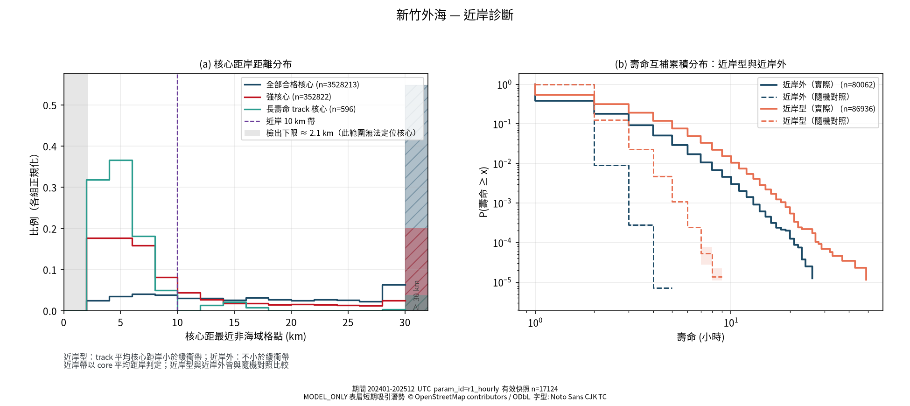

*圖 5-6　逐時 新竹外海：(a) 核心距岸分布；(b) 近岸外與近岸型壽命 CCDF 對照 null。距岸距離場於 30 km 飽和。*

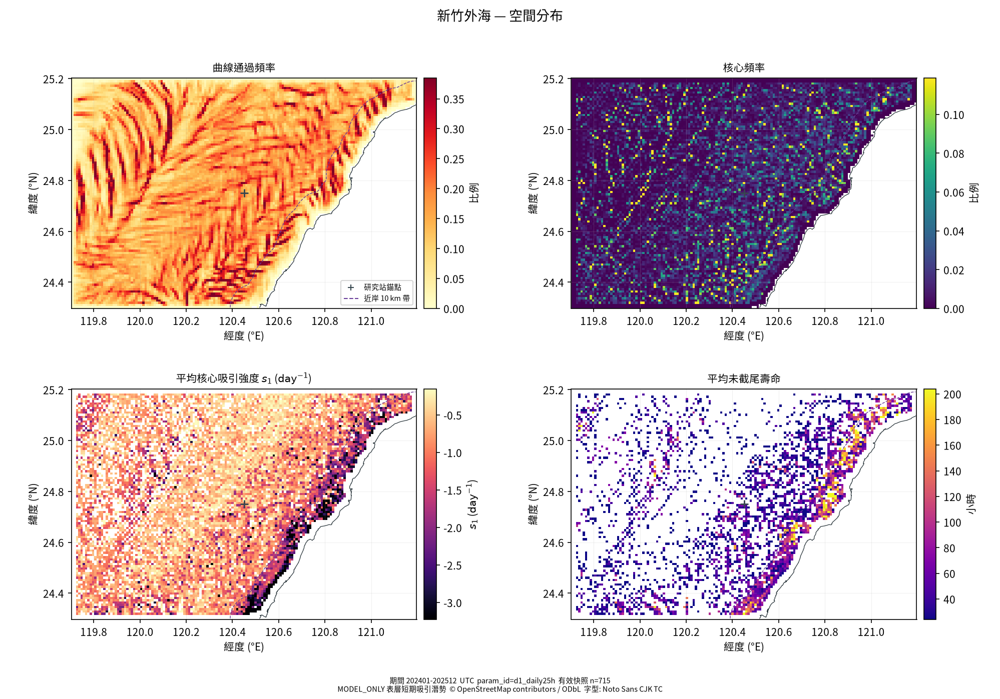

*圖 5-7　日產品 新竹外海：空間分布（同圖 5-1 的版面）。有效快照 n = 715。*

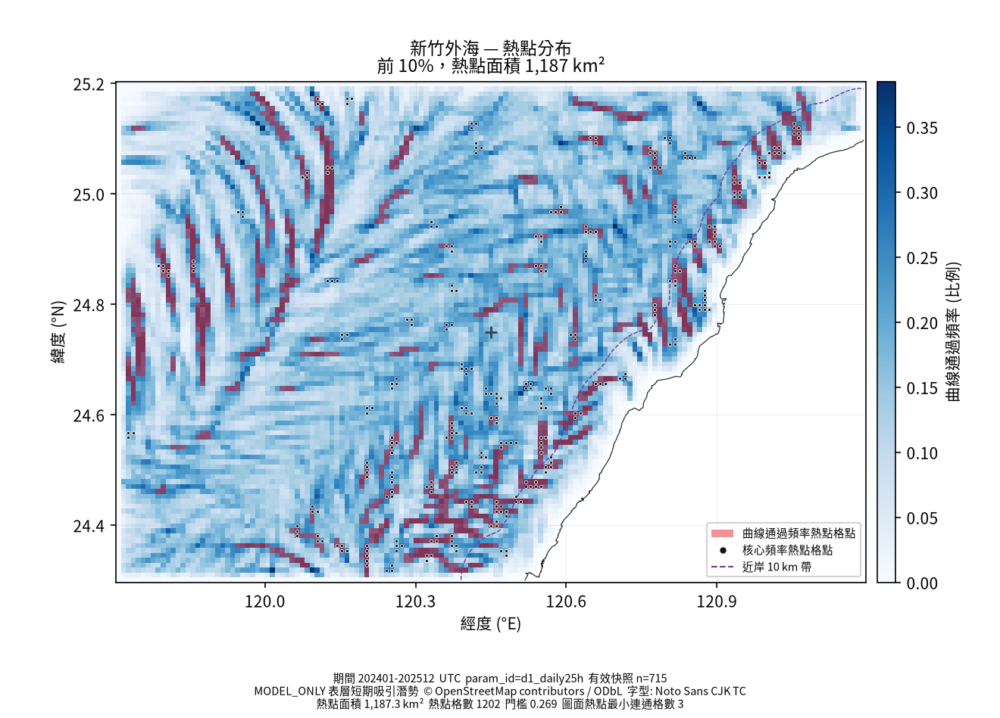

*圖 5-8　日產品 新竹外海：熱點分布（1,202 格，1187 km²，門檻 0.269）。*

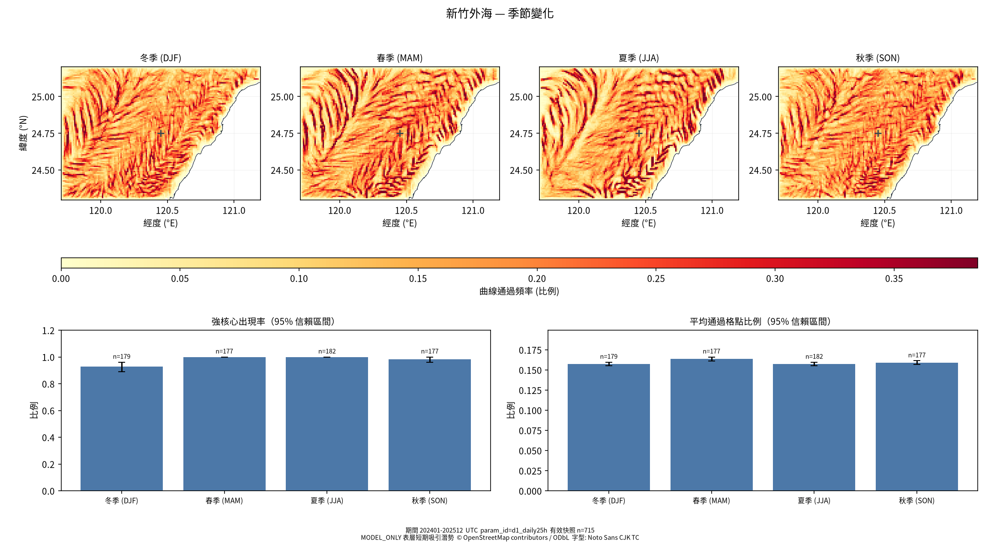

*圖 5-9　日產品 新竹外海：四季曲線通過頻率與強核心出現率、平均通過格點比例（含 95% CI）。*

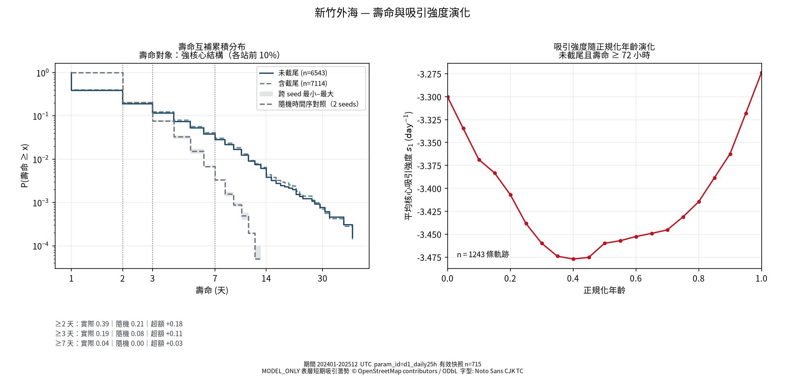

*圖 5-10　日產品 新竹外海：壽命 CCDF（未截尾 n = 6,543）與壽命 ≥72 h track 的平均 $s_1$ 隨正規化年齡演化。*

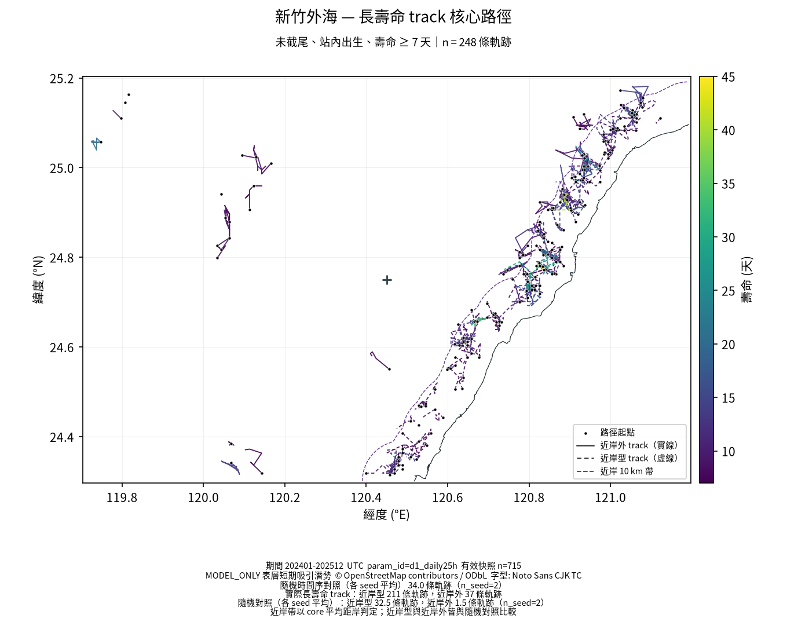

*圖 5-11　日產品 新竹外海：壽命 ≥168 h（7 天）的核心路徑，共 248 條（近岸型 211、近岸外 37）；null 各 seed 平均 34 條（近岸型 32.5、近岸外 1.5）。*

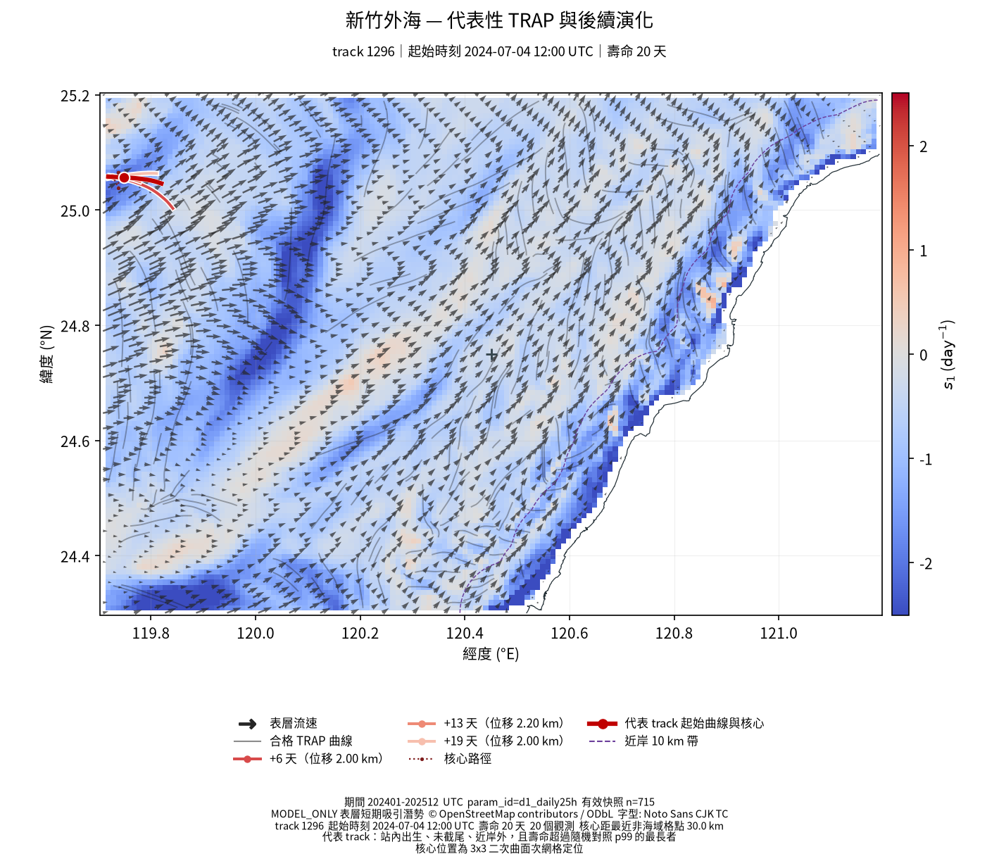

*圖 5-12　日產品 新竹外海：代表性 TRAP（track 1296，起始 2024-07-04 12:00 UTC，壽命 480 h，20 個觀測，核心平均距岸 30.0 km；null p99 壽命 120 h）。*

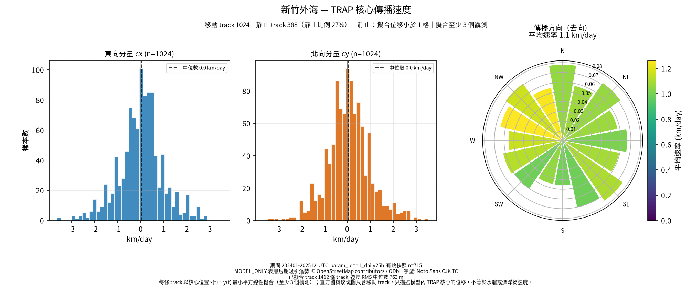

*圖 5-13　日產品 新竹外海：移動 track 1,024 條、靜止 388 條的核心傳播速度分量直方圖與去向玫瑰圖（僅描述結構位移）。*

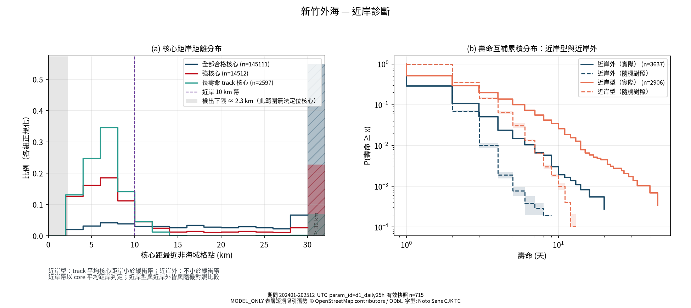

*圖 5-14　日產品 新竹外海：近岸診斷（距岸分布與近岸外／近岸型壽命對照 null）。*

### 解讀

頻率：兩個產品中每個有效快照都有核心與曲線，強核心出現率為 99.02%（逐時）與 97.76%（日產品）；曲線通過格點比例平均為 15.5%（逐時）與 15.9%（日產品）。熱點約占站內面積的前 10%（逐時 1176 km²、日產品 1187 km²），其中 14.8%（逐時）與 16.2%（日產品）的面積位於 10 km 近岸帶。強度與近岸：強核心中有 59.4%（逐時）與 58.6%（日產品）位於近岸帶，高於全部核心的 13.8% 與 13.3%。

生命週期：逐時強核心結構壽命中位數 1 h、p90 4 h；壽命 ≥3 h 的比例為 25%，null 為 1.28%（19.6×）。壽命 ≥24 h 的未截尾 track 共 20 條，其中位於近岸帶者占 90%（樣本數不足，不宜解讀）。日產品壽命中位數 24 h、p90 96 h；壽命 ≥72 h 為 19%（null 7.65%，2.48×），≥168 h 為 3.79%（null 0.335%，11.3×）。日產品 ≥168 h 的長壽命 track 有 248 條，近岸帶占 85.1%；近岸外 ≥168 h 比例為 1.02%（null 0.0288%），近岸型為 7.26%（null 0.656%）。

逐時 ≥24 h 的 20 條長壽命 track 有 90% 位於近岸帶，與近岸地形鎖定的解讀一致。 傳播：逐時移動 track 的核心位移速度中位數 7.83 km/day（靜止 22.7%），日產品 0.935 km/day（靜止 27.5%）；位置擬合殘差 RMS 中位數分別為 536 m 與 763 m，皆小於 1 個格距。

上述為模型流場的診斷，未經獨立觀測驗證；不代表該站實際的海廢聚集頻率或濃度。

## 6. 南灣（`nanwan`，流場區域 C）

### 關鍵統計

| 指標 | 逐時 `r1_hourly` | 日產品 `d1_daily25h` |
| --- | --- | --- |
| 站點分析區面積 (km²) | 13591 | 13591 |
| 有效快照數 | 17,124 | 715 |
| 強核心門檻 (day⁻¹；s⁻¹) | -8.45；-9.776e-05 | -4.86；-5.627e-05 |
| 強核心出現率（分子／分母；95% CI） | 100%（17,124／17,124）[100%, 100%] | 100%（715／715）[100%, 100%] |
| 核心出現率／曲線出現率 | 100%／100%（無區辨力） | 100%／100%（無區辨力） |
| 曲線通過格點比例（95% CI） | 12.58% [12.52%, 12.64%] | 14.67% [14.6%, 14.75%] |
| 核心密度（個／1000 km²／快照） | 15.4 | 16.26 |
| 合格核心總數 | 3,584,375 | 158,037 |
| 核心 $s_1$ 中位數／p10 (day⁻¹) | -2.15／-8.45 | -1.26／-4.86 |
| 熱點面積 km²（格數） | 1359.8（1,386） | 1363.4（1,389） |
| 熱點門檻（曲線通過頻率）／熱點內平均頻率 | 0.2035／0.2476 | 0.2699／0.3598 |
| 熱點內平均核心 $s_1$ (day⁻¹) | -4.77 | -2.72 |
| 熱點內強核心比例（占該站強核心） | 42.86% | 43.16% |
| 熱點面積位於 10 km 近岸帶比例 | 24.73% | 15.4% |
| 近岸外熱點格數／平均通過頻率 | 1,094／0.2459 | 1,100／0.366 |
| 全部核心位於 10 km 近岸帶比例 | 23.51% | 19.39% |
| 強核心位於 10 km 近岸帶比例 | 80.28% | 80.01% |
| 近岸外強核心出現率 | 87.78% | 84.76% |
| 強核心 track 數（全部／未截尾） | 159,976／159,431 | 4,456／3,881 |
| 壽命 平均／中位數／p90 | 2.238／1／4 h | 75.87／48／168 h |
| null 壽命中位數／p90 (h) | 1／2 | 24／72 |
| 長壽命 track（未截尾、站內出生）數；其位於近岸帶比例 | 243；100% | 404；85.15% |

### 壽命分數：真實 vs 時間置換 null

**逐時**（未截尾 track 中壽命不小於門檻者的比例；null 為兩個 seed 平均）

| 門檻 | 真實 | null | 超額 | 比值 | 近岸外 真實／null／超額 | 近岸型 真實／null／超額 |
| --- | --- | --- | --- | --- | --- | --- |
| ≥ 3 h | 25.4% | 2.84% | 22.5% | 8.94× | 15.3%／0.388%／14.9% | 28.9%／3.53%／25.4% |
| ≥ 6 h | 6.59% | 0.114% | 6.47% | 58× | 2.45%／0%／2.45% | 8.06%／0.146%／7.92% |
| ≥ 12 h | 1.03% | 0.000488% | 1.03% | 2.11e+03× | 0.191%／0%／0.191% | 1.33%／0.000626%／1.33% |
| ≥ 24 h | 0.152% | 0% | 0.152% | —（null 為 0，無比值） | 0%／0%／0% | 0.207%／0%／0.207% |

未截尾 track 數：真實 159,431（近岸外 41,916、近岸型 117,515）；null 平均 307,134（近岸外 67,692、近岸型 239,442）。

**日產品**（未截尾 track 中壽命不小於門檻者的比例；null 為兩個 seed 平均）

| 門檻 | 真實 | null | 超額 | 比值 | 近岸外 真實／null／超額 | 近岸型 真實／null／超額 |
| --- | --- | --- | --- | --- | --- | --- |
| ≥ 48 h（2 天） | 53.6% | 32.3% | 21.4% | 1.66× | 50.1%／16.4%／33.7% | 55%／38.9%／16.1% |
| ≥ 72 h（3 天） | 33.6% | 16.2% | 17.4% | 2.08× | 27.9%／4.96%／22.9% | 35.9%／20.9%／15% |
| ≥ 168 h（7 天） | 10.4% | 2.76% | 7.65% | 3.77× | 5.38%／0.0855%／5.29% | 12.4%／3.89%／8.55% |

未截尾 track 數：真實 3,881（近岸外 1,116、近岸型 2,765）；null 平均 7,964（近岸外 2,364、近岸型 5,599）。

### 傳播速度（核心位移）

| 指標 | 逐時 | 日產品 |
| --- | --- | --- |
| 已擬合 track 數（移動／靜止） | 7,180（5,396／1,784） | 1,601（1,062／539） |
| 靜止比例 | 24.85% | 33.67% |
| 速度中位數／p90 (km/day)，僅移動 track | 7.459／17.19 | 0.6513／1.752 |
| 東向／北向分量中位數 (km/day) | 1.98／-0.533 | 8.42e-06／0 |
| 位置擬合殘差 RMS 中位數 (m) | 594.9 | 697.3 |

### 季節分層

| 季節 | 逐時：快照數／強核心出現率／曲線通過格點比例 [95% CI] | 日產品：快照數／強核心出現率／曲線通過格點比例 [95% CI] |
| --- | --- | --- |
| DJF | 4,284／100%／12.83% [12.72%, 12.94%] | 179／100%／15.29% [15.15%, 15.44%] |
| MAM | 4,238／100%／12.39% [12.26%, 12.53%] | 177／100%／14.63% [14.46%, 14.79%] |
| JJA | 4,364／100%／12.35% [12.25%, 12.45%] | 182／100%／14.24% [14.13%, 14.35%] |
| SON | 4,238／100%／12.75% [12.62%, 12.86%] | 177／100%／14.54% [14.39%, 14.7%] |

季節觀察（僅描述分層數值；季節分層僅涵蓋兩個年度，不能推論氣候季節性或年際變異）：

- 逐時：曲線通過格點比例以 DJF 最大（12.8%）、JJA 最小（12.4%），兩者的 95% CI 不重疊。 四季強核心出現率皆不低於 99%。
- 日產品：曲線通過格點比例以 DJF 最大（15.3%）、JJA 最小（14.2%），兩者的 95% CI 不重疊。 四季強核心出現率皆不低於 99%。

### 成果圖

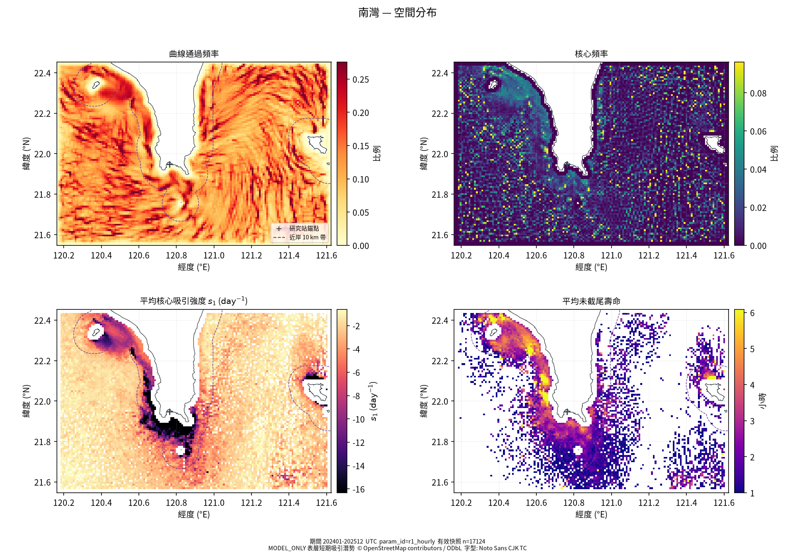

*圖 6-1　逐時 南灣：曲線通過頻率、核心頻率、平均核心 $s_1$、平均未截尾壽命（2×2）。有效快照 n = 17,124；色階為本站 2–98 百分位；虛線為 10 km 近岸帶。*

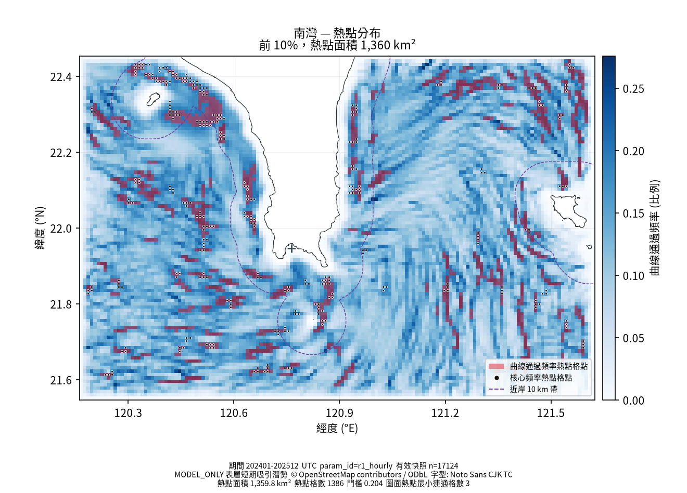

*圖 6-2　逐時 南灣：曲線通過頻率前 10% 熱點（1,386 格，1360 km²，門檻 0.204）。*

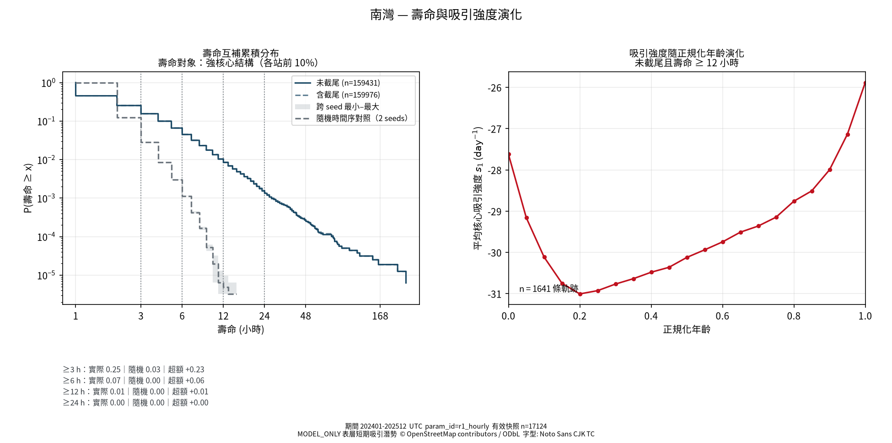

*圖 6-3　逐時 南灣：強核心結構壽命 CCDF（實線未截尾 n = 159,431，灰虛線為時間置換 null）與壽命 ≥12 h track 的平均 $s_1$ 隨正規化年齡演化。*

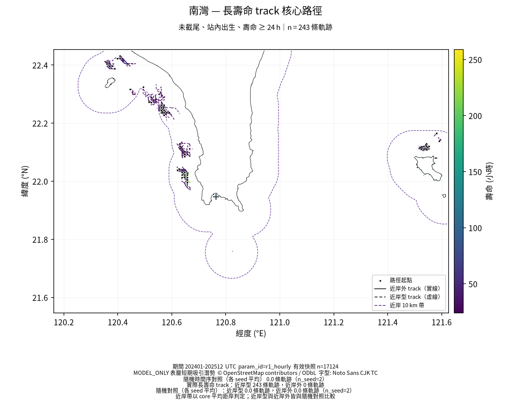

*圖 6-4　逐時 南灣：未截尾、站內出生、壽命 ≥24 h 的核心路徑，共 243 條（近岸型 243、近岸外 0）；null 各 seed 平均 0 條。*

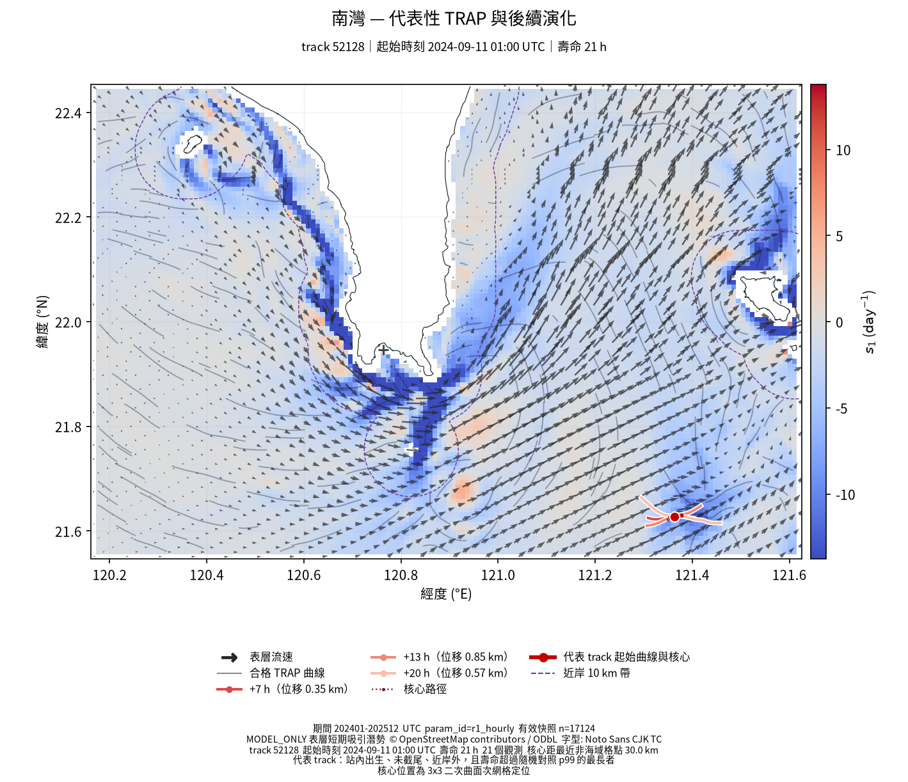

*圖 6-5　逐時 南灣：代表性 TRAP（track 52128，起始 2024-09-11 01:00 UTC，壽命 21 h，21 個觀測，核心平均距岸 30.0 km；選取準則 `offshore_exceeds_null`）。*

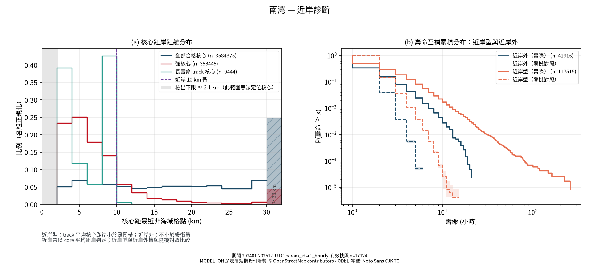

*圖 6-6　逐時 南灣：(a) 核心距岸分布；(b) 近岸外與近岸型壽命 CCDF 對照 null。距岸距離場於 30 km 飽和。*

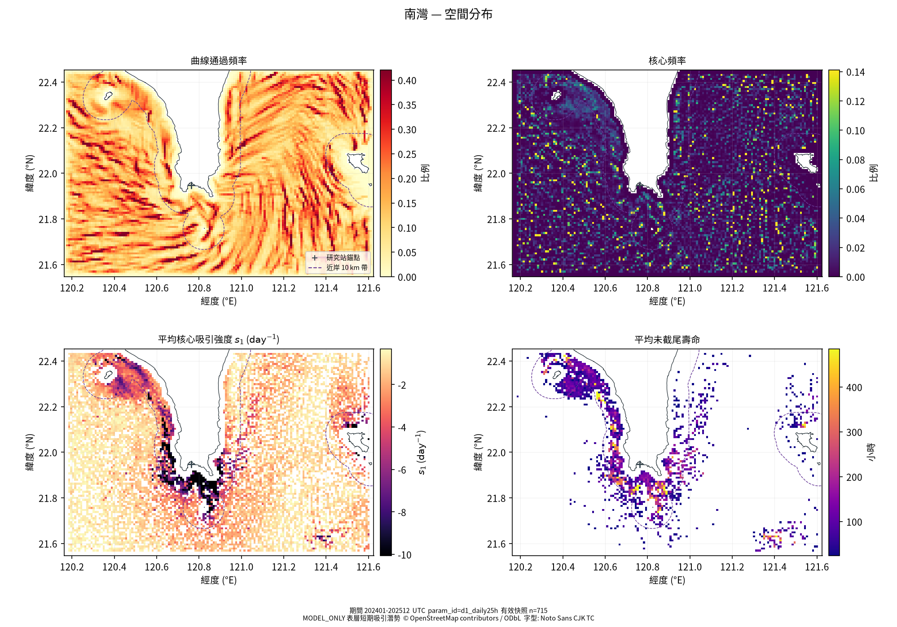

*圖 6-7　日產品 南灣：空間分布（同圖 6-1 的版面）。有效快照 n = 715。*

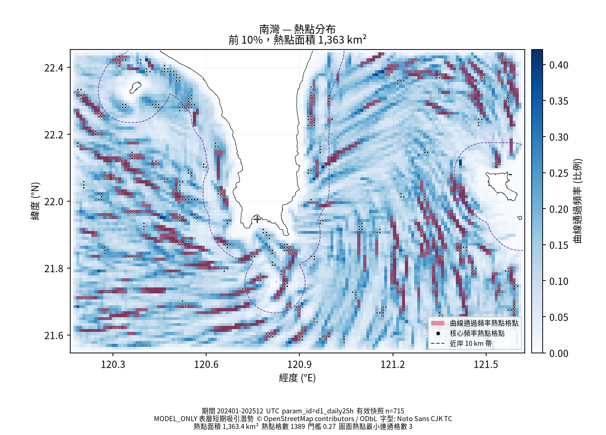

*圖 6-8　日產品 南灣：熱點分布（1,389 格，1363 km²，門檻 0.27）。*

*圖 6-9　日產品 南灣：四季曲線通過頻率與強核心出現率、平均通過格點比例（含 95% CI）。*

*圖 6-10　日產品 南灣：壽命 CCDF（未截尾 n = 3,881）與壽命 ≥72 h track 的平均 $s_1$ 隨正規化年齡演化。*

*圖 6-11　日產品 南灣：壽命 ≥168 h（7 天）的核心路徑，共 404 條（近岸型 344、近岸外 60）；null 各 seed 平均 219.5 條（近岸型 217.5、近岸外 2）。*

*圖 6-12　日產品 南灣：代表性 TRAP（track 988，起始 2024-07-25 12:00 UTC，壽命 1416 h，59 個觀測，核心平均距岸 30.0 km；null p99 壽命 240 h）。*

*圖 6-13　日產品 南灣：移動 track 1,062 條、靜止 539 條的核心傳播速度分量直方圖與去向玫瑰圖（僅描述結構位移）。*

*圖 6-14　日產品 南灣：近岸診斷（距岸分布與近岸外／近岸型壽命對照 null）。*

### 解讀

頻率：兩個產品中每個有效快照都有核心與曲線，強核心出現率為 100%（逐時）與 100%（日產品）；曲線通過格點比例平均為 12.6%（逐時）與 14.7%（日產品）。熱點約占站內面積的前 10%（逐時 1360 km²、日產品 1363 km²），其中 24.7%（逐時）與 15.4%（日產品）的面積位於 10 km 近岸帶。強度與近岸：強核心中有 80.3%（逐時）與 80%（日產品）位於近岸帶，高於全部核心的 23.5% 與 19.4%。

生命週期：逐時強核心結構壽命中位數 1 h、p90 4 h；壽命 ≥3 h 的比例為 25.4%，null 為 2.84%（8.94×）。壽命 ≥24 h 的未截尾 track 共 243 條，其中位於近岸帶者占 100%。日產品壽命中位數 48 h、p90 168 h；壽命 ≥72 h 為 33.6%（null 16.2%，2.08×），≥168 h 為 10.4%（null 2.76%，3.77×）。日產品 ≥168 h 的長壽命 track 有 404 條，近岸帶占 85.1%；近岸外 ≥168 h 比例為 5.38%（null 0.0855%），近岸型為 12.4%（null 3.89%）。

逐時 ≥24 h 的 243 條長壽命 track 有 100% 位於近岸帶，與近岸地形鎖定的解讀一致。 傳播：逐時移動 track 的核心位移速度中位數 7.46 km/day（靜止 24.8%），日產品 0.651 km/day（靜止 33.7%）；位置擬合殘差 RMS 中位數分別為 595 m 與 697 m，皆小於 1 個格距。

上述為模型流場的診斷，未經獨立觀測驗證；不代表該站實際的海廢聚集頻率或濃度。

## 7. 連江（`lienchiang`，流場區域 D）

### 關鍵統計

| 指標 | 逐時 `r1_hourly` | 日產品 `d1_daily25h` |
| --- | --- | --- |
| 站點分析區面積 (km²) | 9469 | 9469 |
| 有效快照數 | 17,124 | 715 |
| 強核心門檻 (day⁻¹；s⁻¹) | -6.32；-7.318e-05 | -2.55；-2.947e-05 |
| 強核心出現率（分子／分母；95% CI） | 99%（16,952／17,124）[98.69%, 99.28%] | 99.72%（713／715）[99.3%, 100%] |
| 核心出現率／曲線出現率 | 100%／100%（無區辨力） | 100%／100%（無區辨力） |
| 曲線通過格點比例（95% CI） | 11.85% [11.79%, 11.91%] | 12.19% [12.11%, 12.28%] |
| 核心密度（個／1000 km²／快照） | 16.89 | 15.52 |
| 合格核心總數 | 2,737,928 | 105,108 |
| 核心 $s_1$ 中位數／p10 (day⁻¹) | -1.29／-6.32 | -0.77／-2.55 |
| 熱點面積 km²（格數） | 948.35（959） | 955（966） |
| 熱點門檻（曲線通過頻率）／熱點內平均頻率 | 0.2116／0.2615 | 0.221／0.2828 |
| 熱點內平均核心 $s_1$ (day⁻¹) | -2.36 | -1.28 |
| 熱點內強核心比例（占該站強核心） | 28.89% | 43.74% |
| 熱點面積位於 10 km 近岸帶比例 | 37.43% | 55.68% |
| 近岸外熱點格數／平均通過頻率 | 475／0.2663 | 486／0.2648 |
| 全部核心位於 10 km 近岸帶比例 | 44.5% | 50.24% |
| 強核心位於 10 km 近岸帶比例 | 89.96% | 90.16% |
| 近岸外強核心出現率 | 56.65% | 53.43% |
| 強核心 track 數（全部／未截尾） | 136,192／135,767 | 4,550／4,122 |
| 壽命 平均／中位數／p90 | 2.011／1／4 h | 54.29／24／120 h |
| null 壽命中位數／p90 (h) | 1／2 | 24／72 |
| 長壽命 track（未截尾、站內出生）數；其位於近岸帶比例 | 1；0%（樣本數不足，不宜解讀） | 212；98.11% |

### 壽命分數：真實 vs 時間置換 null

**逐時**（未截尾 track 中壽命不小於門檻者的比例；null 為兩個 seed 平均）

| 門檻 | 真實 | null | 超額 | 比值 | 近岸外 真實／null／超額 | 近岸型 真實／null／超額 |
| --- | --- | --- | --- | --- | --- | --- |
| ≥ 3 h | 25.4% | 1.74% | 23.7% | 14.6× | 21.5%／0.3%／21.2% | 25.9%／1.92%／24% |
| ≥ 6 h | 3.44% | 0.0199% | 3.42% | 173× | 2.29%／0%／2.29% | 3.58%／0.0223%／3.55% |
| ≥ 12 h | 0.135% | 0% | 0.135% | —（null 為 0，無比值） | 0.089%／0%／0.089% | 0.14%／0%／0.14% |
| ≥ 24 h（樣本數不足，不宜解讀） | 0.000737% | 0% | 0.000737% | —（null 為 0，無比值） | 0.00685%／0%／0.00685% | 0%／0%／0% |

未截尾 track 數：真實 135,767（近岸外 14,609、近岸型 121,158）；null 平均 243,543（近岸外 26,320、近岸型 217,224）。

**日產品**（未截尾 track 中壽命不小於門檻者的比例；null 為兩個 seed 平均）

| 門檻 | 真實 | null | 超額 | 比值 | 近岸外 真實／null／超額 | 近岸型 真實／null／超額 |
| --- | --- | --- | --- | --- | --- | --- |
| ≥ 48 h（2 天） | 46% | 25.3% | 20.7% | 1.82× | 27.8%／8.34%／19.4% | 49.2%／27.9%／21.3% |
| ≥ 72 h（3 天） | 25.5% | 10.4% | 15% | 2.44× | 10.9%／1.39%／9.52% | 28.1%／11.9%／16.2% |
| ≥ 168 h（7 天） | 5.14% | 1.34% | 3.8% | 3.84× | 0.642%／0%／0.642% | 5.94%／1.55%／4.4% |

未截尾 track 數：真實 4,122（近岸外 623、近岸型 3,499）；null 平均 6,417（近岸外 864、近岸型 5,554）。

### 傳播速度（核心位移）

| 指標 | 逐時 | 日產品 |
| --- | --- | --- |
| 已擬合 track 數（移動／靜止） | 2,561（2,380／181） | 1,199（894／305） |
| 靜止比例 | 7.068% | 25.44% |
| 速度中位數／p90 (km/day)，僅移動 track | 11.07／20.16 | 0.8922／2.107 |
| 東向／北向分量中位數 (km/day) | 2.92／-2.88 | 0.0261／-3.71e-16 |
| 位置擬合殘差 RMS 中位數 (m) | 741.8 | 746.7 |

### 季節分層

| 季節 | 逐時：快照數／強核心出現率／曲線通過格點比例 [95% CI] | 日產品：快照數／強核心出現率／曲線通過格點比例 [95% CI] |
| --- | --- | --- |
| DJF | 4,284／97.25%／11.85% [11.77%, 11.93%] | 179／98.88%／11.7% [11.53%, 11.85%] |
| MAM | 4,238／99.86%／11.66% [11.55%, 11.76%] | 177／100%／12.15% [11.98%, 12.3%] |
| JJA | 4,364／100%／11.88% [11.77%, 11.99%] | 182／100%／12.67% [12.5%, 12.82%] |
| SON | 4,238／98.87%／12.01% [11.88%, 12.14%] | 177／100%／12.25% [12.08%, 12.42%] |

季節觀察（僅描述分層數值；季節分層僅涵蓋兩個年度，不能推論氣候季節性或年際變異）：

- 逐時：曲線通過格點比例以 SON 最大（12%）、MAM 最小（11.7%），兩者的 95% CI 不重疊。 強核心出現率以 DJF 最低（97.25%），其餘季節為 MAM 99.86%、JJA 100%、SON 98.87%。
- 日產品：曲線通過格點比例以 JJA 最大（12.7%）、DJF 最小（11.7%），兩者的 95% CI 不重疊。 強核心出現率以 DJF 最低（98.88%），其餘季節為 MAM 100%、JJA 100%、SON 100%。

### 成果圖

*圖 7-1　逐時 連江：曲線通過頻率、核心頻率、平均核心 $s_1$、平均未截尾壽命（2×2）。有效快照 n = 17,124；色階為本站 2–98 百分位；虛線為 10 km 近岸帶。*

*圖 7-2　逐時 連江：曲線通過頻率前 10% 熱點（959 格，948.3 km²，門檻 0.212）。*

*圖 7-3　逐時 連江：強核心結構壽命 CCDF（實線未截尾 n = 135,767，灰虛線為時間置換 null）與壽命 ≥12 h track 的平均 $s_1$ 隨正規化年齡演化。*

*圖 7-4　逐時 連江：未截尾、站內出生、壽命 ≥24 h 的核心路徑，共 1 條（近岸型 0、近岸外 1）；null 各 seed 平均 0 條。（樣本數不足，不宜解讀）*

*圖 7-5　逐時 連江：代表性 TRAP（track 61739，起始 2025-01-21 01:00 UTC，壽命 24 h，24 個觀測，核心平均距岸 12.6 km；選取準則 `offshore_exceeds_null`）。*

*圖 7-6　逐時 連江：(a) 核心距岸分布；(b) 近岸外與近岸型壽命 CCDF 對照 null。距岸距離場於 30 km 飽和。*

*圖 7-7　日產品 連江：空間分布（同圖 7-1 的版面）。有效快照 n = 715。*

*圖 7-8　日產品 連江：熱點分布（966 格，955 km²，門檻 0.221）。*

*圖 7-9　日產品 連江：四季曲線通過頻率與強核心出現率、平均通過格點比例（含 95% CI）。*

*圖 7-10　日產品 連江：壽命 CCDF（未截尾 n = 4,122）與壽命 ≥72 h track 的平均 $s_1$ 隨正規化年齡演化。*

*圖 7-11　日產品 連江：壽命 ≥168 h（7 天）的核心路徑，共 212 條（近岸型 208、近岸外 4）；null 各 seed 平均 86 條（近岸型 86、近岸外 0）。*

*圖 7-12　日產品 連江：代表性 TRAP（track 3894，起始 2025-09-04 12:00 UTC，壽命 216 h，9 個觀測，核心平均距岸 10.2 km；null p99 壽命 168 h）。*

*圖 7-13　日產品 連江：移動 track 894 條、靜止 305 條的核心傳播速度分量直方圖與去向玫瑰圖（僅描述結構位移）。*

*圖 7-14　日產品 連江：近岸診斷（距岸分布與近岸外／近岸型壽命對照 null）。*

### 解讀

頻率：兩個產品中每個有效快照都有核心與曲線，強核心出現率為 99%（逐時）與 99.72%（日產品）；曲線通過格點比例平均為 11.8%（逐時）與 12.2%（日產品）。熱點約占站內面積的前 10%（逐時 948.3 km²、日產品 955 km²），其中 37.4%（逐時）與 55.7%（日產品）的面積位於 10 km 近岸帶。強度與近岸：強核心中有 90%（逐時）與 90.2%（日產品）位於近岸帶，高於全部核心的 44.5% 與 50.2%。

生命週期：逐時強核心結構壽命中位數 1 h、p90 4 h；壽命 ≥3 h 的比例為 25.4%，null 為 1.74%（14.6×）。壽命 ≥24 h 的未截尾 track 共 1 條，其中位於近岸帶者占 0%（樣本數不足，不宜解讀）。日產品壽命中位數 24 h、p90 120 h；壽命 ≥72 h 為 25.5%（null 10.4%，2.44×），≥168 h 為 5.14%（null 1.34%，3.84×）。日產品 ≥168 h 的長壽命 track 有 212 條，近岸帶占 98.1%；近岸外 ≥168 h 比例為 0.642%（null 0%），近岸型為 5.94%（null 1.55%）。

逐時 ≥24 h 的長壽命 track 僅 1 條，樣本數不足，不宜解讀。 日產品長壽命 track 有 98.1% 位於近岸帶。 傳播：逐時移動 track 的核心位移速度中位數 11.1 km/day（靜止 7.07%），日產品 0.892 km/day（靜止 25.4%）；位置擬合殘差 RMS 中位數分別為 742 m 與 747 m，皆小於 1 個格距。

上述為模型流場的診斷，未經獨立觀測驗證；不代表該站實際的海廢聚集頻率或濃度。

## 8. 綜合討論

### 8.1 頻率與強度

以 10 km 緩衝與強核心前 10% 的定義，五站在兩個產品中幾乎每個有效快照都含有強核心（見各站表），因此「是否出現」並不能區分不同日期；較有資訊的是「曲線覆蓋多少面積」（約一成至一成六的站內格點在每個快照被曲線通過）與「熱點在哪裡」（空間集中度）。強核心門檻與熱點是以各站自己的分布定義，只描述該站內部的相對集中位置。

| 站 | 強核心出現率 逐時／日 | 曲線通過格點比例 逐時／日 | 強核心門檻 day⁻¹ 逐時／日 | 熱點面積 km² 逐時／日 |
| --- | --- | --- | --- | --- |
| 貢寮 | 99%／100% | 9.97%／13.3% | -14.85／-4.47 | 688.1／704 |
| 龜山島西側 | 95.3%／99% | 11%／13.5% | -13.43／-5.89 | 433.8／440.7 |
| 新竹外海 | 99%／97.8% | 15.5%／15.9% | -2.98／-2.00 | 1176／1187 |
| 南灣 | 100%／100% | 12.6%／14.7% | -8.45／-4.86 | 1360／1363 |
| 連江 | 99%／99.7% | 11.8%／12.2% | -6.32／-2.55 | 948.3／955 |

此表僅為各站數值的彙整，各站獨立定義，不構成站間排序。

### 8.2 逐時與日產品的時間尺度意義

逐時產品保留潮汐等次日變動，TRAP 結構的壽命以小時計：中位數 1 小時，p90 為 3–4 小時。在 2 km／4 km 的嚴格追蹤門檻下，壽命 ≥3 h 的比例（約 11%–25%）仍遠高於時間置換 null（約 0.5%–2.8%），顯示逐時結構確有時間連續性；但超過 12 小時者極少，超過 24 小時者僅占約 0.00074%–0.15%。逐時結果因含潮汐，其短壽命與潮汐週期的關係尚未用潮相資料分層檢驗（專案無潮相資料）。

日產品經 25 h 平均抑制主要分潮後，結構壽命上升到天的量級（中位數 1–2 天，p90 4–7 天），與 Kunz 等（2024）以逐日資料分析的時間尺度相近，但其研究域為北太平洋中尺度，門檻與壽命不可直接移植到本專案約 1 km 的近岸網格。日產品壽命 ≥7 天者占 3.8%–10.4%，約為 null 的 3.8–11.3 倍；而 ≥2–3 天者的比值僅約 1.5–2.5 倍，說明 2–3 天的壽命有相當部分可由機會串接解釋，只有更長壽命才與 null 明顯分離。因此解讀日產品結果時，建議以 ≥7 天的長壽命 track 與近岸外指標為主。

### 8.3 近岸鎖定的解讀

核心在距非海域格點約 2–3 km 內無法偵測（檢出下限）。在可偵測範圍內，強核心較全部核心更集中於 10 km 近岸帶（各站、兩個產品皆如此，數值見各站表），長壽命日產品 track 的近岸帶比例在多數站超過 70%，且許多為位移小於 1 格的靜止型（日產品靜止比例 25%–34%）。這與「地形（岬角、島嶼）鎖定的應變場或邊界效應」的解讀一致：此類結構不是漂移的收斂帶，其與實際海廢聚集的關係需獨立觀測才能確認。保守的結論應以近岸外（`offshore_*`）指標為準。

例外與細節：龜山島西側日產品的長壽命 track 僅約三分之一位於近岸帶；逐時產品中貢寮與龜山島西側的長壽命 track 全數被歸為近岸外，但代表 track 的核心平均距岸約 10.5–12.5 km（貢寮 10.5 km，見成果圖），貼近 10 km 分割線；連江逐時長壽命 track 只有 1 條；這些逐時長壽命樣本（16、16、1 條，新竹外海亦僅 20 條）樣本數不足，不宜解讀。因此「長壽命者多在近岸」是日產品多數站的現象，不是逐時產品或每一站的通則。

### 8.4 對 null 的穩健性

- 日產品：每一站的近岸外與近岸型壽命 ≥48、72、168 h 比例皆高於其 null（超額皆為正，見各站壽命表）。
- 逐時：近岸外壽命 ≥3、6、12 h 比例在各站皆高於 null；≥24 h 僅有少數 track，南灣近岸外 ≥24 h 為 0（真實與 null 皆 0），其餘站近岸外超額皆不超過 0.07%（最大 0.061%），樣本極少。
- 追蹤全部核心時壽命大多可由機會解釋；本結果採「只追蹤各站前 10% 強核心＋兩個 seed 的時間置換 null」才有超額。null 只有 2 個 seed，且只檢驗「時間連續性」，不檢驗結構的物理意義。

## 9. 限制與使用注意

1. **僅模型資料（MODEL_ONLY）。** 沒有獨立的漂流器或海廢觀測，因此未進行 Serra 等（2020）圖 4a–c／表 1–2 型式的驗證，也未與海廢記錄對照。結果只能稱為「表層短期吸引潛勢」，不得寫成海廢濃度、長期滯留、海底廢聚集或污染來源。SVD 與 TRAP 共用 OCM 強迫，其關聯屬機制探索，不是獨立驗證。
2. **壽命的機會成分。** 日產品壽命 2–3 天有相當部分可由機會解釋（比值僅約 1.5–2.5 倍）；逐時 ≥24 h 的樣本極少。壽命一律指「強核心結構（各站前 10%）」，不是全部 TRAP。null 僅 2 個 seed。
3. **檢出下限與近岸。** 核心無法位於距非海域格點約 2–3 km 內；近岸強核心與長壽命 track 多為靜止型，可能是地形鎖定的應變場或邊界效應。近岸／近岸外的歸類依 track 核心平均距岸判定，對 10 km 緩衝寬度敏感。
4. **相對定義。** 強核心與熱點皆為各站自己的 10% 分位數，不可作跨站大小比較；熱點面積依定義約占站內面積的 10%。核心與曲線出現率皆為 100%，無區辨力。
5. **參數與解析度。** 相對強度 0.3、曲線長度上限、追蹤門檻等未做完整敏感度分析；1 km 網格的近岸結果受網格與遮罩影響。日產品 25 h 平均不是理想低通。
6. **傳播速度** 是結構位移，不是水體或漂浮物速度；逐時與日產品的最少觀測數不同（7 與 3）。
7. **距岸距離場上限。** 本批最終結果的 manifest 記錄距離場於 30 km 飽和（`coast_distance.cap_m = 30000`），而目前程式預設上限為 200 km；10 km 近岸分割不受影響，但距岸直方圖的末格為「≥ 30 km」。
8. **相干性比值的單位。** 本報告的相干性（真實÷null）一律採最終 `site_statistics` 的逐站值：逐時壽命 ≥3 h 為 8.94–31.5 倍，日產品 ≥72 h 約 1.8–2.5 倍。門檻掃描階段的記錄值（逐時約 9–19 倍、日產品約 1.8–2.5 倍）是以流場區域（domain，A 區未拆站）為單位計算，與本報告的逐站值單位不同，數值不可逐項對照；掃描表見實作方式報告第 4.6 節。
9. **季節分層** 只涵蓋兩個年度，不可推論氣候季節性。

## 10. 成果檔案清單

### 10.1 位置

完整最終結果（唯讀）：`outputs/server/{r1_hourly,d1_daily25h}/aggregate_report/`（Mac 副本；SERVER 原位置見第 1 節）。

| 檔案 | 內容 |
| --- | --- |
| `site_statistics.csv`／`site_statistics.json` | 五站 × 7 個分層（`all`、`DJF`、`MAM`、`JJA`、`SON`、`2024`、`2025`）共 35 列統計；JSON 另含 `track_core_filter` 與 `lifetime_scope_zh` |
| `manifest.json`／`manifest.sha256` | schema `traps.period.aggregate.v2`；所有參數、輸入 SHA-256、各站強核心門檻、色階、字型、範例 track 資訊、artifact 的 SHA-256 |
| `_SUCCESS` | 完成標記 |
| `spatial/<site_id>/spatial_{all,DJF,MAM,JJA,SON}.npz` | 站內逐格有效分母、核心／強核心頻率、曲線通過頻率、平均核心強度、平均未截尾壽命、`site_mask`、熱點遮罩、`track_count`、`long_track_count`、`coast_distance_m`、`coast_buffer_mask` 等；站外格點為 NaN |
| `figures/<site_id>/site_<site_id>_<kind>.png` | 每站每產品 12 張，共 5 × 12 × 2 = 120 張 |

`<kind>` ∈ `spatial`、`hotspots`、`seasonal`、`lifetime`、`timeseries`、`example`、`example_coastal`、`method_comparison`、`long_tracks`、`track_density`、`propagation`、`coastal_diagnostic`。

### 10.2 本專案收錄的引用用圖（`docs/reports/figures/<run>/<site>/`）

兩個產品、五站皆收錄 `spatial`、`hotspots`、`lifetime`、`long_tracks`、`example`、`coastal_diagnostic`；日產品另收錄 `seasonal`、`propagation`。其餘圖（`timeseries`、`example_coastal`、`method_comparison`、`track_density`，以及逐時的 `seasonal`、`propagation`）請見上列 `outputs/server/…/figures/<site_id>/` 路徑。

### 10.3 欄位說明（`site_statistics`）

欄位定義見〈[實作方式報告](01_TRAPs_實作方式報告.md)〉第 5 節與 [`docs/operations/SERVER_RUNBOOK.md`](../operations/SERVER_RUNBOOK.md)。欄位命名重點：`strong_core_*`（強核心）、`curve_*`、`mean_pass_cell_fraction`、`hotspot_*`、`track_*`／`track_frac_uncensored_ge_<h>h`、`null_*`／`excess_*`／`ratio_*`（null 對照）、`offshore_*`／`coastal_*`（近岸外／近岸型）、`prop_*`（傳播）、`frac_*_within_buffer`。所有 null、近岸欄位只在 stratum `all` 有值；季節與年份分層的這些欄位為空。

## 附：引用建議

請見 [`README.md`](README.md)。
