# 四、TRAPs 執行成果

〔編輯說明：本章為工項 2「瞬態吸引剖面（TRAPs）」之執行成果，併入全文時置於工項 1 成果之後；表號暫定「表乙-」，圖號暫定「圖乙-」，併入時請重編；數值取自兩次正式執行之逐站統計檔與執行紀錄檔，未自行推算新數值。〕

　　本章彙整 TRAP 分析在 2024 年 1 月至 2025 年 12 月、五個研究站之實際執行成果。流場以兩種產品獨立分析：逐時產品（保留潮汐）與 25 小時置中平均之去潮汐日產品；兩者尺度不同，結果是兩個獨立之分析，不是同一量之兩次重複。各站彼此獨立統計，各有自己之分母、門檻、熱點與色階，本章不做站與站之排序或比較。所有結果為模型內之「表層短期吸引潛勢」（科學狀態僅模式資料），不是海廢濃度、滯留時間、海底廢聚集或污染來源。

　　本章用語如下。「結構軌跡」指同一 TRAP 結構在連續時刻被追蹤所形成的序列；「隨機時間置換對照」（簡稱「隨機對照」）指保留追蹤設定、僅把各可用時間槽之檢出隨機置換後重新追蹤之結果，用以估計「沒有真實時間連續性」時之壽命基準，共使用兩組亂數種子；「超額」為真實值減隨機對照值；「近岸型」指核心平均距岸小於 10 公里，「近岸外」指不小於 10 公里；「截尾」指壽命因資料缺口或研究期邊界而無法完整觀測，「未截尾」則否；「互補累積分布」（complementary cumulative distribution function, CCDF）指壽命不小於某值之比例隨該值之變化；「均方根」（root mean square, RMS）為殘差平方之平均再開方；「逐日區塊重抽樣」（block bootstrap）指以日為單位重抽樣以估計信賴區間；「快照」指某一時刻之流場；「分層」指依季節等條件切分之統計子集。每日（day⁻¹）為應變率之單位，其後僅以 day⁻¹ 表示。

　　本章各指標之意義如下。「出現率」以有效快照為分母，每個快照至多計一次；「強核心」為該站核心強度 $s_1$ 最強之 10%，$s_1$ 單位為每日（day⁻¹），越負越強；「曲線通過格點比例」為每個快照中，TRAP 曲線所經站內格點占站內格點之平均比例；「熱點」為該站曲線通過頻率最高之 10% 格點，是相對於該站自己分布之定義；「壽命」只指各站強核心結構之未截尾結構軌跡，慣例為末次觀測時間減首次觀測時間再加一個取樣間隔；「超額」為真實比例減隨機對照比例（兩個種子平均），「比值」為真實除以隨機對照；括號內為逐日區塊重抽樣之 95% 信賴區間（只有出現率與曲線通過格點比例附有）；「近岸帶」為距非分析海域格點 10 公里以內。

　　本節重點：4 個流場區域 × 24 個月 = 96 個區域月份全數完成偵測、追蹤與彙整，逐時產品每站有 17,124 個有效快照、日產品每站有 715 個有效快照。各站核心出現率與曲線出現率在兩個產品中皆為 100%，不具區辨力，有資訊之頻率指標為強核心出現率與曲線通過格點比例，強度指標為強核心門檻與熱點內之 $s_1$。逐時產品強核心結構之壽命中位數在五站皆為 1 小時，日產品為 1–2 天（24–48 小時）；真實壽命在逐時 3、6、12 小時與日產品 168 小時（7 天）之各門檻皆高於隨機對照，但日產品 2–3 天之壽命有相當部分可由機會串接解釋。強核心與長壽命結構軌跡偏向集中於 10 公里近岸帶，且核心在距非海域格點約 2–3 公里內無法檢出，因此近岸結果須視為可能之地形鎖定，而非漂移之收斂帶。

## （一）執行規模與完成度

### 1、資料規模與完成度

　　本計畫資料為中央氣象署 OCM／SCHISM 表層流場，預處理為 1 公里規則公尺網格，涵蓋 4 個流場區域、5 個研究站，期間 2024 年 1 月至 2025 年 12 月，共 4 × 24 = 96 個區域月份，依專案記錄全數為標準等級且狀態為可用。逐時產品另有 17,196 列去除 72 個月交界重複之 UTC 時刻後，為 17,124 個有效快照（缺漏 420 個小時，含 48 個長於 1 小時之缺口，最長 50 小時，一律不補值）；日產品為 715 個有效快照（每個流場區域另有 16 日因視窗小時數少於 23 而省略）。表乙-1列出兩個產品之執行規模與完成度。兩次執行之彙整皆完成，執行紀錄檔記錄無缺漏流場區域（缺漏流場區域名單為空）與無缺漏研究站（缺漏研究站名單為空），且完成標記檔與執行紀錄檔內全部輸出檔之 SHA-256 已核對。

**表乙-1  兩個產品之執行規模與完成度**

| 項目 | 逐時產品 | 日產品 |
|---|---|---|
| 流場區域數／研究站數 | 4／5 | 4／5 |
| 區域月份數（4 區域 × 24 個月） | 96（全數標準等級、可用） | 96（由逐時產品衍生） |
| 有效快照數（每站） | 17,124 | 715 |
| 流場區域缺漏／研究站缺漏 | 0／0 | 0／0 |
| 逐站統計檔列數（5 站 × 7 個分層） | 35 | 35 |
| 成果圖數量（5 站 × 12 種） | 60 | 60 |
| 隨機對照種子 | 1、2 | 1、2 |
| 狀態 | 可用 | 可用 |
| 彙整結果格式／套件版本 | 第 2 版／0.1.0 | 第 2 版／0.1.0 |
| 程式版本（程式修改標記） | 99c3151（否） | 99c3151（否） |
| 彙整完成時間（UTC） | 2026-09-29 10:40 | 2026-09-29 10:34 |

資料來源：本計畫兩次執行之執行紀錄檔與逐站統計檔；缺漏與省略數量為專案記錄。

### 2、執行耗時

　　執行環境為伺服器（Ubuntu 20.04、56 核、125 GB 記憶體，Python 3.12）。表乙-2列出各階段耗時；逐時偵測、強核心追蹤與日產品全流程之耗時為專案記錄，彙整耗時取自執行紀錄檔之執行耗時。

**表乙-2  各階段執行耗時**

| 階段 | 逐時產品 | 日產品 | 來源 |
|---|---|---|---|
| 偵測（區域月份檢出，96 個區域月份） | 約 45 分鐘（32–40 個平行工作程序，約 0.9–1.1 秒每快照每核） | — | 專案記錄 |
| 強核心追蹤與隨機對照追蹤 | 約 1.5 分鐘 | — | 專案記錄 |
| 彙整（逐站統計、逐日區塊重抽樣、成果圖） | 398.6 秒 | 145.9 秒 | 執行紀錄檔執行耗時 |
| 日產品全流程（日產品建置至彙整） | — | 約 10 分鐘 | 專案記錄 |

資料來源：本計畫執行紀錄與兩次執行之執行紀錄檔；專案記錄之耗時為概略值。

### 3、各站強核心門檻與追蹤保留數

　　表乙-3列出各站強核心門檻（站內合格核心 $s_1$ 之 10% 分位數）、合格核心數與追蹤保留數。各站之門檻為該站自己之相對定義，此表只是各站數值之並列，不構成站間排序。

**表乙-3  各站強核心門檻與追蹤保留數**

| 站點 | 逐時強核心門檻（每日） | 逐時合格／保留核心數 | 日產品強核心門檻（每日） | 日產品合格／保留核心數 |
|---|---|---|---|---|
| 貢寮 | −14.85 | 1,469,434／146,944 | −4.471 | 77,790／7,779 |
| 龜山島西側 | −13.43 | 968,760／96,879 | −5.887 | 43,714／4,372 |
| 新竹外海 | −2.98 | 3,528,213／352,822 | −2.004 | 145,111／14,512 |
| 南灣 | −8.447 | 3,584,375／358,445 | −4.862 | 158,037／15,804 |
| 連江 | −6.322 | 2,737,928／273,793 | −2.546 | 105,108／10,511 |

資料來源：本計畫兩次執行之執行紀錄檔（結構軌跡核心篩選紀錄）；保留數約為合格核心數之 10%。

## （二）逐站成果

　　本節逐站呈現兩個產品之結果。每站依序說明頻率、強度、生命週期、近岸與近岸外、傳播速度與季節分層，並列出一張關鍵統計表、一張壽命分數對照表與一張季節分層表；每站以六張圖呈現：日產品之熱點與空間分布、逐時與日產品之壽命、日產品之長壽命結構軌跡與代表性 TRAP。

　　各圖之標示如下。空間分布圖為站內 2×2 面板，依序為曲線通過頻率、核心頻率、平均核心 $s_1$（每日）與平均未截尾壽命，虛線為 10 公里近岸帶，色階上下限為該站分析區之 2–98 百分位。熱點圖標出曲線通過頻率最高 10% 之格點，並疊加核心頻率前 10% 之格點。壽命圖左為壽命互補累積分布（互補累積分布），實線為未截尾、虛線含截尾、灰色為隨機對照與跨種子範圍；右為壽命不小於 12 小時（日產品 72 小時）之未截尾結構軌跡之平均核心 $s_1$ 對正規化年齡。長壽命路徑圖為站內出生、未截尾、壽命不小於 24 小時（日產品 168 小時）之核心路徑，依壽命著色，近岸型虛線、近岸外實線。代表性 TRAP 圖顯示代表結構軌跡起始時刻之 $s_1$、全部合格曲線（淡色）、代表曲線與核心（紅）及核心路徑；代表結構軌跡之選取準則為近岸外且壽命超過隨機對照，即站內出生、未截尾、核心平均距岸不小於 10 公里（近岸外）且壽命大於隨機對照之第 99 百分位數者中壽命最長者。圖面文字為繁體中文。

### 1、貢寮

　　貢寮位於流場區域 A（與另一研究站共用同一流場，以最近錨點互斥分割統計歸屬），站點分析區面積 6852.5 平方公里。逐時產品有 17,124 個有效快照，日產品有 715 個，皆為全部標準快照。圖乙-1至圖乙-6與表乙-4至表乙-6呈現貢寮之結果。

　　在頻率方面，逐時產品之核心出現率與曲線出現率皆為 100%（17,124 個有效快照皆至少有一個核心與一條曲線），不具區辨力；強核心出現率為 99.05%（16,961／17,124，95% 信賴區間 98.77–99.31%），曲線通過格點比例為 9.969%（95% 信賴區間 9.93–10.01%），即每個快照約有 9.97% 之站內格點被 TRAP 曲線通過。日產品之核心出現率與曲線出現率同為 100%；強核心出現率為 100%（715／715，95% 信賴區間 100.00–100.00%），曲線通過格點比例為 13.33%（95% 信賴區間 13.22–13.45%）。核心密度逐時為 12.52、日產品為 15.88 個每 1,000 平方公里每快照。

　　在強度方面，逐時產品之強核心門檻為 −14.85 每日（−1.719×10⁻⁴ 每秒）；站內合格核心共 1,469,434 個，核心 $s_1$ 之中位數與第 10 百分位數為 −3.605 與 −14.85 每日。熱點共 698 格、688.05 平方公里，熱點門檻（曲線通過頻率）為 0.1519，熱點內平均通過頻率 0.1831，熱點內核心平均 $s_1$ 為 −7.226 每日，該站強核心有 34.45% 落在熱點格點內。日產品之強核心門檻為 −4.471 每日（−5.175×10⁻⁵ 每秒），核心 $s_1$ 之中位數與第 10 百分位數為 −1.308 與 −4.471 每日；熱點 714 格、703.97 平方公里，門檻 0.2196，熱點內平均通過頻率 0.2815，熱點內核心平均 $s_1$ 為 −2.435 每日，強核心有 49.27% 落在熱點格點內。日產品之強核心門檻與核心強度量值小於逐時產品，與 25 小時平均抑制潮汐與高頻應變一致；熱點為相對定義，面積約為站內面積之 10%。

　　在生命週期方面，逐時產品共追蹤 99,858 條強核心結構軌跡，其中未截尾 99,595 條；壽命平均 1.48 小時、中位數 1 小時、第 90 百分位數為 3 小時；隨機對照之壽命中位數與第 90 百分位數為 1 與 1 小時。壽命不小於 3 小時者，真實為 11.25%、隨機對照為 1.093%、超額 10.16%、比值 10.3×；壽命不小於 6 小時者，真實為 0.8263%、隨機對照為 0.0129%、超額 0.8135%、比值 64.1×；壽命不小於 12 小時者，真實為 0.05924%、隨機對照為 0%、超額 0.05924%（隨機對照為 0，無比值）（約 59 條）；壽命不小於 24 小時者僅 16 條（0.01607%，隨機對照為 0%），樣本數不足（不大於 20 條），不宜解讀。

　　日產品共追蹤 3,252 條強核心結構軌跡，其中未截尾 2,926 條；壽命平均 55.73 小時、中位數 24 小時（1 日）、第 90 百分位數為 120 小時（5 日）；隨機對照之壽命中位數與第 90 百分位數為 24 與 72 小時。壽命不小於 48 小時者，真實為 42.82%、隨機對照為 27.69%、超額 15.13%、比值 1.55×；壽命不小於 72 小時者，真實為 23.38%、隨機對照為 12.87%、超額 10.51%、比值 1.82×；壽命不小於 168 小時者，真實為 6.083%、隨機對照為 1.134%、超額 4.95%、比值 5.37×。站內出生、未截尾、壽命不小於 168 小時（7 天）之長壽命結構軌跡有 177 條。壽命 48 與 72 小時之比值較低，表示 2–3 天之壽命有相當部分可由機會串接解釋。

　　在近岸與近岸外方面（緩衝帶 10 公里），逐時產品之全部核心有 28.17% 位於近岸帶，強核心則有 66.34%；日產品分別為 23.73% 與 65.48%。強核心之近岸比例高於全部核心之近岸比例，顯示強核心偏向近岸。近岸外強核心出現率（門檻不變）逐時為 80.69%、日產品為 94.55%。熱點面積有 31.96%（逐時）與 25.35%（日產品）位於近岸帶；只在近岸外格點重取分位數之熱點，逐時為 531 格、平均通過頻率 0.1768，日產品為 533 格、平均通過頻率 0.2753。

　　長壽命結構軌跡位於近岸帶之比例，逐時產品為 0%（長壽命結構軌跡 16 條，樣本數不足，不宜解讀），日產品為 72.88%（177 條）。日產品中，未截尾結構軌跡近岸外 1,061 條、近岸型 1,865 條；壽命分數（真實與隨機對照）依序為：不小於 48 小時：近岸外 31.86%（隨機對照 19.27%）、近岸型 49.06%（隨機對照 32.94%）；不小於 72 小時：近岸外 14.99%（隨機對照 9.009%）、近岸型 28.15%（隨機對照 15.27%）；不小於 168 小時：近岸外 4.524%（隨機對照 0.8808%）、近岸型 6.971%（隨機對照 1.291%）。逐時產品中，近岸外 35,447 條、近岸型 64,148 條；不小於 3 小時：近岸外 8.37%（隨機對照 0.3595%）、近岸型 12.84%（隨機對照 1.493%）；不小於 6 小時：近岸外 1.233%（隨機對照 0%）、近岸型 0.6017%（隨機對照 0.01992%）；不小於 12 小時：近岸外 0.1636%（隨機對照 0%）、近岸型 0.001559%（隨機對照 0%）；不小於 24 小時：近岸外 0.04514%（隨機對照 0%）、近岸型 0%（隨機對照 0%）。逐時近岸外不小於 24 小時者只有 16 條，不宜解讀。

　　在傳播速度方面（模型內 TRAP 核心之位移，不是水體或漂浮物速度），逐時產品已擬合 409 條結構軌跡（移動 315 條、靜止 94 條，靜止比例 22.98%）；移動結構軌跡之速度中位數 7.879、第 90 百分位數為 16.41 公里每日，東向與北向分量中位數為 2.29 與 −0.974 公里每日，位置擬合殘差均方根中位數 679.5 公尺。日產品已擬合 792 條（移動 555 條、靜止 237 條，靜止比例 29.92%），速度中位數 0.718、第 90 百分位數為 2.095 公里每日，東向與北向分量中位數 0.0452 與 −0.0136 公里每日，殘差均方根中位數 744 公尺。逐時（至少 7 個觀測）與日產品（至少 3 個觀測）之樣本不可直接對照。

　　在季節分層方面，逐時產品之曲線通過格點比例以春季（3–5 月）最大（10.05%）、夏季（6–8 月）最小（9.797%），兩者之 95% 信賴區間不重疊；強核心出現率以冬季（12–2 月）最低（98.55%），其餘季節依序為春季（3–5 月） 99.39%、夏季（6–8 月） 99.34%、秋季（9–11 月） 98.91%。日產品之曲線通過格點比例以冬季（12–2 月）最大（14.61%）、夏季（6–8 月）最小（12.41%），兩者之 95% 信賴區間不重疊；四季強核心出現率皆為 100%。季節分層僅涵蓋兩個年度，只描述分層數值，不能推論氣候季節性或年際變異。

**表乙-4  貢寮關鍵統計**

| 指標 | 逐時產品 | 日產品 |
|---|---|---|
| 站點分析區面積（平方公里） | 6852.5 | 6852.5 |
| 有效快照數 | 17,124 | 715 |
| 強核心門檻（每日；每秒） | −14.85；−1.719×10⁻⁴ | −4.471；−5.175×10⁻⁵ |
| 強核心出現率（分子／分母；95% 信賴區間） | 99.05%（16,961／17,124） （98.77–99.31%） | 100%（715／715） （100.00–100.00%） |
| 核心出現率／曲線出現率 | 100%／100%（無區辨力） | 100%／100%（無區辨力） |
| 曲線通過格點比例（95% 信賴區間） | 9.969% （9.93–10.01%） | 13.33% （13.22–13.45%） |
| 核心密度（個每 1,000 平方公里每快照） | 12.52 | 15.88 |
| 合格核心總數 | 1,469,434 | 77,790 |
| 核心 $s_1$ 中位數／第 10 百分位數（每日） | −3.605／−14.85 | −1.308／−4.471 |
| 熱點面積（平方公里）（格數） | 688.05（698） | 703.97（714） |
| 熱點門檻（曲線通過頻率）／熱點內平均頻率 | 0.1519／0.1831 | 0.2196／0.2815 |
| 熱點內核心平均 $s_1$（每日） | −7.226 | −2.435 |
| 熱點內強核心比例（占該站強核心） | 34.45% | 49.27% |
| 熱點面積位於 10 公里近岸帶比例 | 31.96% | 25.35% |
| 近岸外熱點格數／平均通過頻率 | 531／0.1768 | 533／0.2753 |
| 全部核心位於 10 公里近岸帶比例 | 28.17% | 23.73% |
| 強核心位於 10 公里近岸帶比例 | 66.34% | 65.48% |
| 近岸外強核心出現率 | 80.69% | 94.55% |
| 強核心結構軌跡數（全部／未截尾） | 99,858／99,595 | 3,252／2,926 |
| 壽命平均／中位數／第 90 百分位數（小時） | 1.48／1／3 | 55.73／24／120 |
| 隨機對照壽命中位數／第 90 百分位數（小時） | 1／1 | 24／72 |
| 長壽命結構軌跡數（未截尾、站內出生）；位於近岸帶比例 | 16；0%（樣本數不足，不宜解讀） | 177；72.88% |
| 傳播：已擬合結構軌跡數（移動／靜止） | 409（315／94） | 792（555／237） |
| 傳播：靜止比例 | 22.98% | 29.92% |
| 傳播：速度中位數／第 90 百分位數（公里每日，僅移動結構軌跡） | 7.879／16.41 | 0.718／2.095 |
| 傳播：東向／北向分量中位數（公里每日） | 2.29／−0.974 | 0.0452／−0.0136 |
| 傳播：位置擬合殘差均方根中位數（公尺） | 679.5 | 744 |

資料來源：本計畫逐站統計檔（分層：全部）；貢寮站點分析區；熱點與強核心皆為本站相對定義；括號內為逐日區塊重抽樣之 95% 信賴區間。

**表乙-5  貢寮壽命分數：真實與隨機對照**

| 產品與門檻 | 類別 | 真實 | 隨機對照 | 超額 | 比值 |
|---|---|---|---|---|---|
| 逐時 ≥ 3 小時 | 全部 | 11.25% | 1.093% | 10.16% | 10.3× |
|  | 近岸外 | 8.37% | 0.3595% | 8.011% | — |
|  | 近岸型 | 12.84% | 1.493% | 11.35% | — |
| 逐時 ≥ 6 小時 | 全部 | 0.8263% | 0.0129% | 0.8135% | 64.1× |
|  | 近岸外 | 1.233% | 0% | 1.233% | — |
|  | 近岸型 | 0.6017% | 0.01992% | 0.5818% | — |
| 逐時 ≥ 12 小時 | 全部 | 0.05924% | 0% | 0.05924% | — |
|  | 近岸外 | 0.1636% | 0% | 0.1636% | — |
|  | 近岸型 | 0.001559% | 0% | 0.001559% | — |
| 逐時 ≥ 24 小時（樣本不足） | 全部 | 0.01607% | 0% | 0.01607% | — |
|  | 近岸外 | 0.04514% | 0% | 0.04514% | — |
|  | 近岸型 | 0% | 0% | 0% | — |
| 日產品 ≥ 48 小時 | 全部 | 42.82% | 27.69% | 15.13% | 1.55× |
|  | 近岸外 | 31.86% | 19.27% | 12.59% | — |
|  | 近岸型 | 49.06% | 32.94% | 16.13% | — |
| 日產品 ≥ 72 小時 | 全部 | 23.38% | 12.87% | 10.51% | 1.82× |
|  | 近岸外 | 14.99% | 9.009% | 5.976% | — |
|  | 近岸型 | 28.15% | 15.27% | 12.88% | — |
| 日產品 ≥ 168 小時 | 全部 | 6.083% | 1.134% | 4.95% | 5.37× |
|  | 近岸外 | 4.524% | 0.8808% | 3.643% | — |
|  | 近岸型 | 6.971% | 1.291% | 5.679% | — |

資料來源：本計畫逐站統計檔；壽命分數為未截尾結構軌跡中壽命不小於門檻者之比例，隨機對照為兩個種子平均；隨機對照為 0 時比值不定義，以「—」表示；近岸外與近岸型各列之比值未計算（以「—」表示）；「樣本不足」表示該門檻之長壽命結構軌跡不大於 20 條，樣本數不足，不宜解讀；未截尾結構軌跡數：逐時真實 99,595（近岸外 35,447、近岸型 64,148），隨機對照平均 135,718；日產品真實 2,926（近岸外 1,061、近岸型 1,865），隨機對照平均 4,587。

**表乙-6  貢寮季節分層**

| 季節 | 產品 | 快照數 | 強核心出現率 | 曲線通過格點比例（95% 信賴區間） |
|---|---|---|---|---|
| 冬季 | 逐時產品 | 4,284 | 98.55% | 10.03% （9.96–10.10%） |
|  | 日產品 | 179 | 100% | 14.61% （14.42–14.82%） |
| 春季 | 逐時產品 | 4,238 | 99.39% | 10.05% （9.97–10.14%） |
|  | 日產品 | 177 | 100% | 13.59% （13.37–13.81%） |
| 夏季 | 逐時產品 | 4,364 | 99.34% | 9.797% （9.74–9.87%） |
|  | 日產品 | 182 | 100% | 12.41% （12.21–12.59%） |
| 秋季 | 逐時產品 | 4,238 | 98.91% | 10% （9.93–10.08%） |
|  | 日產品 | 177 | 100% | 12.72% （12.51–12.94%） |

資料來源：本計畫逐站統計檔（分層為冬季（12–2 月）、春季（3–5 月）、夏季（6–8 月）、秋季（9–11 月））；季節分層僅涵蓋兩個年度。

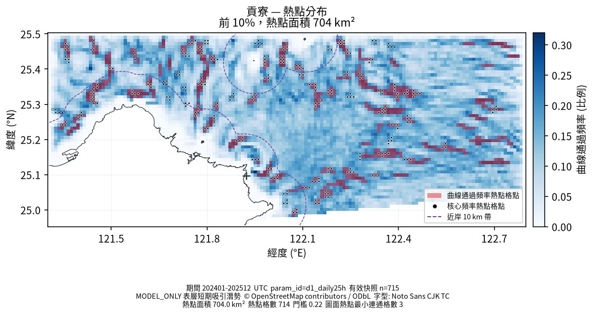{width=6.3in}

**圖乙-1  日產品貢寮：曲線通過頻率前 10% 熱點（714 格，703.97 平方公里，門檻 0.22）**

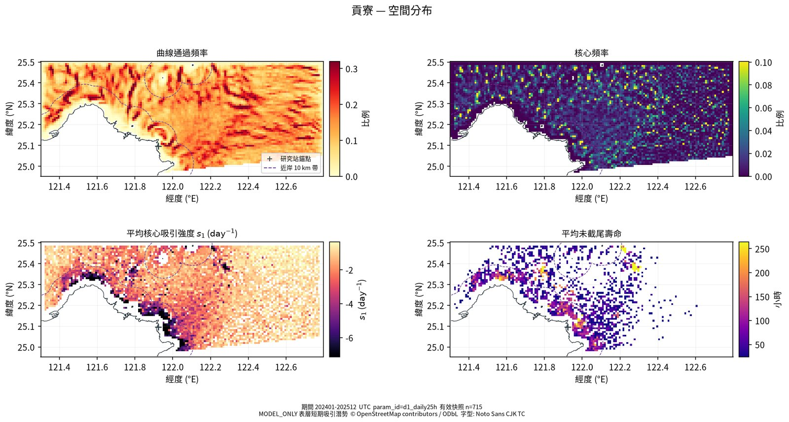{width=6.3in}

**圖乙-2  日產品貢寮：曲線通過頻率、核心頻率、平均核心 $s_1$（每日）與平均未截尾壽命（2×2；有效快照 n = 715；虛線為 10 公里近岸帶）**

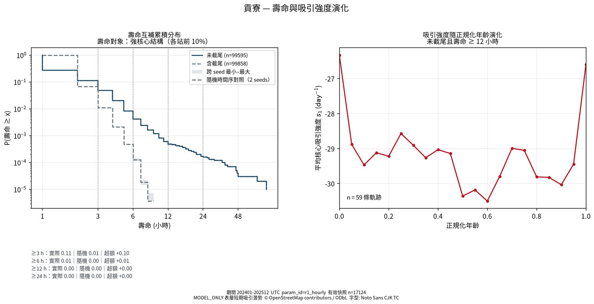{width=6.3in}

**圖乙-3  逐時貢寮：強核心結構壽命互補累積分布（實線為未截尾，n = 99,595；灰色為隨機對照）與壽命不小於 12 小時結構軌跡之平均 $s_1$ 隨正規化年齡之演化**

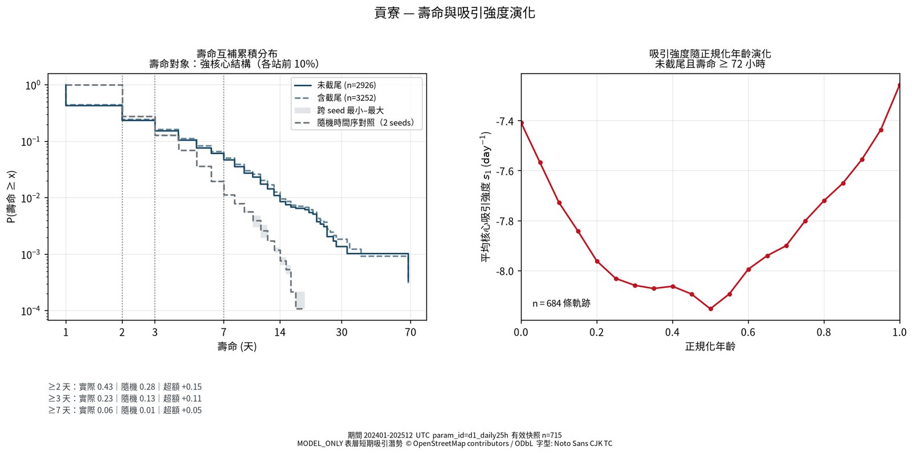{width=6.3in}

**圖乙-4  日產品貢寮：壽命互補累積分布（未截尾 n = 2,926）與壽命不小於 72 小時結構軌跡之平均 $s_1$ 隨正規化年齡之演化**

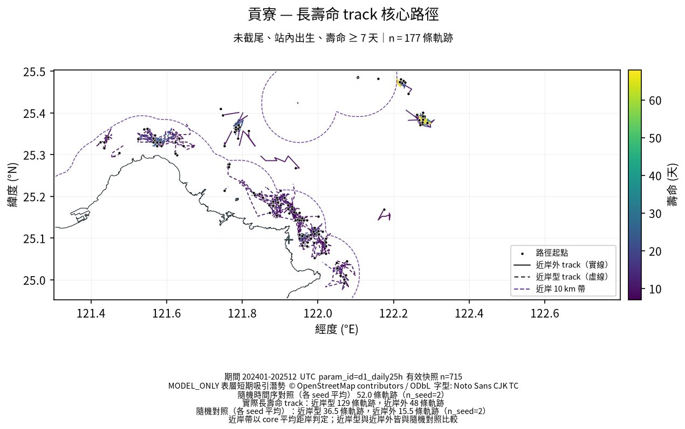{width=6.3in}

**圖乙-5  日產品貢寮：壽命不小於 168 小時（7 天）之核心路徑，共 177 條（近岸型 129、近岸外 48）；隨機對照各種子平均 52 條（近岸型 36.5、近岸外 15.5）**

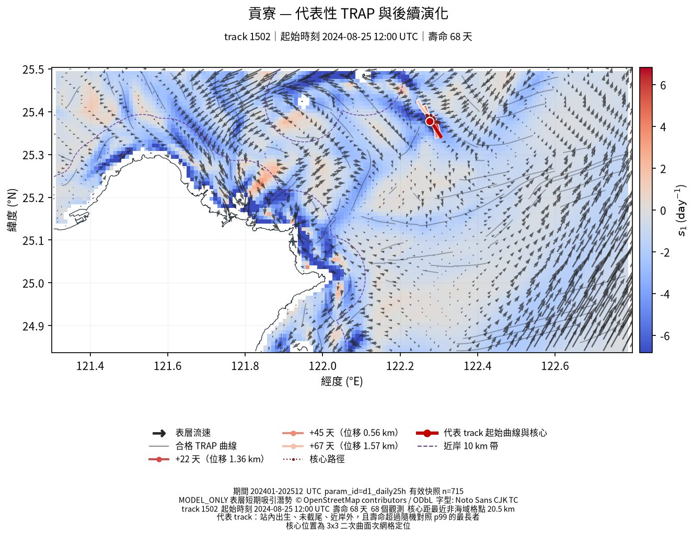{width=6.3in}

**圖乙-6  日產品貢寮：代表性 TRAP（結構軌跡 1502，起始 2024-08-25 12:00 UTC，壽命 1632 小時，68 個觀測，核心平均距岸 20.5 公里；選取準則近岸外且壽命超過隨機對照；隨機對照之第 99 百分位數壽命 168 小時）**

### 2、龜山島西側

　　龜山島西側位於流場區域 A（與另一研究站共用同一流場，以最近錨點互斥分割統計歸屬），站點分析區面積 4330.7 平方公里。逐時產品有 17,124 個有效快照，日產品有 715 個，皆為全部標準快照。圖乙-7至圖乙-12與表乙-7至表乙-9呈現龜山島西側之結果。

　　在頻率方面，逐時產品之核心出現率與曲線出現率皆為 100%（17,124 個有效快照皆至少有一個核心與一條曲線），不具區辨力；強核心出現率為 95.32%（16,323／17,124，95% 信賴區間 94.53–95.99%），曲線通過格點比例為 10.97%（95% 信賴區間 10.90–11.04%），即每個快照約有 11% 之站內格點被 TRAP 曲線通過。日產品之核心出現率與曲線出現率同為 100%；強核心出現率為 99.02%（708／715，95% 信賴區間 98.32–99.58%），曲線通過格點比例為 13.45%（95% 信賴區間 13.32–13.58%）。核心密度逐時為 13.06、日產品為 14.12 個每 1,000 平方公里每快照。

　　在強度方面，逐時產品之強核心門檻為 −13.43 每日（−1.554×10⁻⁴ 每秒）；站內合格核心共 968,760 個，核心 $s_1$ 之中位數與第 10 百分位數為 −2.674 與 −13.43 每日。熱點共 438 格、433.76 平方公里，熱點門檻（曲線通過頻率）為 0.1706，熱點內平均通過頻率 0.2124，熱點內核心平均 $s_1$ 為 −5.669 每日，該站強核心有 34.45% 落在熱點格點內。日產品之強核心門檻為 −5.887 每日（−6.814×10⁻⁵ 每秒），核心 $s_1$ 之中位數與第 10 百分位數為 −1.285 與 −5.887 每日；熱點 445 格、440.65 平方公里，門檻 0.2252，熱點內平均通過頻率 0.3039，熱點內核心平均 $s_1$ 為 −2.754 每日，強核心有 56.31% 落在熱點格點內。日產品之強核心門檻與核心強度量值小於逐時產品，與 25 小時平均抑制潮汐與高頻應變一致；熱點為相對定義，面積約為站內面積之 10%。

　　在生命週期方面，逐時產品共追蹤 55,797 條強核心結構軌跡，其中未截尾 55,647 條；壽命平均 1.747 小時、中位數 1 小時、第 90 百分位數為 3 小時；隨機對照之壽命中位數與第 90 百分位數為 1 與 1 小時。壽命不小於 3 小時者，真實為 17.03%、隨機對照為 0.5401%、超額 16.49%、比值 31.5×；壽命不小於 6 小時者，真實為 2.338%、隨機對照為 0.003827%、超額 2.334%、比值 611×；壽命不小於 12 小時者，真實為 0.23%、隨機對照為 0%、超額 0.23%（隨機對照為 0，無比值）（約 128 條）；壽命不小於 24 小時者僅 16 條（0.02875%，隨機對照為 0%），樣本數不足（不大於 20 條），不宜解讀。

　　日產品共追蹤 1,761 條強核心結構軌跡，其中未截尾 1,576 條；壽命平均 56.07 小時、中位數 24 小時（1 日）、第 90 百分位數為 96 小時（4 日）；隨機對照之壽命中位數與第 90 百分位數為 24 與 72 小時。壽命不小於 48 小時者，真實為 42.2%、隨機對照為 28.11%、超額 14.08%、比值 1.5×；壽命不小於 72 小時者，真實為 22.34%、隨機對照為 11.66%、超額 10.68%、比值 1.92×；壽命不小於 168 小時者，真實為 4.759%、隨機對照為 0.7037%、超額 4.055%、比值 6.76×。站內出生、未截尾、壽命不小於 168 小時（7 天）之長壽命結構軌跡有 74 條。壽命 48 與 72 小時之比值較低，表示 2–3 天之壽命有相當部分可由機會串接解釋。

　　在近岸與近岸外方面（緩衝帶 10 公里），逐時產品之全部核心有 20.92% 位於近岸帶，強核心則有 51.44%；日產品分別為 16.26% 與 35.52%。強核心之近岸比例高於全部核心之近岸比例，顯示強核心偏向近岸。近岸外強核心出現率（門檻不變）逐時為 80.79%、日產品為 94.27%。熱點面積有 10.73%（逐時）與 7.192%（日產品）位於近岸帶；只在近岸外格點重取分位數之熱點，逐時為 368 格、平均通過頻率 0.2174，日產品為 374 格、平均通過頻率 0.3133。

　　長壽命結構軌跡位於近岸帶之比例，逐時產品為 0%（長壽命結構軌跡 16 條，樣本數不足，不宜解讀），日產品為 32.43%（74 條）。日產品中，未截尾結構軌跡近岸外 852 條、近岸型 724 條；壽命分數（真實與隨機對照）依序為：不小於 48 小時：近岸外 44.01%（隨機對照 31.91%）、近岸型 40.06%（隨機對照 22.88%）；不小於 72 小時：近岸外 25.23%（隨機對照 14.76%）、近岸型 18.92%（隨機對照 7.371%）；不小於 168 小時：近岸外 5.869%（隨機對照 1.085%）、近岸型 3.453%（隨機對照 0.1759%）。逐時產品中，近岸外 26,052 條、近岸型 29,595 條；不小於 3 小時：近岸外 17.82%（隨機對照 0.8059%）、近岸型 16.34%（隨機對照 0.2945%）；不小於 6 小時：近岸外 2.956%（隨機對照 0.006829%）、近岸型 1.794%（隨機對照 0.001052%）；不小於 12 小時：近岸外 0.4222%（隨機對照 0%）、近岸型 0.06082%（隨機對照 0%）；不小於 24 小時：近岸外 0.06142%（隨機對照 0%）、近岸型 0%（隨機對照 0%）。逐時近岸外不小於 24 小時者只有 16 條，不宜解讀。

　　在傳播速度方面（模型內 TRAP 核心之位移，不是水體或漂浮物速度），逐時產品已擬合 776 條結構軌跡（移動 635 條、靜止 141 條，靜止比例 18.17%）；移動結構軌跡之速度中位數 9.533、第 90 百分位數為 20.47 公里每日，東向與北向分量中位數為 −1.38 與 −2.88 公里每日，位置擬合殘差均方根中位數 683.6 公尺。日產品已擬合 424 條（移動 285 條、靜止 139 條，靜止比例 32.78%），速度中位數 0.7523、第 90 百分位數為 2.051 公里每日，東向與北向分量中位數 0.0427 與 0.00241 公里每日，殘差均方根中位數 665.3 公尺。逐時（至少 7 個觀測）與日產品（至少 3 個觀測）之樣本不可直接對照。

　　在季節分層方面，逐時產品之曲線通過格點比例以春季（3–5 月）最大（11.14%）、夏季（6–8 月）最小（10.86%），兩者之 95% 信賴區間重疊；強核心出現率以冬季（12–2 月）最低（89.33%），其餘季節依序為春季（3–5 月） 94.45%、夏季（6–8 月） 98.97%、秋季（9–11 月） 98.49%。日產品之曲線通過格點比例以春季（3–5 月）最大（13.78%）、秋季（9–11 月）最小（13.14%），兩者之 95% 信賴區間不重疊；強核心出現率以冬季（12–2 月）最低（97.21%），其餘季節依序為春季（3–5 月） 98.87%、夏季（6–8 月） 100%、秋季（9–11 月） 100%。季節分層僅涵蓋兩個年度，只描述分層數值，不能推論氣候季節性或年際變異。

**表乙-7  龜山島西側關鍵統計**

| 指標 | 逐時產品 | 日產品 |
|---|---|---|
| 站點分析區面積（平方公里） | 4330.7 | 4330.7 |
| 有效快照數 | 17,124 | 715 |
| 強核心門檻（每日；每秒） | −13.43；−1.554×10⁻⁴ | −5.887；−6.814×10⁻⁵ |
| 強核心出現率（分子／分母；95% 信賴區間） | 95.32%（16,323／17,124） （94.53–95.99%） | 99.02%（708／715） （98.32–99.58%） |
| 核心出現率／曲線出現率 | 100%／100%（無區辨力） | 100%／100%（無區辨力） |
| 曲線通過格點比例（95% 信賴區間） | 10.97% （10.90–11.04%） | 13.45% （13.32–13.58%） |
| 核心密度（個每 1,000 平方公里每快照） | 13.06 | 14.12 |
| 合格核心總數 | 968,760 | 43,714 |
| 核心 $s_1$ 中位數／第 10 百分位數（每日） | −2.674／−13.43 | −1.285／−5.887 |
| 熱點面積（平方公里）（格數） | 433.76（438） | 440.65（445） |
| 熱點門檻（曲線通過頻率）／熱點內平均頻率 | 0.1706／0.2124 | 0.2252／0.3039 |
| 熱點內核心平均 $s_1$（每日） | −5.669 | −2.754 |
| 熱點內強核心比例（占該站強核心） | 34.45% | 56.31% |
| 熱點面積位於 10 公里近岸帶比例 | 10.73% | 7.192% |
| 近岸外熱點格數／平均通過頻率 | 368／0.2174 | 374／0.3133 |
| 全部核心位於 10 公里近岸帶比例 | 20.92% | 16.26% |
| 強核心位於 10 公里近岸帶比例 | 51.44% | 35.52% |
| 近岸外強核心出現率 | 80.79% | 94.27% |
| 強核心結構軌跡數（全部／未截尾） | 55,797／55,647 | 1,761／1,576 |
| 壽命平均／中位數／第 90 百分位數（小時） | 1.747／1／3 | 56.07／24／96 |
| 隨機對照壽命中位數／第 90 百分位數（小時） | 1／1 | 24／72 |
| 長壽命結構軌跡數（未截尾、站內出生）；位於近岸帶比例 | 16；0%（樣本數不足，不宜解讀） | 74；32.43% |
| 傳播：已擬合結構軌跡數（移動／靜止） | 776（635／141） | 424（285／139） |
| 傳播：靜止比例 | 18.17% | 32.78% |
| 傳播：速度中位數／第 90 百分位數（公里每日，僅移動結構軌跡） | 9.533／20.47 | 0.7523／2.051 |
| 傳播：東向／北向分量中位數（公里每日） | −1.38／−2.88 | 0.0427／0.00241 |
| 傳播：位置擬合殘差均方根中位數（公尺） | 683.6 | 665.3 |

資料來源：本計畫逐站統計檔（分層：全部）；龜山島西側站點分析區；熱點與強核心皆為本站相對定義；括號內為逐日區塊重抽樣之 95% 信賴區間。

**表乙-8  龜山島西側壽命分數：真實與隨機對照**

| 產品與門檻 | 類別 | 真實 | 隨機對照 | 超額 | 比值 |
|---|---|---|---|---|---|
| 逐時 ≥ 3 小時 | 全部 | 17.03% | 0.5401% | 16.49% | 31.5× |
|  | 近岸外 | 17.82% | 0.8059% | 17.01% | — |
|  | 近岸型 | 16.34% | 0.2945% | 16.05% | — |
| 逐時 ≥ 6 小時 | 全部 | 2.338% | 0.003827% | 2.334% | 611× |
|  | 近岸外 | 2.956% | 0.006829% | 2.949% | — |
|  | 近岸型 | 1.794% | 0.001052% | 1.793% | — |
| 逐時 ≥ 12 小時 | 全部 | 0.23% | 0% | 0.23% | — |
|  | 近岸外 | 0.4222% | 0% | 0.4222% | — |
|  | 近岸型 | 0.06082% | 0% | 0.06082% | — |
| 逐時 ≥ 24 小時（樣本不足） | 全部 | 0.02875% | 0% | 0.02875% | — |
|  | 近岸外 | 0.06142% | 0% | 0.06142% | — |
|  | 近岸型 | 0% | 0% | 0% | — |
| 日產品 ≥ 48 小時 | 全部 | 42.2% | 28.11% | 14.08% | 1.5× |
|  | 近岸外 | 44.01% | 31.91% | 12.11% | — |
|  | 近岸型 | 40.06% | 22.88% | 17.18% | — |
| 日產品 ≥ 72 小時 | 全部 | 22.34% | 11.66% | 10.68% | 1.92× |
|  | 近岸外 | 25.23% | 14.76% | 10.48% | — |
|  | 近岸型 | 18.92% | 7.371% | 11.55% | — |
| 日產品 ≥ 168 小時 | 全部 | 4.759% | 0.7037% | 4.055% | 6.76× |
|  | 近岸外 | 5.869% | 1.085% | 4.783% | — |
|  | 近岸型 | 3.453% | 0.1759% | 3.277% | — |

資料來源：本計畫逐站統計檔；壽命分數為未截尾結構軌跡中壽命不小於門檻者之比例，隨機對照為兩個種子平均；隨機對照為 0 時比值不定義，以「—」表示；近岸外與近岸型各列之比值未計算（以「—」表示）；「樣本不足」表示該門檻之長壽命結構軌跡不大於 20 條，樣本數不足，不宜解讀；未截尾結構軌跡數：逐時真實 55,647（近岸外 26,052、近岸型 29,595），隨機對照平均 91,462；日產品真實 1,576（近岸外 852、近岸型 724），隨機對照平均 2,698。

**表乙-9  龜山島西側季節分層**

| 季節 | 產品 | 快照數 | 強核心出現率 | 曲線通過格點比例（95% 信賴區間） |
|---|---|---|---|---|
| 冬季 | 逐時產品 | 4,284 | 89.33% | 10.86% （10.73–11.00%） |
|  | 日產品 | 179 | 97.21% | 13.61% （13.34–13.87%） |
| 春季 | 逐時產品 | 4,238 | 94.45% | 11.14% （10.98–11.30%） |
|  | 日產品 | 177 | 98.87% | 13.78% （13.48–14.08%） |
| 夏季 | 逐時產品 | 4,364 | 98.97% | 10.86% （10.74–10.99%） |
|  | 日產品 | 182 | 100% | 13.27% （13.01–13.57%） |
| 秋季 | 逐時產品 | 4,238 | 98.49% | 11.02% （10.90–11.14%） |
|  | 日產品 | 177 | 100% | 13.14% （12.90–13.37%） |

資料來源：本計畫逐站統計檔（分層為冬季（12–2 月）、春季（3–5 月）、夏季（6–8 月）、秋季（9–11 月））；季節分層僅涵蓋兩個年度。

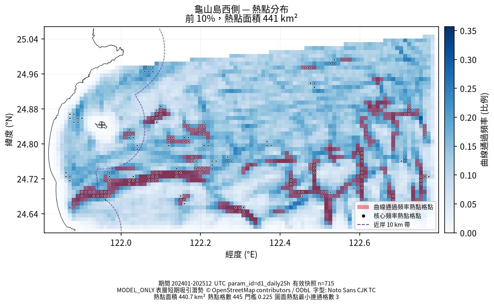{width=6.3in}

**圖乙-7  日產品龜山島西側：曲線通過頻率前 10% 熱點（445 格，440.65 平方公里，門檻 0.225）**

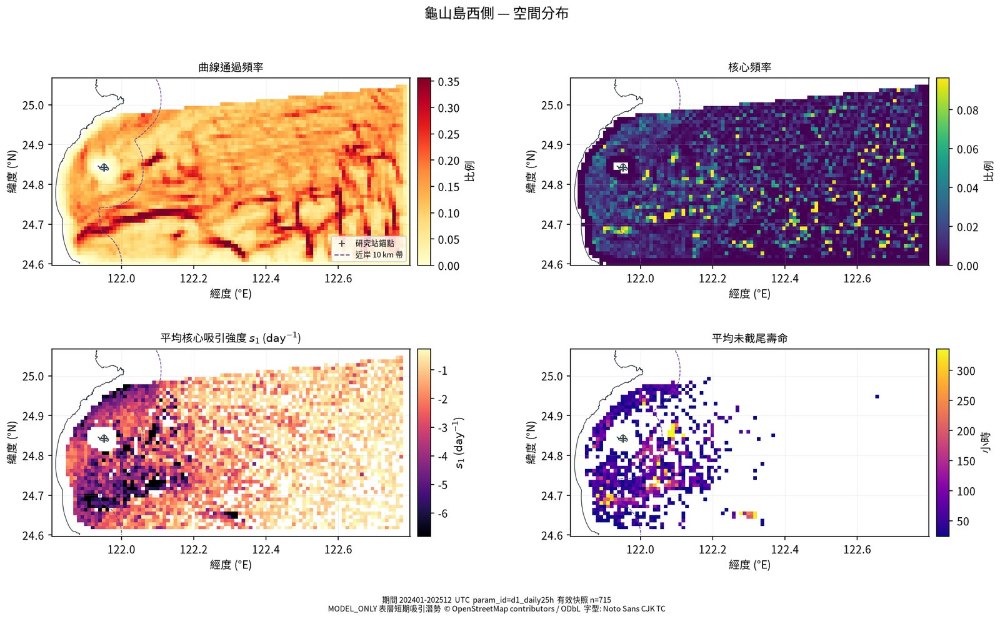{width=6.3in}

**圖乙-8  日產品龜山島西側：曲線通過頻率、核心頻率、平均核心 $s_1$（每日）與平均未截尾壽命（2×2；有效快照 n = 715；虛線為 10 公里近岸帶）**

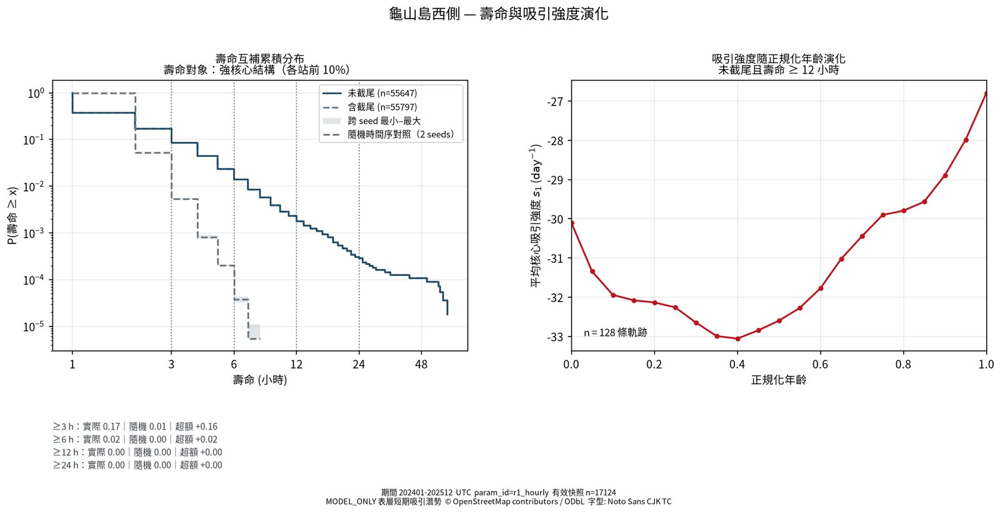{width=6.3in}

**圖乙-9  逐時龜山島西側：強核心結構壽命互補累積分布（實線為未截尾，n = 55,647；灰色為隨機對照）與壽命不小於 12 小時結構軌跡之平均 $s_1$ 隨正規化年齡之演化**

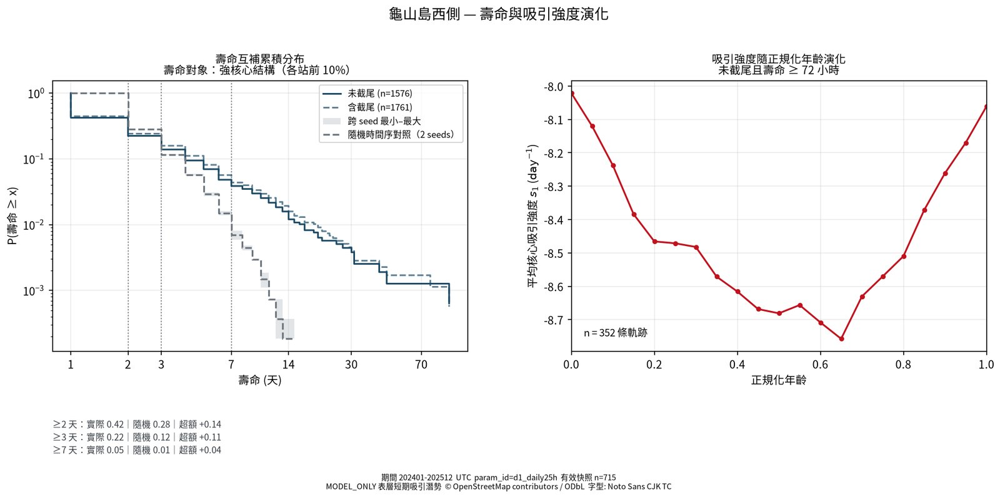{width=6.3in}

**圖乙-10  日產品龜山島西側：壽命互補累積分布（未截尾 n = 1,576）與壽命不小於 72 小時結構軌跡之平均 $s_1$ 隨正規化年齡之演化**

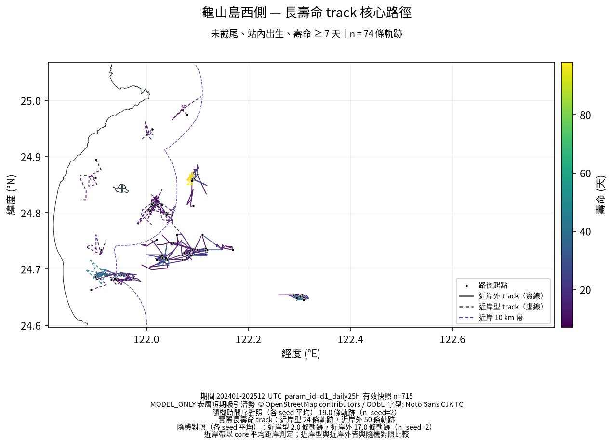{width=6.3in}

**圖乙-11  日產品龜山島西側：壽命不小於 168 小時（7 天）之核心路徑，共 74 條（近岸型 24、近岸外 50）；隨機對照各種子平均 19 條（近岸型 2、近岸外 17）**

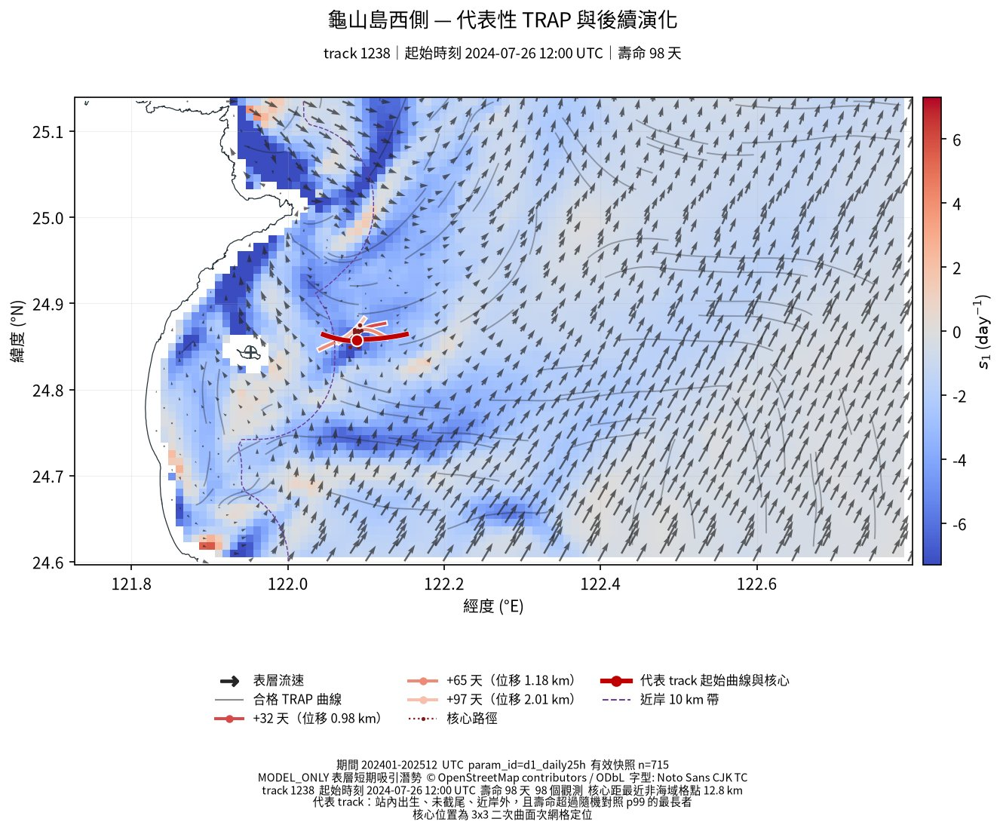{width=6.3in}

**圖乙-12  日產品龜山島西側：代表性 TRAP（結構軌跡 1238，起始 2024-07-26 12:00 UTC，壽命 2352 小時，98 個觀測，核心平均距岸 12.8 公里；選取準則近岸外且壽命超過隨機對照；隨機對照之第 99 百分位數壽命 144 小時）**

### 3、新竹外海

　　新竹外海位於流場區域 B（使用完整流場區域之分析海域），站點分析區面積 11738 平方公里。逐時產品有 17,124 個有效快照，日產品有 715 個，皆為全部標準快照。圖乙-13至圖乙-18與表乙-10至表乙-12呈現新竹外海之結果。

　　在頻率方面，逐時產品之核心出現率與曲線出現率皆為 100%（17,124 個有效快照皆至少有一個核心與一條曲線），不具區辨力；強核心出現率為 99.02%（16,957／17,124，95% 信賴區間 98.75–99.30%），曲線通過格點比例為 15.53%（95% 信賴區間 15.42–15.64%），即每個快照約有 15.5% 之站內格點被 TRAP 曲線通過。日產品之核心出現率與曲線出現率同為 100%；強核心出現率為 97.76%（699／715，95% 信賴區間 96.64–98.74%），曲線通過格點比例為 15.94%（95% 信賴區間 15.82–16.06%）。核心密度逐時為 17.55、日產品為 17.29 個每 1,000 平方公里每快照。

　　在強度方面，逐時產品之強核心門檻為 −2.98 每日（−3.449×10⁻⁵ 每秒）；站內合格核心共 3,528,213 個，核心 $s_1$ 之中位數與第 10 百分位數為 −0.9044 與 −2.98 每日。熱點共 1,190 格、1175.8 平方公里，熱點門檻（曲線通過頻率）為 0.2376，熱點內平均通過頻率 0.2861，熱點內核心平均 $s_1$ 為 −1.377 每日，該站強核心有 26.15% 落在熱點格點內。日產品之強核心門檻為 −2.004 每日（−2.319×10⁻⁵ 每秒），核心 $s_1$ 之中位數與第 10 百分位數為 −0.6999 與 −2.004 每日；熱點 1,202 格、1187.3 平方公里，門檻 0.2685，熱點內平均通過頻率 0.3392，熱點內核心平均 $s_1$ 為 −1.083 每日，強核心有 40.88% 落在熱點格點內。日產品之強核心門檻與核心強度量值小於逐時產品，與 25 小時平均抑制潮汐與高頻應變一致；熱點為相對定義，面積約為站內面積之 10%。

　　在生命週期方面，逐時產品共追蹤 167,536 條強核心結構軌跡，其中未截尾 166,998 條；壽命平均 2.105 小時、中位數 1 小時、第 90 百分位數為 4 小時；隨機對照之壽命中位數與第 90 百分位數為 1 與 1 小時。壽命不小於 3 小時者，真實為 25.02%、隨機對照為 1.275%、超額 23.74%、比值 19.6×；壽命不小於 6 小時者，真實為 5.371%、隨機對照為 0.01363%、超額 5.358%、比值 394×；壽命不小於 12 小時者，真實為 0.4808%、隨機對照為 0%、超額 0.4808%（隨機對照為 0，無比值）（約 803 條）；壽命不小於 24 小時者僅 20 條（0.01198%，隨機對照為 0%），樣本數不足（不大於 20 條），不宜解讀。

　　日產品共追蹤 7,114 條強核心結構軌跡，其中未截尾 6,543 條；壽命平均 47.75 小時、中位數 24 小時（1 日）、第 90 百分位數為 96 小時（4 日）；隨機對照之壽命中位數與第 90 百分位數為 24 與 48 小時。壽命不小於 48 小時者，真實為 38.76%、隨機對照為 20.69%、超額 18.07%、比值 1.87×；壽命不小於 72 小時者，真實為 19%、隨機對照為 7.649%、超額 11.35%、比值 2.48×；壽命不小於 168 小時者，真實為 3.79%、隨機對照為 0.3348%、超額 3.455%、比值 11.3×。站內出生、未截尾、壽命不小於 168 小時（7 天）之長壽命結構軌跡有 248 條。壽命 48 與 72 小時之比值較低，表示 2–3 天之壽命有相當部分可由機會串接解釋。

　　在近岸與近岸外方面（緩衝帶 10 公里），逐時產品之全部核心有 13.82% 位於近岸帶，強核心則有 59.37%；日產品分別為 13.26% 與 58.63%。強核心之近岸比例高於全部核心之近岸比例，顯示強核心偏向近岸。近岸外強核心出現率（門檻不變）逐時為 79.13%、日產品為 76.64%。熱點面積有 14.79%（逐時）與 16.22%（日產品）位於近岸帶；只在近岸外格點重取分位數之熱點，逐時為 1,059 格、平均通過頻率 0.2818，日產品為 1,066 格、平均通過頻率 0.3306。

　　長壽命結構軌跡位於近岸帶之比例，逐時產品為 90%（長壽命結構軌跡 20 條，樣本數不足，不宜解讀），日產品為 85.08%（248 條）。日產品中，未截尾結構軌跡近岸外 3,637 條、近岸型 2,906 條；壽命分數（真實與隨機對照）依序為：不小於 48 小時：近岸外 28.73%（隨機對照 6.913%）、近岸型 51.31%（隨機對照 35.16%）；不小於 72 小時：近岸外 10.75%（隨機對照 1.018%）、近岸型 29.32%（隨機對照 14.61%）；不小於 168 小時：近岸外 1.017%（隨機對照 0.02878%）、近岸型 7.261%（隨機對照 0.6556%）。逐時產品中，近岸外 80,062 條、近岸型 86,936 條；不小於 3 小時：近岸外 17.95%（隨機對照 0.02751%）、近岸型 31.52%（隨機對照 2.252%）；不小於 6 小時：近岸外 2.909%（隨機對照 0%）、近岸型 7.639%（隨機對照 0.02429%）；不小於 12 小時：近岸外 0.1998%（隨機對照 0%）、近岸型 0.7396%（隨機對照 0%）；不小於 24 小時：近岸外 0.002498%（隨機對照 0%）、近岸型 0.0207%（隨機對照 0%）。逐時近岸外不小於 24 小時者只有 2 條，不宜解讀。

　　在傳播速度方面（模型內 TRAP 核心之位移，不是水體或漂浮物速度），逐時產品已擬合 5,672 條結構軌跡（移動 4,382 條、靜止 1,290 條，靜止比例 22.74%）；移動結構軌跡之速度中位數 7.827、第 90 百分位數為 15.97 公里每日，東向與北向分量中位數為 0 與 2.95 公里每日，位置擬合殘差均方根中位數 536.3 公尺。日產品已擬合 1,412 條（移動 1,024 條、靜止 388 條，靜止比例 27.48%），速度中位數 0.9351、第 90 百分位數為 2.151 公里每日，東向與北向分量中位數 0.0156 與 0.026 公里每日，殘差均方根中位數 763.1 公尺。逐時（至少 7 個觀測）與日產品（至少 3 個觀測）之樣本不可直接對照。

　　在季節分層方面，逐時產品之曲線通過格點比例以冬季（12–2 月）最大（16.42%）、夏季（6–8 月）最小（14.53%），兩者之 95% 信賴區間不重疊；強核心出現率以冬季（12–2 月）最低（97.74%），其餘季節依序為春季（3–5 月） 99.93%、夏季（6–8 月） 100%、秋季（9–11 月） 98.42%。日產品之曲線通過格點比例以春季（3–5 月）最大（16.36%）、夏季（6–8 月）最小（15.74%），兩者之 95% 信賴區間不重疊；強核心出現率以冬季（12–2 月）最低（92.74%），其餘季節依序為春季（3–5 月） 100%、夏季（6–8 月） 100%、秋季（9–11 月） 98.31%。季節分層僅涵蓋兩個年度，只描述分層數值，不能推論氣候季節性或年際變異。

**表乙-10  新竹外海關鍵統計**

| 指標 | 逐時產品 | 日產品 |
|---|---|---|
| 站點分析區面積（平方公里） | 11738 | 11738 |
| 有效快照數 | 17,124 | 715 |
| 強核心門檻（每日；每秒） | −2.98；−3.449×10⁻⁵ | −2.004；−2.319×10⁻⁵ |
| 強核心出現率（分子／分母；95% 信賴區間） | 99.02%（16,957／17,124） （98.75–99.30%） | 97.76%（699／715） （96.64–98.74%） |
| 核心出現率／曲線出現率 | 100%／100%（無區辨力） | 100%／100%（無區辨力） |
| 曲線通過格點比例（95% 信賴區間） | 15.53% （15.42–15.64%） | 15.94% （15.82–16.06%） |
| 核心密度（個每 1,000 平方公里每快照） | 17.55 | 17.29 |
| 合格核心總數 | 3,528,213 | 145,111 |
| 核心 $s_1$ 中位數／第 10 百分位數（每日） | −0.9044／−2.98 | −0.6999／−2.004 |
| 熱點面積（平方公里）（格數） | 1175.8（1,190） | 1187.3（1,202） |
| 熱點門檻（曲線通過頻率）／熱點內平均頻率 | 0.2376／0.2861 | 0.2685／0.3392 |
| 熱點內核心平均 $s_1$（每日） | −1.377 | −1.083 |
| 熱點內強核心比例（占該站強核心） | 26.15% | 40.88% |
| 熱點面積位於 10 公里近岸帶比例 | 14.79% | 16.22% |
| 近岸外熱點格數／平均通過頻率 | 1,059／0.2818 | 1,066／0.3306 |
| 全部核心位於 10 公里近岸帶比例 | 13.82% | 13.26% |
| 強核心位於 10 公里近岸帶比例 | 59.37% | 58.63% |
| 近岸外強核心出現率 | 79.13% | 76.64% |
| 強核心結構軌跡數（全部／未截尾） | 167,536／166,998 | 7,114／6,543 |
| 壽命平均／中位數／第 90 百分位數（小時） | 2.105／1／4 | 47.75／24／96 |
| 隨機對照壽命中位數／第 90 百分位數（小時） | 1／1 | 24／48 |
| 長壽命結構軌跡數（未截尾、站內出生）；位於近岸帶比例 | 20；90%（樣本數不足，不宜解讀） | 248；85.08% |
| 傳播：已擬合結構軌跡數（移動／靜止） | 5,672（4,382／1,290） | 1,412（1,024／388） |
| 傳播：靜止比例 | 22.74% | 27.48% |
| 傳播：速度中位數／第 90 百分位數（公里每日，僅移動結構軌跡） | 7.827／15.97 | 0.9351／2.151 |
| 傳播：東向／北向分量中位數（公里每日） | 0／2.95 | 0.0156／0.026 |
| 傳播：位置擬合殘差均方根中位數（公尺） | 536.3 | 763.1 |

資料來源：本計畫逐站統計檔（分層：全部）；新竹外海站點分析區；熱點與強核心皆為本站相對定義；括號內為逐日區塊重抽樣之 95% 信賴區間。

**表乙-11  新竹外海壽命分數：真實與隨機對照**

| 產品與門檻 | 類別 | 真實 | 隨機對照 | 超額 | 比值 |
|---|---|---|---|---|---|
| 逐時 ≥ 3 小時 | 全部 | 25.02% | 1.275% | 23.74% | 19.6× |
|  | 近岸外 | 17.95% | 0.02751% | 17.92% | — |
|  | 近岸型 | 31.52% | 2.252% | 29.27% | — |
| 逐時 ≥ 6 小時 | 全部 | 5.371% | 0.01363% | 5.358% | 394× |
|  | 近岸外 | 2.909% | 0% | 2.909% | — |
|  | 近岸型 | 7.639% | 0.02429% | 7.615% | — |
| 逐時 ≥ 12 小時 | 全部 | 0.4808% | 0% | 0.4808% | — |
|  | 近岸外 | 0.1998% | 0% | 0.1998% | — |
|  | 近岸型 | 0.7396% | 0% | 0.7396% | — |
| 逐時 ≥ 24 小時（樣本不足） | 全部 | 0.01198% | 0% | 0.01198% | — |
|  | 近岸外 | 0.002498% | 0% | 0.002498% | — |
|  | 近岸型 | 0.0207% | 0% | 0.0207% | — |
| 日產品 ≥ 48 小時 | 全部 | 38.76% | 20.69% | 18.07% | 1.87× |
|  | 近岸外 | 28.73% | 6.913% | 21.82% | — |
|  | 近岸型 | 51.31% | 35.16% | 16.15% | — |
| 日產品 ≥ 72 小時 | 全部 | 19% | 7.649% | 11.35% | 2.48× |
|  | 近岸外 | 10.75% | 1.018% | 9.732% | — |
|  | 近岸型 | 29.32% | 14.61% | 14.71% | — |
| 日產品 ≥ 168 小時 | 全部 | 3.79% | 0.3348% | 3.455% | 11.3× |
|  | 近岸外 | 1.017% | 0.02878% | 0.9885% | — |
|  | 近岸型 | 7.261% | 0.6556% | 6.605% | — |

資料來源：本計畫逐站統計檔；壽命分數為未截尾結構軌跡中壽命不小於門檻者之比例，隨機對照為兩個種子平均；隨機對照為 0 時比值不定義，以「—」表示；近岸外與近岸型各列之比值未計算（以「—」表示）；「樣本不足」表示該門檻之長壽命結構軌跡不大於 20 條，樣本數不足，不宜解讀；未截尾結構軌跡數：逐時真實 166,998（近岸外 80,062、近岸型 86,936），隨機對照平均 322,902；日產品真實 6,543（近岸外 3,637、近岸型 2,906），隨機對照平均 10,153。

**表乙-12  新竹外海季節分層**

| 季節 | 產品 | 快照數 | 強核心出現率 | 曲線通過格點比例（95% 信賴區間） |
|---|---|---|---|---|
| 冬季 | 逐時產品 | 4,284 | 97.74% | 16.42% （16.24–16.59%） |
|  | 日產品 | 179 | 92.74% | 15.75% （15.52–15.96%） |
| 春季 | 逐時產品 | 4,238 | 99.93% | 15.57% （15.36–15.78%） |
|  | 日產品 | 177 | 100% | 16.36% （16.09–16.61%） |
| 夏季 | 逐時產品 | 4,364 | 100% | 14.53% （14.38–14.69%） |
|  | 日產品 | 182 | 100% | 15.74% （15.52–15.96%） |
| 秋季 | 逐時產品 | 4,238 | 98.42% | 15.62% （15.38–15.84%） |
|  | 日產品 | 177 | 98.31% | 15.91% （15.67–16.13%） |

資料來源：本計畫逐站統計檔（分層為冬季（12–2 月）、春季（3–5 月）、夏季（6–8 月）、秋季（9–11 月））；季節分層僅涵蓋兩個年度。

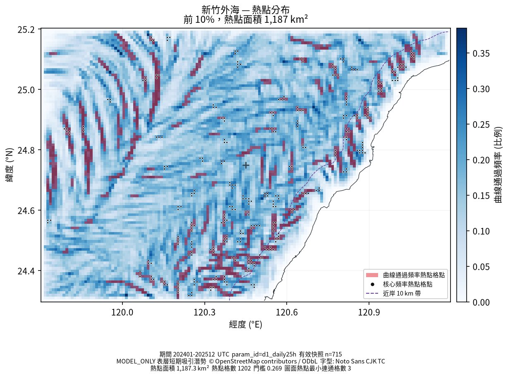{width=6.3in}

**圖乙-13  日產品新竹外海：曲線通過頻率前 10% 熱點（1,202 格，1187.3 平方公里，門檻 0.269）**

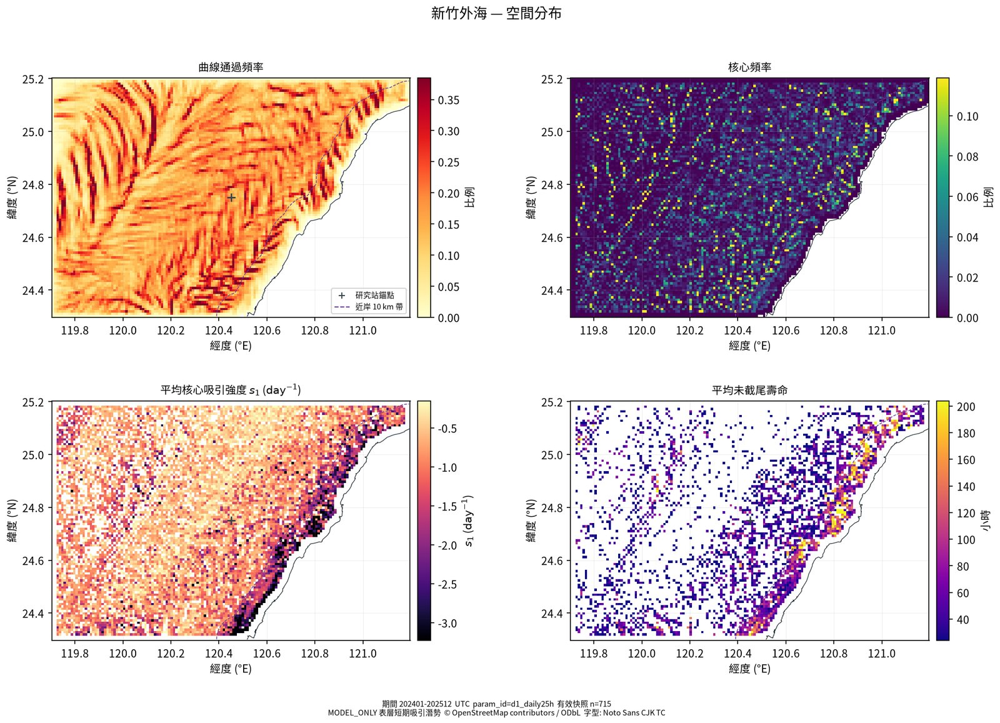{width=6.3in}

**圖乙-14  日產品新竹外海：曲線通過頻率、核心頻率、平均核心 $s_1$（每日）與平均未截尾壽命（2×2；有效快照 n = 715；虛線為 10 公里近岸帶）**

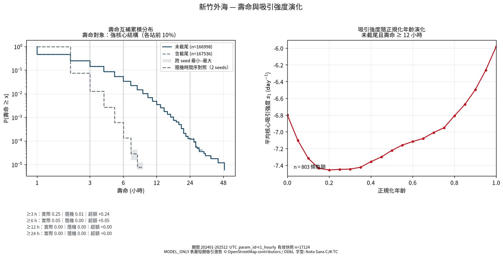{width=6.3in}

**圖乙-15  逐時新竹外海：強核心結構壽命互補累積分布（實線為未截尾，n = 166,998；灰色為隨機對照）與壽命不小於 12 小時結構軌跡之平均 $s_1$ 隨正規化年齡之演化**

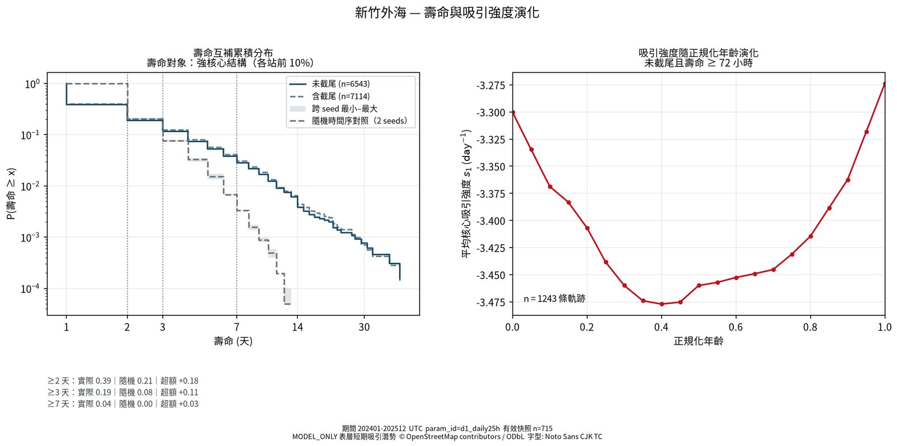{width=6.3in}

**圖乙-16  日產品新竹外海：壽命互補累積分布（未截尾 n = 6,543）與壽命不小於 72 小時結構軌跡之平均 $s_1$ 隨正規化年齡之演化**

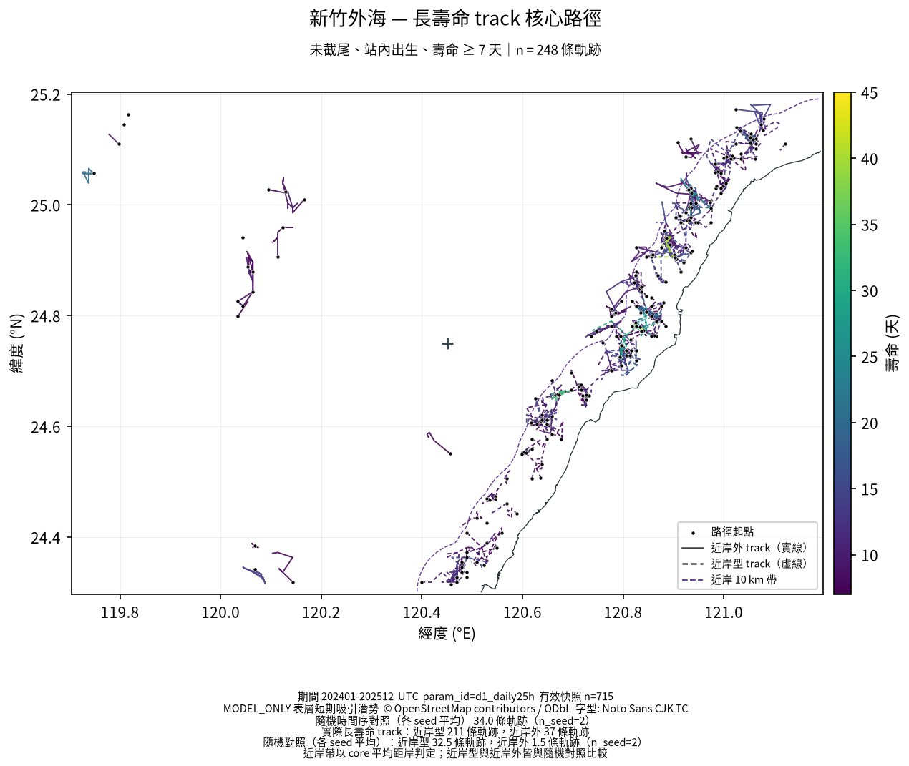{width=6.3in}

**圖乙-17  日產品新竹外海：壽命不小於 168 小時（7 天）之核心路徑，共 248 條（近岸型 211、近岸外 37）；隨機對照各種子平均 34 條（近岸型 32.5、近岸外 1.5）**

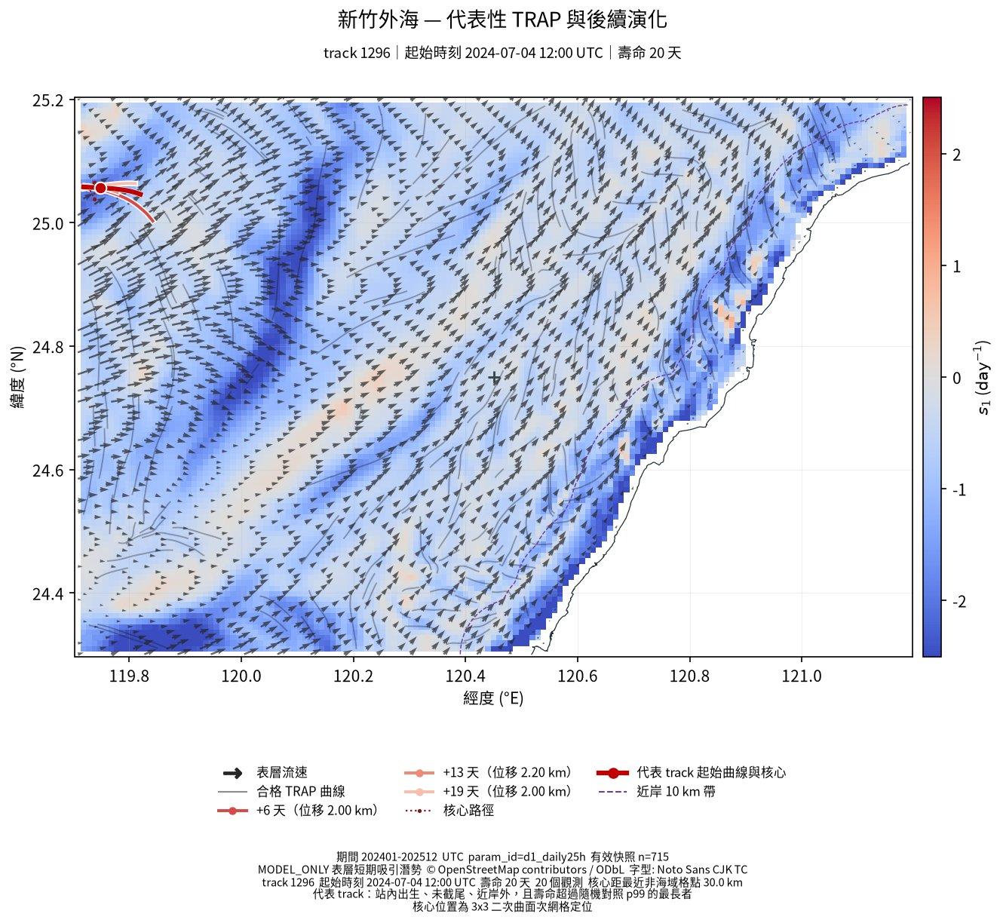{width=6.3in}

**圖乙-18  日產品新竹外海：代表性 TRAP（結構軌跡 1296，起始 2024-07-04 12:00 UTC，壽命 480 小時，20 個觀測，核心平均距岸 30 公里；選取準則近岸外且壽命超過隨機對照；隨機對照之第 99 百分位數壽命 120 小時）**

### 4、南灣

　　南灣位於流場區域 C（使用完整流場區域之分析海域），站點分析區面積 13591 平方公里。逐時產品有 17,124 個有效快照，日產品有 715 個，皆為全部標準快照。圖乙-19至圖乙-24與表乙-13至表乙-15呈現南灣之結果。

　　在頻率方面，逐時產品之核心出現率與曲線出現率皆為 100%（17,124 個有效快照皆至少有一個核心與一條曲線），不具區辨力；強核心出現率為 100%（17,124／17,124，95% 信賴區間 100.00–100.00%），曲線通過格點比例為 12.58%（95% 信賴區間 12.52–12.64%），即每個快照約有 12.6% 之站內格點被 TRAP 曲線通過。日產品之核心出現率與曲線出現率同為 100%；強核心出現率為 100%（715／715，95% 信賴區間 100.00–100.00%），曲線通過格點比例為 14.67%（95% 信賴區間 14.60–14.75%）。核心密度逐時為 15.4、日產品為 16.26 個每 1,000 平方公里每快照。

　　在強度方面，逐時產品之強核心門檻為 −8.447 每日（−9.776×10⁻⁵ 每秒）；站內合格核心共 3,584,375 個，核心 $s_1$ 之中位數與第 10 百分位數為 −2.149 與 −8.447 每日。熱點共 1,386 格、1359.8 平方公里，熱點門檻（曲線通過頻率）為 0.2035，熱點內平均通過頻率 0.2476，熱點內核心平均 $s_1$ 為 −4.769 每日，該站強核心有 42.86% 落在熱點格點內。日產品之強核心門檻為 −4.862 每日（−5.627×10⁻⁵ 每秒），核心 $s_1$ 之中位數與第 10 百分位數為 −1.263 與 −4.862 每日；熱點 1,389 格、1363.4 平方公里，門檻 0.2699，熱點內平均通過頻率 0.3598，熱點內核心平均 $s_1$ 為 −2.717 每日，強核心有 43.16% 落在熱點格點內。日產品之強核心門檻與核心強度量值小於逐時產品，與 25 小時平均抑制潮汐與高頻應變一致；熱點為相對定義，面積約為站內面積之 10%。

　　在生命週期方面，逐時產品共追蹤 159,976 條強核心結構軌跡，其中未截尾 159,431 條；壽命平均 2.238 小時、中位數 1 小時、第 90 百分位數為 4 小時；隨機對照之壽命中位數與第 90 百分位數為 1 與 2 小時。壽命不小於 3 小時者，真實為 25.35%、隨機對照為 2.837%、超額 22.52%、比值 8.94×；壽命不小於 6 小時者，真實為 6.586%、隨機對照為 0.1136%、超額 6.472%、比值 58×；壽命不小於 12 小時者，真實為 1.029%、隨機對照為 0.000488%、超額 1.029%、比值 2110×（約 1,641 條）；壽命不小於 24 小時者僅 243 條（0.1524%，隨機對照為 0%），樣本數尚可，但仍遠少於較短壽命之樣本。

　　日產品共追蹤 4,456 條強核心結構軌跡，其中未截尾 3,881 條；壽命平均 75.87 小時、中位數 48 小時（2 日）、第 90 百分位數為 168 小時（7 日）；隨機對照之壽命中位數與第 90 百分位數為 24 與 72 小時。壽命不小於 48 小時者，真實為 53.62%、隨機對照為 32.25%、超額 21.37%、比值 1.66×；壽命不小於 72 小時者，真實為 33.57%、隨機對照為 16.18%、超額 17.39%、比值 2.08×；壽命不小於 168 小時者，真實為 10.41%、隨機對照為 2.759%、超額 7.651%、比值 3.77×。站內出生、未截尾、壽命不小於 168 小時（7 天）之長壽命結構軌跡有 404 條。壽命 48 與 72 小時之比值較低，表示 2–3 天之壽命有相當部分可由機會串接解釋。

　　在近岸與近岸外方面（緩衝帶 10 公里），逐時產品之全部核心有 23.51% 位於近岸帶，強核心則有 80.28%；日產品分別為 19.39% 與 80.01%。強核心之近岸比例高於全部核心之近岸比例，顯示強核心偏向近岸。近岸外強核心出現率（門檻不變）逐時為 87.78%、日產品為 84.76%。熱點面積有 24.73%（逐時）與 15.4%（日產品）位於近岸帶；只在近岸外格點重取分位數之熱點，逐時為 1,094 格、平均通過頻率 0.2459，日產品為 1,100 格、平均通過頻率 0.366。

　　長壽命結構軌跡位於近岸帶之比例，逐時產品為 100%（長壽命結構軌跡 243 條），日產品為 85.15%（404 條）。日產品中，未截尾結構軌跡近岸外 1,116 條、近岸型 2,765 條；壽命分數（真實與隨機對照）依序為：不小於 48 小時：近岸外 50.09%（隨機對照 16.42%）、近岸型 55.05%（隨機對照 38.94%）；不小於 72 小時：近岸外 27.87%（隨機對照 4.96%）、近岸型 35.88%（隨機對照 20.92%）；不小於 168 小時：近岸外 5.376%（隨機對照 0.08553%）、近岸型 12.44%（隨機對照 3.887%）。逐時產品中，近岸外 41,916 條、近岸型 117,515 條；不小於 3 小時：近岸外 15.33%（隨機對照 0.3878%）、近岸型 28.93%（隨機對照 3.529%）；不小於 6 小時：近岸外 2.45%（隨機對照 0%）、近岸型 8.061%（隨機對照 0.1458%）；不小於 12 小時：近岸外 0.1909%（隨機對照 0%）、近岸型 1.328%（隨機對照 0.000626%）；不小於 24 小時：近岸外 0%（隨機對照 0%）、近岸型 0.2068%（隨機對照 0%）。逐時近岸外不小於 24 小時者只有 0 條，不宜解讀。

　　在傳播速度方面（模型內 TRAP 核心之位移，不是水體或漂浮物速度），逐時產品已擬合 7,180 條結構軌跡（移動 5,396 條、靜止 1,784 條，靜止比例 24.85%）；移動結構軌跡之速度中位數 7.459、第 90 百分位數為 17.19 公里每日，東向與北向分量中位數為 1.98 與 −0.533 公里每日，位置擬合殘差均方根中位數 594.9 公尺。日產品已擬合 1,601 條（移動 1,062 條、靜止 539 條，靜止比例 33.67%），速度中位數 0.6513、第 90 百分位數為 1.752 公里每日，東向與北向分量中位數 0.000008 與 0 公里每日，殘差均方根中位數 697.3 公尺。逐時（至少 7 個觀測）與日產品（至少 3 個觀測）之樣本不可直接對照。

　　在季節分層方面，逐時產品之曲線通過格點比例以冬季（12–2 月）最大（12.83%）、夏季（6–8 月）最小（12.35%），兩者之 95% 信賴區間不重疊；四季強核心出現率皆為 100%。日產品之曲線通過格點比例以冬季（12–2 月）最大（15.29%）、夏季（6–8 月）最小（14.24%），兩者之 95% 信賴區間不重疊；四季強核心出現率皆為 100%。季節分層僅涵蓋兩個年度，只描述分層數值，不能推論氣候季節性或年際變異。

**表乙-13  南灣關鍵統計**

| 指標 | 逐時產品 | 日產品 |
|---|---|---|
| 站點分析區面積（平方公里） | 13591 | 13591 |
| 有效快照數 | 17,124 | 715 |
| 強核心門檻（每日；每秒） | −8.447；−9.776×10⁻⁵ | −4.862；−5.627×10⁻⁵ |
| 強核心出現率（分子／分母；95% 信賴區間） | 100%（17,124／17,124） （100.00–100.00%） | 100%（715／715） （100.00–100.00%） |
| 核心出現率／曲線出現率 | 100%／100%（無區辨力） | 100%／100%（無區辨力） |
| 曲線通過格點比例（95% 信賴區間） | 12.58% （12.52–12.64%） | 14.67% （14.60–14.75%） |
| 核心密度（個每 1,000 平方公里每快照） | 15.4 | 16.26 |
| 合格核心總數 | 3,584,375 | 158,037 |
| 核心 $s_1$ 中位數／第 10 百分位數（每日） | −2.149／−8.447 | −1.263／−4.862 |
| 熱點面積（平方公里）（格數） | 1359.8（1,386） | 1363.4（1,389） |
| 熱點門檻（曲線通過頻率）／熱點內平均頻率 | 0.2035／0.2476 | 0.2699／0.3598 |
| 熱點內核心平均 $s_1$（每日） | −4.769 | −2.717 |
| 熱點內強核心比例（占該站強核心） | 42.86% | 43.16% |
| 熱點面積位於 10 公里近岸帶比例 | 24.73% | 15.4% |
| 近岸外熱點格數／平均通過頻率 | 1,094／0.2459 | 1,100／0.366 |
| 全部核心位於 10 公里近岸帶比例 | 23.51% | 19.39% |
| 強核心位於 10 公里近岸帶比例 | 80.28% | 80.01% |
| 近岸外強核心出現率 | 87.78% | 84.76% |
| 強核心結構軌跡數（全部／未截尾） | 159,976／159,431 | 4,456／3,881 |
| 壽命平均／中位數／第 90 百分位數（小時） | 2.238／1／4 | 75.87／48／168 |
| 隨機對照壽命中位數／第 90 百分位數（小時） | 1／2 | 24／72 |
| 長壽命結構軌跡數（未截尾、站內出生）；位於近岸帶比例 | 243；100% | 404；85.15% |
| 傳播：已擬合結構軌跡數（移動／靜止） | 7,180（5,396／1,784） | 1,601（1,062／539） |
| 傳播：靜止比例 | 24.85% | 33.67% |
| 傳播：速度中位數／第 90 百分位數（公里每日，僅移動結構軌跡） | 7.459／17.19 | 0.6513／1.752 |
| 傳播：東向／北向分量中位數（公里每日） | 1.98／−0.533 | 0.000008／0 |
| 傳播：位置擬合殘差均方根中位數（公尺） | 594.9 | 697.3 |

資料來源：本計畫逐站統計檔（分層：全部）；南灣站點分析區；熱點與強核心皆為本站相對定義；括號內為逐日區塊重抽樣之 95% 信賴區間。

**表乙-14  南灣壽命分數：真實與隨機對照**

| 產品與門檻 | 類別 | 真實 | 隨機對照 | 超額 | 比值 |
|---|---|---|---|---|---|
| 逐時 ≥ 3 小時 | 全部 | 25.35% | 2.837% | 22.52% | 8.94× |
|  | 近岸外 | 15.33% | 0.3878% | 14.94% | — |
|  | 近岸型 | 28.93% | 3.529% | 25.4% | — |
| 逐時 ≥ 6 小時 | 全部 | 6.586% | 0.1136% | 6.472% | 58× |
|  | 近岸外 | 2.45% | 0% | 2.45% | — |
|  | 近岸型 | 8.061% | 0.1458% | 7.915% | — |
| 逐時 ≥ 12 小時 | 全部 | 1.029% | 0.000488% | 1.029% | 2110× |
|  | 近岸外 | 0.1909% | 0% | 0.1909% | — |
|  | 近岸型 | 1.328% | 0.000626% | 1.328% | — |
| 逐時 ≥ 24 小時 | 全部 | 0.1524% | 0% | 0.1524% | — |
|  | 近岸外 | 0% | 0% | 0% | — |
|  | 近岸型 | 0.2068% | 0% | 0.2068% | — |
| 日產品 ≥ 48 小時 | 全部 | 53.62% | 32.25% | 21.37% | 1.66× |
|  | 近岸外 | 50.09% | 16.42% | 33.67% | — |
|  | 近岸型 | 55.05% | 38.94% | 16.1% | — |
| 日產品 ≥ 72 小時 | 全部 | 33.57% | 16.18% | 17.39% | 2.08× |
|  | 近岸外 | 27.87% | 4.96% | 22.91% | — |
|  | 近岸型 | 35.88% | 20.92% | 14.96% | — |
| 日產品 ≥ 168 小時 | 全部 | 10.41% | 2.759% | 7.651% | 3.77× |
|  | 近岸外 | 5.376% | 0.08553% | 5.291% | — |
|  | 近岸型 | 12.44% | 3.887% | 8.555% | — |

資料來源：本計畫逐站統計檔；壽命分數為未截尾結構軌跡中壽命不小於門檻者之比例，隨機對照為兩個種子平均；隨機對照為 0 時比值不定義，以「—」表示；近岸外與近岸型各列之比值未計算（以「—」表示）；「樣本不足」表示該門檻之長壽命結構軌跡不大於 20 條，樣本數不足，不宜解讀；未截尾結構軌跡數：逐時真實 159,431（近岸外 41,916、近岸型 117,515），隨機對照平均 307,134；日產品真實 3,881（近岸外 1,116、近岸型 2,765），隨機對照平均 7,964。

**表乙-15  南灣季節分層**

| 季節 | 產品 | 快照數 | 強核心出現率 | 曲線通過格點比例（95% 信賴區間） |
|---|---|---|---|---|
| 冬季 | 逐時產品 | 4,284 | 100% | 12.83% （12.72–12.94%） |
|  | 日產品 | 179 | 100% | 15.29% （15.15–15.44%） |
| 春季 | 逐時產品 | 4,238 | 100% | 12.39% （12.26–12.53%） |
|  | 日產品 | 177 | 100% | 14.63% （14.46–14.79%） |
| 夏季 | 逐時產品 | 4,364 | 100% | 12.35% （12.25–12.45%） |
|  | 日產品 | 182 | 100% | 14.24% （14.13–14.35%） |
| 秋季 | 逐時產品 | 4,238 | 100% | 12.75% （12.62–12.86%） |
|  | 日產品 | 177 | 100% | 14.54% （14.39–14.70%） |

資料來源：本計畫逐站統計檔（分層為冬季（12–2 月）、春季（3–5 月）、夏季（6–8 月）、秋季（9–11 月））；季節分層僅涵蓋兩個年度。

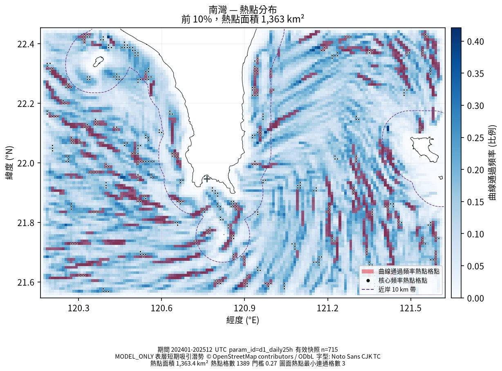{width=6.3in}

**圖乙-19  日產品南灣：曲線通過頻率前 10% 熱點（1,389 格，1363.4 平方公里，門檻 0.27）**

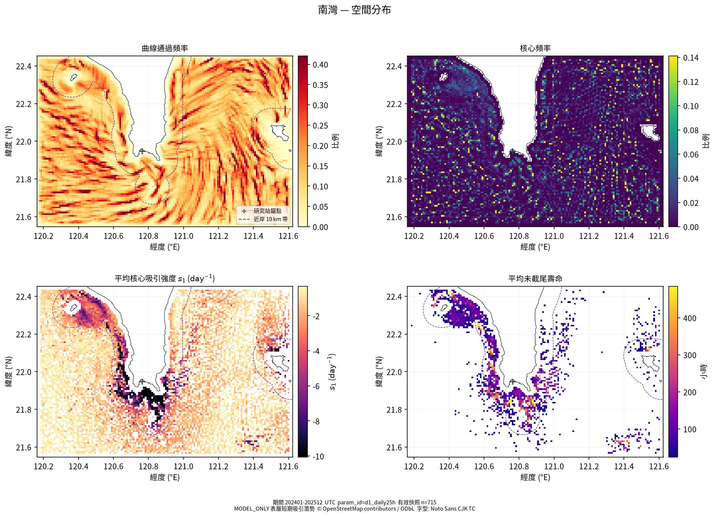{width=6.3in}

**圖乙-20  日產品南灣：曲線通過頻率、核心頻率、平均核心 $s_1$（每日）與平均未截尾壽命（2×2；有效快照 n = 715；虛線為 10 公里近岸帶）**

{width=6.3in}

**圖乙-21  逐時南灣：強核心結構壽命互補累積分布（實線為未截尾，n = 159,431；灰色為隨機對照）與壽命不小於 12 小時結構軌跡之平均 $s_1$ 隨正規化年齡之演化**

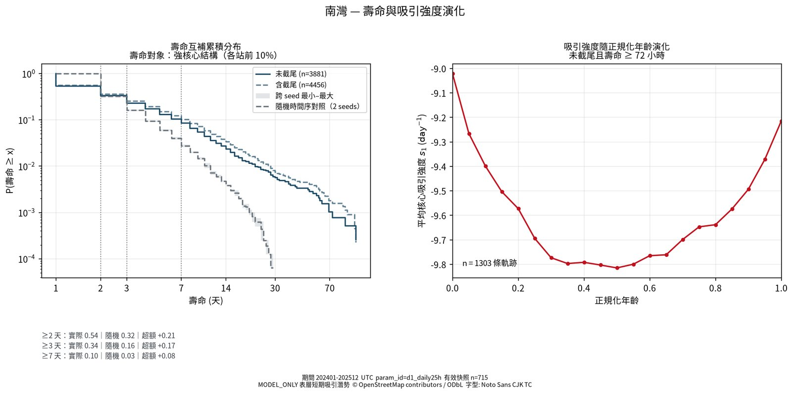{width=6.3in}

**圖乙-22  日產品南灣：壽命互補累積分布（未截尾 n = 3,881）與壽命不小於 72 小時結構軌跡之平均 $s_1$ 隨正規化年齡之演化**

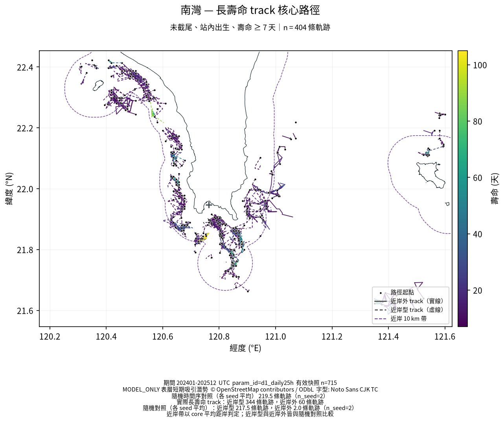{width=6.3in}

**圖乙-23  日產品南灣：壽命不小於 168 小時（7 天）之核心路徑，共 404 條（近岸型 344、近岸外 60）；隨機對照各種子平均 219.5 條（近岸型 217.5、近岸外 2）**

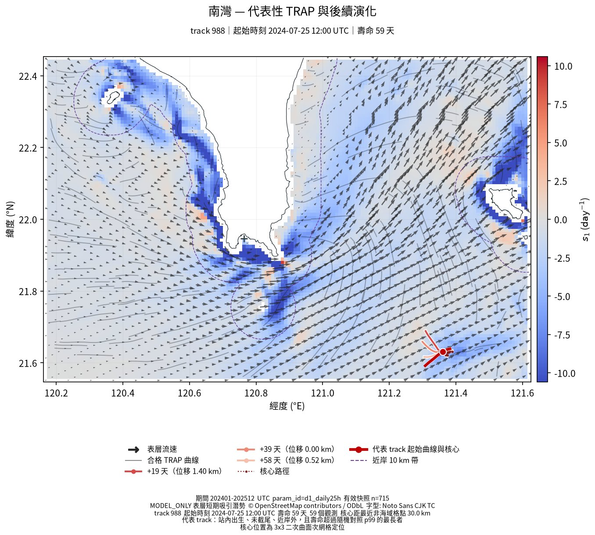{width=6.3in}

**圖乙-24  日產品南灣：代表性 TRAP（結構軌跡 988，起始 2024-07-25 12:00 UTC，壽命 1416 小時，59 個觀測，核心平均距岸 30 公里；選取準則近岸外且壽命超過隨機對照；隨機對照之第 99 百分位數壽命 240 小時）**

### 5、連江

　　連江位於流場區域 D（使用完整流場區域之分析海域），站點分析區面積 9469 平方公里。逐時產品有 17,124 個有效快照，日產品有 715 個，皆為全部標準快照。圖乙-25至圖乙-30與表乙-16至表乙-18呈現連江之結果。

　　在頻率方面，逐時產品之核心出現率與曲線出現率皆為 100%（17,124 個有效快照皆至少有一個核心與一條曲線），不具區辨力；強核心出現率為 99%（16,952／17,124，95% 信賴區間 98.69–99.28%），曲線通過格點比例為 11.85%（95% 信賴區間 11.79–11.91%），即每個快照約有 11.8% 之站內格點被 TRAP 曲線通過。日產品之核心出現率與曲線出現率同為 100%；強核心出現率為 99.72%（713／715，95% 信賴區間 99.30–100.00%），曲線通過格點比例為 12.19%（95% 信賴區間 12.11–12.28%）。核心密度逐時為 16.89、日產品為 15.52 個每 1,000 平方公里每快照。

　　在強度方面，逐時產品之強核心門檻為 −6.322 每日（−7.318×10⁻⁵ 每秒）；站內合格核心共 2,737,928 個，核心 $s_1$ 之中位數與第 10 百分位數為 −1.287 與 −6.322 每日。熱點共 959 格、948.35 平方公里，熱點門檻（曲線通過頻率）為 0.2116，熱點內平均通過頻率 0.2615，熱點內核心平均 $s_1$ 為 −2.361 每日，該站強核心有 28.89% 落在熱點格點內。日產品之強核心門檻為 −2.546 每日（−2.947×10⁻⁵ 每秒），核心 $s_1$ 之中位數與第 10 百分位數為 −0.7658 與 −2.546 每日；熱點 966 格、955 平方公里，門檻 0.221，熱點內平均通過頻率 0.2828，熱點內核心平均 $s_1$ 為 −1.284 每日，強核心有 43.74% 落在熱點格點內。日產品之強核心門檻與核心強度量值小於逐時產品，與 25 小時平均抑制潮汐與高頻應變一致；熱點為相對定義，面積約為站內面積之 10%。

　　在生命週期方面，逐時產品共追蹤 136,192 條強核心結構軌跡，其中未截尾 135,767 條；壽命平均 2.011 小時、中位數 1 小時、第 90 百分位數為 4 小時；隨機對照之壽命中位數與第 90 百分位數為 1 與 2 小時。壽命不小於 3 小時者，真實為 25.43%、隨機對照為 1.743%、超額 23.69%、比值 14.6×；壽命不小於 6 小時者，真實為 3.438%、隨機對照為 0.01991%、超額 3.418%、比值 173×；壽命不小於 12 小時者，真實為 0.1348%、隨機對照為 0%、超額 0.1348%（隨機對照為 0，無比值）（約 183 條）；壽命不小於 24 小時者僅 1 條（0.000737%，隨機對照為 0%），樣本數不足（不大於 20 條），不宜解讀。

　　日產品共追蹤 4,550 條強核心結構軌跡，其中未截尾 4,122 條；壽命平均 54.29 小時、中位數 24 小時（1 日）、第 90 百分位數為 120 小時（5 日）；隨機對照之壽命中位數與第 90 百分位數為 24 與 72 小時。壽命不小於 48 小時者，真實為 46%、隨機對照為 25.29%、超額 20.71%、比值 1.82×；壽命不小於 72 小時者，真實為 25.47%、隨機對照為 10.44%、超額 15.03%、比值 2.44×；壽命不小於 168 小時者，真實為 5.143%、隨機對照為 1.34%、超額 3.803%、比值 3.84×。站內出生、未截尾、壽命不小於 168 小時（7 天）之長壽命結構軌跡有 212 條。壽命 48 與 72 小時之比值較低，表示 2–3 天之壽命有相當部分可由機會串接解釋。

　　在近岸與近岸外方面（緩衝帶 10 公里），逐時產品之全部核心有 44.5% 位於近岸帶，強核心則有 89.96%；日產品分別為 50.24% 與 90.16%。強核心之近岸比例高於全部核心之近岸比例，顯示強核心偏向近岸。近岸外強核心出現率（門檻不變）逐時為 56.65%、日產品為 53.43%。熱點面積有 37.43%（逐時）與 55.68%（日產品）位於近岸帶；只在近岸外格點重取分位數之熱點，逐時為 475 格、平均通過頻率 0.2663，日產品為 486 格、平均通過頻率 0.2648。

　　長壽命結構軌跡位於近岸帶之比例，逐時產品為 0%（長壽命結構軌跡 1 條，樣本數不足，不宜解讀），日產品為 98.11%（212 條）。日產品中，未截尾結構軌跡近岸外 623 條、近岸型 3,499 條；壽命分數（真實與隨機對照）依序為：不小於 48 小時：近岸外 27.77%（隨機對照 8.343%）、近岸型 49.24%（隨機對照 27.92%）；不小於 72 小時：近岸外 10.91%（隨機對照 1.393%）、近岸型 28.07%（隨機對照 11.85%）；不小於 168 小時：近岸外 0.6421%（隨機對照 0%）、近岸型 5.945%（隨機對照 1.549%）。逐時產品中，近岸外 14,609 條、近岸型 121,158 條；不小於 3 小時：近岸外 21.47%（隨機對照 0.3002%）、近岸型 25.91%（隨機對照 1.918%）；不小於 6 小時：近岸外 2.293%（隨機對照 0%）、近岸型 3.576%（隨機對照 0.02233%）；不小於 12 小時：近岸外 0.08899%（隨機對照 0%）、近岸型 0.1403%（隨機對照 0%）；不小於 24 小時：近岸外 0.006845%（隨機對照 0%）、近岸型 0%（隨機對照 0%）。逐時近岸外不小於 24 小時者只有 1 條，不宜解讀。

　　在傳播速度方面（模型內 TRAP 核心之位移，不是水體或漂浮物速度），逐時產品已擬合 2,561 條結構軌跡（移動 2,380 條、靜止 181 條，靜止比例 7.068%）；移動結構軌跡之速度中位數 11.07、第 90 百分位數為 20.16 公里每日，東向與北向分量中位數為 2.92 與 −2.88 公里每日，位置擬合殘差均方根中位數 741.8 公尺。日產品已擬合 1,199 條（移動 894 條、靜止 305 條，靜止比例 25.44%），速度中位數 0.8922、第 90 百分位數為 2.107 公里每日，東向與北向分量中位數 0.0261 與 0 公里每日，殘差均方根中位數 746.7 公尺。逐時（至少 7 個觀測）與日產品（至少 3 個觀測）之樣本不可直接對照。

　　在季節分層方面，逐時產品之曲線通過格點比例以秋季（9–11 月）最大（12.01%）、春季（3–5 月）最小（11.66%），兩者之 95% 信賴區間不重疊；強核心出現率以冬季（12–2 月）最低（97.25%），其餘季節依序為春季（3–5 月） 99.86%、夏季（6–8 月） 100%、秋季（9–11 月） 98.87%。日產品之曲線通過格點比例以夏季（6–8 月）最大（12.67%）、冬季（12–2 月）最小（11.7%），兩者之 95% 信賴區間不重疊；強核心出現率以冬季（12–2 月）最低（98.88%），其餘季節依序為春季（3–5 月） 100%、夏季（6–8 月） 100%、秋季（9–11 月） 100%。季節分層僅涵蓋兩個年度，只描述分層數值，不能推論氣候季節性或年際變異。

**表乙-16  連江關鍵統計**

| 指標 | 逐時產品 | 日產品 |
|---|---|---|
| 站點分析區面積（平方公里） | 9469 | 9469 |
| 有效快照數 | 17,124 | 715 |
| 強核心門檻（每日；每秒） | −6.322；−7.318×10⁻⁵ | −2.546；−2.947×10⁻⁵ |
| 強核心出現率（分子／分母；95% 信賴區間） | 99%（16,952／17,124） （98.69–99.28%） | 99.72%（713／715） （99.30–100.00%） |
| 核心出現率／曲線出現率 | 100%／100%（無區辨力） | 100%／100%（無區辨力） |
| 曲線通過格點比例（95% 信賴區間） | 11.85% （11.79–11.91%） | 12.19% （12.11–12.28%） |
| 核心密度（個每 1,000 平方公里每快照） | 16.89 | 15.52 |
| 合格核心總數 | 2,737,928 | 105,108 |
| 核心 $s_1$ 中位數／第 10 百分位數（每日） | −1.287／−6.322 | −0.7658／−2.546 |
| 熱點面積（平方公里）（格數） | 948.35（959） | 955（966） |
| 熱點門檻（曲線通過頻率）／熱點內平均頻率 | 0.2116／0.2615 | 0.221／0.2828 |
| 熱點內核心平均 $s_1$（每日） | −2.361 | −1.284 |
| 熱點內強核心比例（占該站強核心） | 28.89% | 43.74% |
| 熱點面積位於 10 公里近岸帶比例 | 37.43% | 55.68% |
| 近岸外熱點格數／平均通過頻率 | 475／0.2663 | 486／0.2648 |
| 全部核心位於 10 公里近岸帶比例 | 44.5% | 50.24% |
| 強核心位於 10 公里近岸帶比例 | 89.96% | 90.16% |
| 近岸外強核心出現率 | 56.65% | 53.43% |
| 強核心結構軌跡數（全部／未截尾） | 136,192／135,767 | 4,550／4,122 |
| 壽命平均／中位數／第 90 百分位數（小時） | 2.011／1／4 | 54.29／24／120 |
| 隨機對照壽命中位數／第 90 百分位數（小時） | 1／2 | 24／72 |
| 長壽命結構軌跡數（未截尾、站內出生）；位於近岸帶比例 | 1；0%（樣本數不足，不宜解讀） | 212；98.11% |
| 傳播：已擬合結構軌跡數（移動／靜止） | 2,561（2,380／181） | 1,199（894／305） |
| 傳播：靜止比例 | 7.068% | 25.44% |
| 傳播：速度中位數／第 90 百分位數（公里每日，僅移動結構軌跡） | 11.07／20.16 | 0.8922／2.107 |
| 傳播：東向／北向分量中位數（公里每日） | 2.92／−2.88 | 0.0261／0 |
| 傳播：位置擬合殘差均方根中位數（公尺） | 741.8 | 746.7 |

資料來源：本計畫逐站統計檔（分層：全部）；連江站點分析區；熱點與強核心皆為本站相對定義；括號內為逐日區塊重抽樣之 95% 信賴區間。

**表乙-17  連江壽命分數：真實與隨機對照**

| 產品與門檻 | 類別 | 真實 | 隨機對照 | 超額 | 比值 |
|---|---|---|---|---|---|
| 逐時 ≥ 3 小時 | 全部 | 25.43% | 1.743% | 23.69% | 14.6× |
|  | 近岸外 | 21.47% | 0.3002% | 21.17% | — |
|  | 近岸型 | 25.91% | 1.918% | 23.99% | — |
| 逐時 ≥ 6 小時 | 全部 | 3.438% | 0.01991% | 3.418% | 173× |
|  | 近岸外 | 2.293% | 0% | 2.293% | — |
|  | 近岸型 | 3.576% | 0.02233% | 3.554% | — |
| 逐時 ≥ 12 小時 | 全部 | 0.1348% | 0% | 0.1348% | — |
|  | 近岸外 | 0.08899% | 0% | 0.08899% | — |
|  | 近岸型 | 0.1403% | 0% | 0.1403% | — |
| 逐時 ≥ 24 小時（樣本不足） | 全部 | 0.000737% | 0% | 0.000737% | — |
|  | 近岸外 | 0.006845% | 0% | 0.006845% | — |
|  | 近岸型 | 0% | 0% | 0% | — |
| 日產品 ≥ 48 小時 | 全部 | 46% | 25.29% | 20.71% | 1.82× |
|  | 近岸外 | 27.77% | 8.343% | 19.43% | — |
|  | 近岸型 | 49.24% | 27.92% | 21.32% | — |
| 日產品 ≥ 72 小時 | 全部 | 25.47% | 10.44% | 15.03% | 2.44× |
|  | 近岸外 | 10.91% | 1.393% | 9.522% | — |
|  | 近岸型 | 28.07% | 11.85% | 16.21% | — |
| 日產品 ≥ 168 小時 | 全部 | 5.143% | 1.34% | 3.803% | 3.84× |
|  | 近岸外 | 0.6421% | 0% | 0.6421% | — |
|  | 近岸型 | 5.945% | 1.549% | 4.396% | — |

資料來源：本計畫逐站統計檔；壽命分數為未截尾結構軌跡中壽命不小於門檻者之比例，隨機對照為兩個種子平均；隨機對照為 0 時比值不定義，以「—」表示；近岸外與近岸型各列之比值未計算（以「—」表示）；「樣本不足」表示該門檻之長壽命結構軌跡不大於 20 條，樣本數不足，不宜解讀；未截尾結構軌跡數：逐時真實 135,767（近岸外 14,609、近岸型 121,158），隨機對照平均 243,543；日產品真實 4,122（近岸外 623、近岸型 3,499），隨機對照平均 6,417。

**表乙-18  連江季節分層**

| 季節 | 產品 | 快照數 | 強核心出現率 | 曲線通過格點比例（95% 信賴區間） |
|---|---|---|---|---|
| 冬季 | 逐時產品 | 4,284 | 97.25% | 11.85% （11.77–11.93%） |
|  | 日產品 | 179 | 98.88% | 11.7% （11.53–11.85%） |
| 春季 | 逐時產品 | 4,238 | 99.86% | 11.66% （11.55–11.76%） |
|  | 日產品 | 177 | 100% | 12.15% （11.98–12.30%） |
| 夏季 | 逐時產品 | 4,364 | 100% | 11.88% （11.77–11.99%） |
|  | 日產品 | 182 | 100% | 12.67% （12.50–12.82%） |
| 秋季 | 逐時產品 | 4,238 | 98.87% | 12.01% （11.88–12.14%） |
|  | 日產品 | 177 | 100% | 12.25% （12.08–12.42%） |

資料來源：本計畫逐站統計檔（分層為冬季（12–2 月）、春季（3–5 月）、夏季（6–8 月）、秋季（9–11 月））；季節分層僅涵蓋兩個年度。

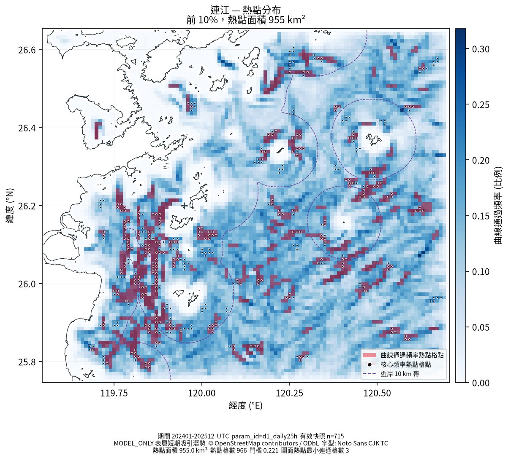{width=6.3in}

**圖乙-25  日產品連江：曲線通過頻率前 10% 熱點（966 格，955 平方公里，門檻 0.221）**

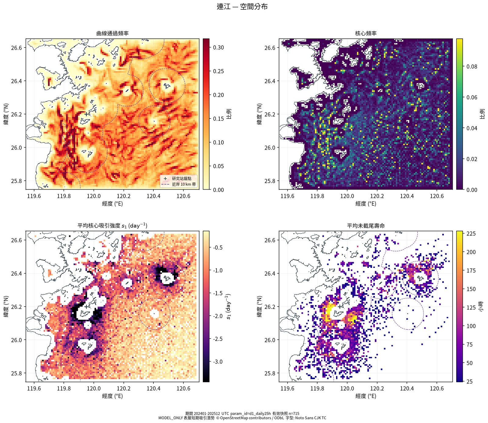{width=6.3in}

**圖乙-26  日產品連江：曲線通過頻率、核心頻率、平均核心 $s_1$（每日）與平均未截尾壽命（2×2；有效快照 n = 715；虛線為 10 公里近岸帶）**

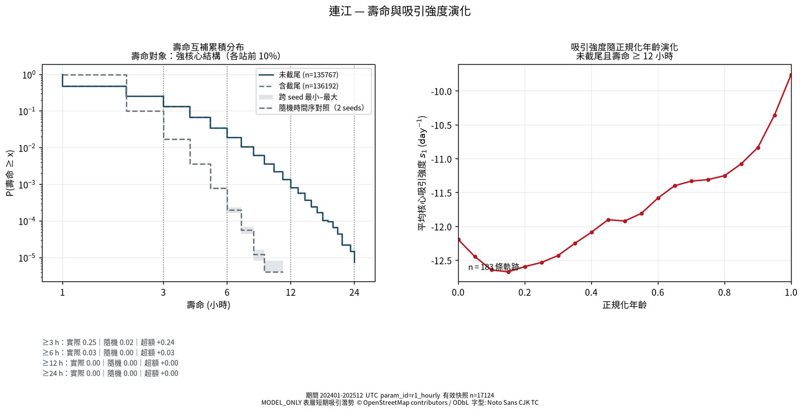{width=6.3in}

**圖乙-27  逐時連江：強核心結構壽命互補累積分布（實線為未截尾，n = 135,767；灰色為隨機對照）與壽命不小於 12 小時結構軌跡之平均 $s_1$ 隨正規化年齡之演化**

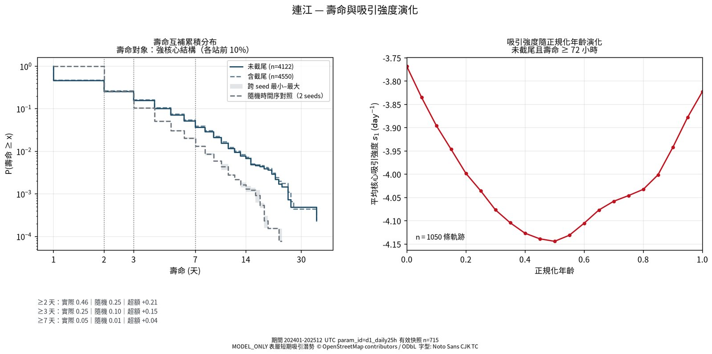{width=6.3in}

**圖乙-28  日產品連江：壽命互補累積分布（未截尾 n = 4,122）與壽命不小於 72 小時結構軌跡之平均 $s_1$ 隨正規化年齡之演化**

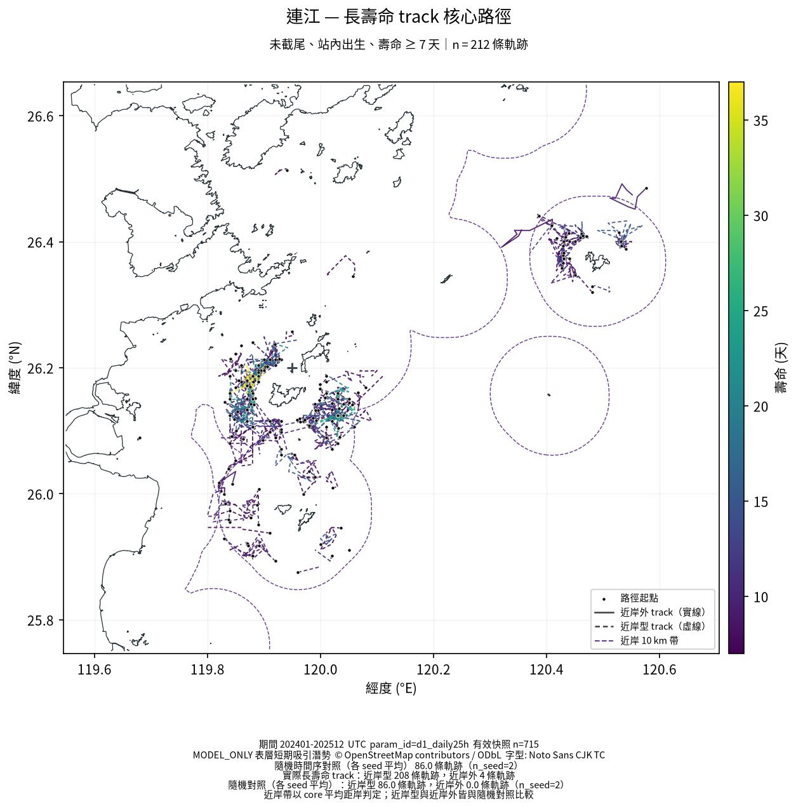{width=6.3in}

**圖乙-29  日產品連江：壽命不小於 168 小時（7 天）之核心路徑，共 212 條（近岸型 208、近岸外 4）；隨機對照各種子平均 86 條（近岸型 86、近岸外 0）**

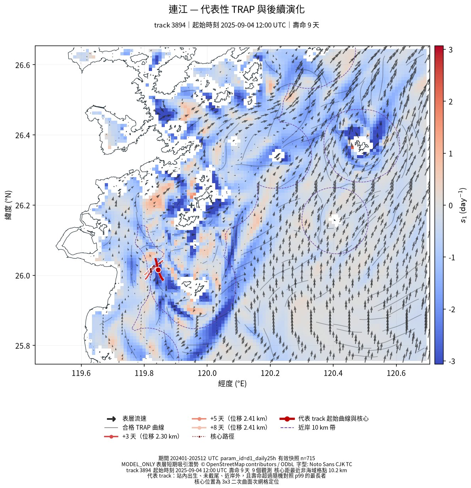{width=6.3in}

**圖乙-30  日產品連江：代表性 TRAP（結構軌跡 3894，起始 2025-09-04 12:00 UTC，壽命 216 小時，9 個觀測，核心平均距岸 10.2 公里；選取準則近岸外且壽命超過隨機對照；隨機對照之第 99 百分位數壽命 168 小時）**

## （三）綜合說明

### 1、各站摘要

　　以下逐站摘要各站獨立之結果，各站之門檻與熱點皆為該站自己之相對定義，不作站間排序。

　　貢寮：逐時與日產品之強核心出現率為 99.05% 與 100%，曲線通過格點比例為 9.969% 與 13.33%；熱點面積為 688.05 與 703.97 平方公里；日產品壽命不小於 168 小時者真實為 6.083%、隨機對照為 1.134%（比值 5.37×）；強核心位於近岸帶之比例為 66.34%（逐時）與 65.48%（日產品）；日產品長壽命結構軌跡位於近岸帶之比例為 72.88%（177 條）；逐時長壽命結構軌跡僅 16 條，樣本數不足，不宜解讀。

　　龜山島西側：逐時與日產品之強核心出現率為 95.32% 與 99.02%，曲線通過格點比例為 10.97% 與 13.45%；熱點面積為 433.76 與 440.65 平方公里；日產品壽命不小於 168 小時者真實為 4.759%、隨機對照為 0.7037%（比值 6.76×）；強核心位於近岸帶之比例為 51.44%（逐時）與 35.52%（日產品）；日產品長壽命結構軌跡位於近岸帶之比例為 32.43%（74 條）；逐時長壽命結構軌跡僅 16 條，樣本數不足，不宜解讀。

　　新竹外海：逐時與日產品之強核心出現率為 99.02% 與 97.76%，曲線通過格點比例為 15.53% 與 15.94%；熱點面積為 1175.8 與 1187.3 平方公里；日產品壽命不小於 168 小時者真實為 3.79%、隨機對照為 0.3348%（比值 11.3×）；強核心位於近岸帶之比例為 59.37%（逐時）與 58.63%（日產品）；日產品長壽命結構軌跡位於近岸帶之比例為 85.08%（248 條）；逐時長壽命結構軌跡僅 20 條，樣本數不足，不宜解讀。

　　南灣：逐時與日產品之強核心出現率為 100% 與 100%，曲線通過格點比例為 12.58% 與 14.67%；熱點面積為 1359.8 與 1363.4 平方公里；日產品壽命不小於 168 小時者真實為 10.41%、隨機對照為 2.759%（比值 3.77×）；強核心位於近岸帶之比例為 80.28%（逐時）與 80.01%（日產品）；日產品長壽命結構軌跡位於近岸帶之比例為 85.15%（404 條）；逐時長壽命結構軌跡僅 243 條。

　　連江：逐時與日產品之強核心出現率為 99% 與 99.72%，曲線通過格點比例為 11.85% 與 12.19%；熱點面積為 948.35 與 955 平方公里；日產品壽命不小於 168 小時者真實為 5.143%、隨機對照為 1.34%（比值 3.84×）；強核心位於近岸帶之比例為 89.96%（逐時）與 90.16%（日產品）；日產品長壽命結構軌跡位於近岸帶之比例為 98.11%（212 條）；逐時長壽命結構軌跡僅 1 條，樣本數不足，不宜解讀。

### 2、逐時與日產品之時間尺度意義

　　逐時產品保留潮汐等次日變動，TRAP 結構之壽命以小時計：五站之壽命中位數皆為 1 小時，第 90 百分位數為 3、4 小時。在核心 2 公里、曲線 4 公里之嚴格追蹤門檻下，壽命不小於 3 小時之比例仍高於隨機對照，顯示逐時結構確有時間連續性；但超過 12 小時者極少，不小於 24 小時者更少。逐時結果含潮汐，其短壽命與潮汐週期之關係尚未用潮相資料分層檢驗（本計畫無潮相資料）。

　　日產品經 25 小時平均抑制主要分潮後，結構壽命上升到天之量級：壽命中位數為 24、48 小時，第 90 百分位數為 96、120、168 小時。這與 Kunz 等（2024）以逐日資料分析之時間尺度相近，但其研究域為北太平洋中尺度，門檻與壽命不可直接移植到本計畫約 1 公里之近岸網格。日產品壽命不小於 7 天者高於隨機對照（比值 3.77–11.3 倍），但不小於 48 與 72 小時者之比值只有 1.5–2.48 倍，說明 2–3 天之壽命有相當部分可由機會串接解釋，只有更長之壽命才與隨機對照明顯分離；因此解讀日產品結果時，建議以不小於 7 天之長壽命結構軌跡與近岸外指標為主。

### 3、近岸鎖定

　　核心在距非海域格點約 2–3 公里內無法偵測（檢出下限）。在可偵測範圍內，五站在兩個產品中，強核心位於近岸帶之比例皆高於該站全部核心之近岸比例（各站數值見關鍵統計表）；日產品長壽命結構軌跡位於近岸帶之比例，貢寮、新竹外海、南灣、連江超過 70%，龜山島西側為 32.43%，未超過 70%。日產品之靜止比例（擬合位移小於 1 個格距者）於各站見關鍵統計表，許多長壽命結構軌跡為位移小於 1 格之靜止型。這與「地形（岬角、島嶼）鎖定之應變場或邊界效應」之解讀一致：此類結構不是漂移之收斂帶，其與實際海廢聚集之關係須獨立觀測才能確認。保守之結論應以近岸外指標為準。

　　逐時產品中，長壽命結構軌跡之樣本數：貢寮 16 條、龜山島西側 16 條、新竹外海 20 條、南灣 243 條、連江 1 條；其中不大於 20 條者樣本數不足，不宜解讀。因此「長壽命者多在近岸」是日產品多數站之現象，不是逐時產品或每一站之通則。

### 4、對隨機對照之穩健性

　　日產品：每一站之近岸外與近岸型壽命不小於 48、72、168 小時之比例皆高於其隨機對照（超額皆為正，見各站壽命分數表）。逐時：近岸外壽命不小於 3、6、12 小時之比例在各站皆高於隨機對照；不小於 24 小時者僅有少數結構軌跡，樣本極少，不宜解讀。追蹤全部核心時壽命大多可由機會解釋；本結果採「只追蹤各站前 10% 強核心加兩個種子之隨機對照」才有超額。隨機對照只有 2 個種子，且只檢驗「時間連續性」，不檢驗結構之物理意義。

## （四）限制與使用說明

　　一、僅模式資料。沒有獨立之漂流器或海廢觀測，因此未進行 Serra 等（2020）圖 4a–c 與表 1–2 型式之驗證，也未與海廢記錄對照。結果只能稱為「表層短期吸引潛勢」，不得寫成海廢濃度、長期滯留、海底廢聚集或污染來源。SVD 與 TRAP 共用 OCM 強迫，其關聯屬機制探索，不是獨立驗證。

　　二、壽命之機會成分。日產品壽命 2–3 天有相當部分可由機會解釋；逐時不小於 24 小時之樣本極少。壽命一律指「強核心結構（各站前 10%）」，不是全部 TRAP；隨機對照僅 2 個種子。

　　三、檢出下限與近岸。核心無法位於距非海域格點約 2–3 公里內；近岸強核心與長壽命結構軌跡多為靜止型，可能是地形鎖定之應變場或邊界效應。近岸與近岸外之歸類依結構軌跡核心平均距岸判定，對 10 公里緩衝寬度敏感。

　　四、相對定義。強核心與熱點皆為各站自己之 10% 分位數，不可作跨站大小比較；熱點面積依定義約占站內面積之 10%。核心與曲線出現率皆為 100%，無區辨力。

　　五、參數與解析度。相對強度 0.30、曲線長度上限、追蹤門檻等未做完整敏感度分析；1 公里網格之近岸結果受網格與遮罩影響。日產品 25 小時平均不是理想低通。

　　六、傳播速度是結構位移，不是水體或漂浮物速度；逐時與日產品之最少觀測數不同（7 與 3）。

　　七、距岸距離場上限。兩次最終結果之執行紀錄檔記錄距離場於 30 公里飽和，而目前程式預設上限為 200 公里；10 公里近岸分割不受影響，但距岸直方圖之末格為「不小於 30 公里」。

　　八、相干性比值之單位。本章之相干性（真實除以隨機對照）一律採最終逐站統計檔之逐站值；方法章門檻掃描階段之記錄值以流場區域為單位計算，與逐站值單位不同，不可逐項對照。

　　九、季節分層只涵蓋兩個年度，不可推論氣候季節性。

　　十、使用說明。引用本章數值時，請同時註明「僅模式資料、無獨立觀測驗證」，以及程式版本與兩次執行之執行識別（逐時產品、日產品）。完整結果檔（逐站統計檔、執行紀錄檔、逐站空間陣列與全部 60 × 2 張成果圖）見兩次執行之彙整報告目錄。

## （五）附註：識別名稱與檔案名稱對照

　　本章內文以中文名稱敘述；與程式及輸出檔中之英文名稱對照見表乙-19。

**表乙-19  中文用語與程式、檔案名稱對照**

| 本章用語 | 程式或檔案中之名稱 |
|---|---|
| 逐時產品、日產品（執行識別） | r1_hourly、d1_daily25h |
| 逐站統計檔 | site_statistics.csv、site_statistics.json |
| 執行紀錄檔與雜湊檔 | manifest.json、manifest.sha256 |
| 彙整結果格式 | traps.period.aggregate.v2 |
| 狀態標記；僅模式資料 | state_label（READY）；MODEL_ONLY |
| 程式版本與修改標記 | git_commit、git_dirty |
| 結構軌跡；隨機對照；亂數種子 | track；null；seed（1、2） |
| 區域月份；分層 | domain-month；stratum（all、DJF、MAM、JJA、SON、年份） |
| 近岸外；近岸型；超額 | offshore；coastal；excess |
| 強核心門檻紀錄；結構軌跡核心篩選紀錄 | strong_core_thresholds；track_core_filter |
| 缺漏流場區域、缺漏研究站名單 | domains_missing、sites_missing |
| 成果圖檔名 | site_<站名>_{hotspots、spatial、lifetime、long_tracks、example}.png |

資料來源：本計畫程式庫與兩次執行之執行紀錄檔。
