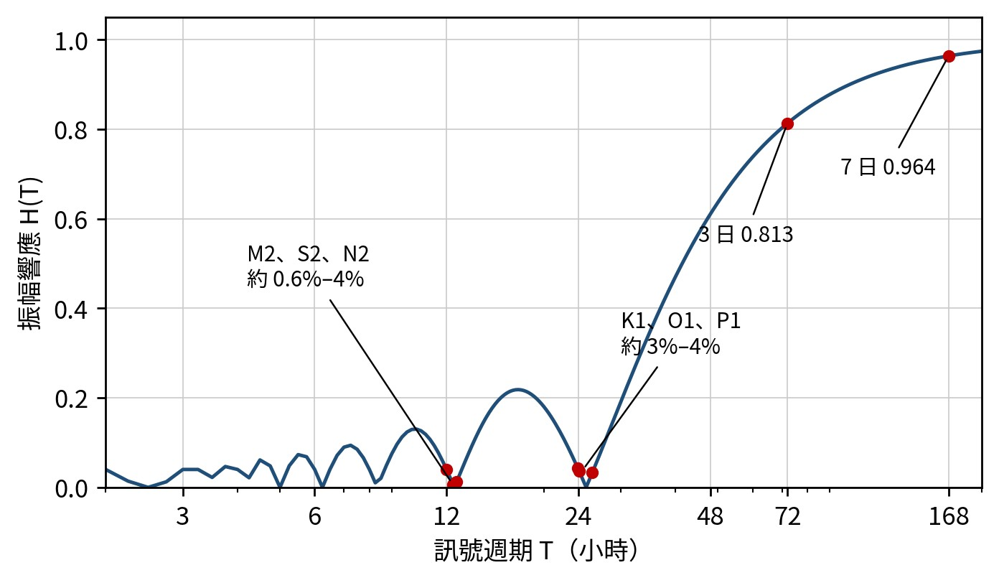
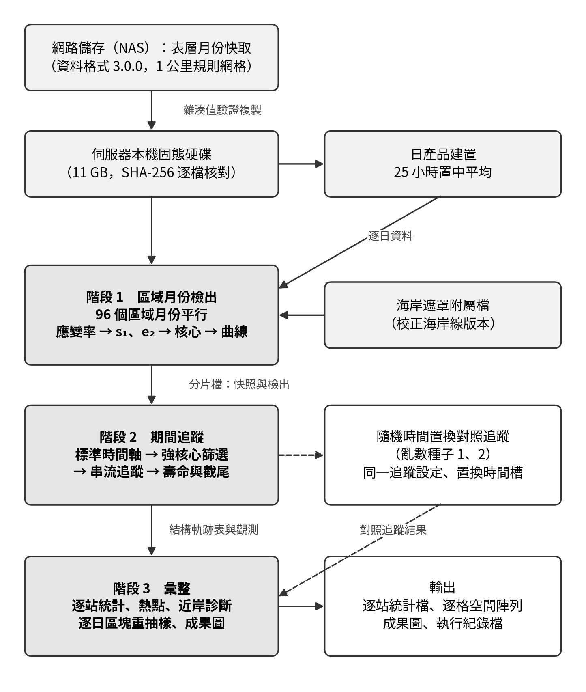

# 三、瞬態吸引剖面（TRAPs）實作方法

〔編輯說明：本章為工項 2「瞬態吸引剖面（TRAPs）」之實作方法，併入全文時置於工項 1 之後；式號暫自 (1) 起編，表號暫定「表甲-」，圖號暫定「圖甲-」，併入時請重編；各項數值取自本計畫兩次正式執行之執行紀錄檔與逐站統計檔，標明「示範數值」者為說明用。〕

　　本章說明瞬態吸引剖面（Transient Attracting Profiles, TRAPs，以下簡稱 TRAP）之完整計算程序，依計算順序分為十二個步驟。每個步驟依「目的、輸入、計算步驟、輸出、算例」五項說明：先列出控制方程式與各符號之定義與單位，再逐步代入數字計算。讀者可依序照做，得到與本計畫相同之結果。

　　本計畫之 TRAP 分析以表層二維流速為唯一輸入，不使用波浪、風與水深資料。TRAP 屬歐拉（Eulerian）幾何結構，描述某一瞬間流場中「壓縮最強」之位置與其骨架曲線，並非粒子、水團或廢棄物之軌跡；所有結果只能解讀為模型內之「表層短期吸引潛勢」，不是海廢濃度、滯留時間、海底廢聚集或污染來源。

　　流場以兩種產品獨立分析：逐時產品保留潮汐；日產品為 25 小時置中平均之去潮汐流場。兩個產品共用步驟 1 至 5 與步驟 8 至 12 之全部公式與檢出參數，差別只在步驟 6 之流場來源、步驟 7 之追蹤門檻與取樣間隔。每個研究站獨立統計，不做跨站比較。

　　本章用語如下。「結構軌跡」指同一 TRAP 結構在連續時刻被追蹤所形成的序列；「隨機時間置換對照」（簡稱「隨機對照」）指保留追蹤設定、僅把各可用時間槽之檢出隨機置換後重新追蹤之結果，用以估計「沒有真實時間連續性」時之壽命基準；「互補累積分布」（complementary cumulative distribution function, CCDF）指壽命不小於某值之結構軌跡比例隨該值之變化；「均方根」（root mean square, RMS）為殘差平方之平均再開方；「逐日區塊重抽樣」（block bootstrap）指以日為單位重抽樣以估計信賴區間。成果表中，每日（day⁻¹）為應變率之單位，其後僅以 day⁻¹ 表示。

　　算例分兩類。標明「實際數字」者，取自本計畫之設定、輸入資料或計算結果；標明「示範數值」者，為說明計算流程而自行設定之數字，數值落在合理範圍，但不代表任何一個實際站點或時刻。所有算例之算術均以程式逐項計算後填入，數字以四捨五入方式取到所列位數，連續運算以未四捨五入之中間值進行。

**表甲-1  TRAP 計算步驟總覽**

| 步驟 | 目的 | 主要式號 |
|---|---|---|
| 1、速度梯度與應變率張量 | 由表層流速求應變率矩陣 | (1)–(4) |
| 2、特徵值與特徵向量 | 求最強壓縮率與拉伸方向 | (5)–(7) |
| 3、TRAP 核心定位與次網格修正 | 找出壓縮最強之局部極小點 | (8)–(10) |
| 4、TRAP 曲線積分與停止條件 | 沿拉伸方向積分出骨架曲線 | (11)–(17) |
| 5、品質門檻 | 決定快照、核心、曲線與強核心是否採用 | (18)–(19) |
| 6、逐時／日平均流場產品 | 建立去潮汐之 25 小時日產品 | (20)–(21) |
| 7、時序追蹤 | 把相鄰時刻之 TRAP 配成同一條結構軌跡 | (22)–(24) |
| 8、隨機時間置換對照 | 估計機會水準之壽命 | (25) |
| 9、壽命與截尾 | 計算壽命並處理截尾 | (26)–(27) |
| 10、統計指標 | 出現率、通過比例、熱點與信賴區間 | (28)–(32) |
| 11、近岸診斷 | 區分近岸型與近岸外 | (33) |
| 12、傳播速度 | 估計 TRAP 核心位移速度 | (34)–(36) |

資料來源：本研究整理。

## （一）資料與前處理

### 1、流場資料與研究站

　　輸入為中央氣象署海洋模式（CWA-OCM，採 SCHISM 非結構化網格）之表層流速，分量為東向表層流速 u 與北向表層流速 v，單位為每秒公尺。上游已把模式輸出重採樣為 1 公里規則公尺網格（座標 x、y 之單位為公尺；資料格式版本 3.0.0）。本計畫涵蓋四個流場區域與五個研究站，期間為 2024 年 1 月至 2025 年 12 月，共 4 個區域 × 24 個月 = 96 個區域月份，依專案記錄全數為標準等級且狀態為可用。

**表甲-2  流場區域與研究站**

| 流場區域 | 研究站 |
|---|---|
| A | 貢寮、龜山島西側 |
| B | 新竹外海 |
| C | 南灣 |
| D | 連江 |

資料來源：本計畫研究設計設定檔。

　　A 區之貢寮與龜山島西側共用同一流場，以兩個錨點（站點中心點）之公尺距離做互斥最近錨點分割，距離相等者歸貢寮；分割只決定統計歸屬，不裁切流場微分或曲線積分。B、C、D 三區各只含一站，使用完整流場區域之分析海域。

### 2、正式時間軸與缺口

　　逐時正式時間軸串接各月份後共 17,196 列，月份交界有 72 個重複之 UTC 時刻；以「依 UTC 穩定排序、重複者保留較晚月份」之規則處理後為 17,124 個唯一時刻。檢核：2024 年（366 日）與 2025 年（365 日）共 731 日，應有 731 × 24 = 17,544 個整點，減去唯一時刻 17,124 個，缺漏 420 個小時，與專案記錄之缺漏小時數 420 相符。缺漏中有 48 個缺口長於 1 小時，最長 50 小時。缺口一律不內插、不補值，只記錄；追蹤與統計以缺口截尾處理（見步驟 7 與步驟 9）。

### 3、海岸遮罩

　　分析海域遮罩採校正海岸線版本（以開放街圖精確海岸線製作，與專案海岸線向量檔同一 SHA-256），由遮罩匯出程式逐位元匯出為分析海域遮罩檔並附中繼資料附屬檔。靜態網格遮罩檔只代表網格支撐範圍，不等於陸地遮罩；正式檢出程式拒絕缺少附屬檔之輸入。專案內之海岸線向量檔（© OpenStreetMap contributors，ODbL）只供圖面疊加海岸線，不影響數值。

### 4、資料落地與唯讀原則

　　資料由網路儲存（NAS）複製到伺服器本機固態硬碟（SSD）（11 GB，SHA-256 逐檔核對），沿用 Lagrangian 逆向追蹤專案「本機優先、網路儲存只當來源」之慣例。程式以記憶體映射唯讀讀取來源資料，從不修改來源；資料格式、來源與逐時遮罩之檢查採嚴格停止原則（不符即停止，不自行補救）。

## （二）數值計算

### 1、速度梯度與應變率張量

#### （1）目的

　　由表層二維流速求每個格點之速度梯度，組成應變率張量（應變率矩陣）。應變率描述流體在該點被拉長或壓縮之快慢，是 TRAP 之判定依據。

#### （2）輸入

　　某一時刻（逐時產品為一個整點，日產品為一個 UTC 日）之表層東向流速 $u$ 與北向流速 $v$（每秒公尺，下稱每秒 m），定義在 1 公里規則網格；格點之公尺座標 $x_j$（東向）與 $y_i$（北向），其中 $i$ 為北向列序、$j$ 為東向行序；分析海域遮罩。

#### （3）計算步驟

　　第一步，以中心差分求流速對位置之偏導數：

$$
\frac{\partial u}{\partial x}\approx\frac{u_{i,j+1}-u_{i,j-1}}{x_{j+1}-x_{j-1}},\qquad \frac{\partial u}{\partial y}\approx\frac{u_{i+1,j}-u_{i-1,j}}{y_{i+1}-y_{i-1}} \qquad (1)
$$

$$
\frac{\partial v}{\partial x}\approx\frac{v_{i,j+1}-v_{i,j-1}}{x_{j+1}-x_{j-1}},\qquad \frac{\partial v}{\partial y}\approx\frac{v_{i+1,j}-v_{i-1,j}}{y_{i+1}-y_{i-1}} \qquad (2)
$$

　　其中：$u_{i,j}$、$v_{i,j}$ 為第 $i$ 列第 $j$ 行格點之東向與北向流速（每秒 m）；$x_j$、$y_i$ 為格點之東向與北向公尺座標（公尺），分母為該格點兩側座標之差，約 2,000 公尺（兩個格距）；$\partial u/\partial x$ 等四個偏導數之單位為每秒（s⁻¹）。

　　第二步，由四個偏導數組成應變率張量，即速度梯度之對稱部分：

$$
\mathbf{S}=\tfrac12\left(\nabla\mathbf{v}+\nabla\mathbf{v}^{\mathsf T}\right)=\begin{pmatrix}\dfrac{\partial u}{\partial x} & \tfrac12\left(\dfrac{\partial v}{\partial x}+\dfrac{\partial u}{\partial y}\right)\\[2mm]\tfrac12\left(\dfrac{\partial v}{\partial x}+\dfrac{\partial u}{\partial y}\right) & \dfrac{\partial v}{\partial y}\end{pmatrix}=\begin{pmatrix}a & b\\ b & d\end{pmatrix} \qquad (3)
$$

　　其中：$\mathbf{S}$ 為應變率張量（每秒，s⁻¹），對稱矩陣；$\nabla\mathbf{v}$ 為速度梯度張量，$\mathbf{v}=(u,v)$；$a=\partial u/\partial x$ 為東西向之伸縮率；$d=\partial v/\partial y$ 為南北向之伸縮率；$b$ 為剪切應變率，其值為 $\partial v/\partial x$ 與 $\partial u/\partial y$ 之平均。式(3)即工項需求之式(5)。

　　第三步，單位換算。計算以每秒為單位，成果表以每日（day⁻¹）表示，換算為乘以 86,400：

$$
s_{\mathrm{day}}=86400\,s_{\mathrm{s}} \qquad (4)
$$

　　其中：$s_{\mathrm{s}}$ 為以每秒（s⁻¹）表示之應變率；$s_{\mathrm{day}}$ 為以每日（day⁻¹）表示之應變率；86,400 為一日之秒數。

　　遮罩安全規則：中心格點與其東、西、南、北四個鄰點，只要有一格無效（陸地、缺值或非有限值），該格點就不產生導數，不把海岸或缺值當成 0。這是保守之嚴格停止設計，也避免曲線穿過遮罩缺口。本計畫不做空間平滑（平滑半徑為 0；程式保留有遮罩保護之圖擴散選項，本次未啟用）。

#### （4）輸出

　　每個格點之 $a$、$b$、$d$（每秒）；導數無效之格點記為無效。流場本身與應變率場不落地，只儲存步驟 3 與步驟 4 之核心與曲線。

#### （5）算例

　　以下為示範數值：某格點（相鄰格距 1,000 公尺，兩側座標差 2000 公尺）之四個鄰點流速（每秒 m）如表甲-3。

**表甲-3  應變率張量算例之四個鄰點流速（示範數值，單位：每秒 m）**

| 鄰點 | 東向流速 $u$ | 北向流速 $v$ |
|---|---|---|
| 東（$j+1$） | 0.12 | 0.05 |
| 西（$j-1$） | 0.2 | 0.01 |
| 北（$i+1$） | 0.18 | 0 |
| 南（$i-1$） | 0.14 | 0.04 |

資料來源：本研究示範計算。

　　依式(1)與式(2)：$\partial u/\partial x=(0.12-0.2)/2000=-4\times 10^{-5}$ 每秒；$\partial u/\partial y=(0.18-0.14)/2000=2\times 10^{-5}$ 每秒；$\partial v/\partial x=(0.05-0.01)/2000=2\times 10^{-5}$ 每秒；$\partial v/\partial y=(0-0.04)/2000=-2\times 10^{-5}$ 每秒。

　　依式(3)：$a=-4\times 10^{-5}$ 每秒，$d=-2\times 10^{-5}$ 每秒，$b=\tfrac12(2\times 10^{-5}+2\times 10^{-5})=2\times 10^{-5}$ 每秒。換算為每日：$a=−3.456$、$b=1.728$、$d=−1.728$ 每日。若四個鄰點中有任何一個位於陸地，該格點不計算導數，亦不參與步驟 2 以後之任何判定。

### 2、特徵值與特徵向量

#### （1）目的

　　求應變率張量之兩個特徵值（最強壓縮率與最強拉伸率）及其方向。最小特徵值為負，代表該點在某一方向上流體被壓縮。

#### （2）輸入

　　步驟 1 之 $a$、$b$、$d$（每秒）。

#### （3）計算步驟

　　對稱 $2\times2$ 矩陣之特徵方程 $\det(\mathbf{S}-\lambda\mathbf{I})=0$（工項需求之特徵方程）有封閉解：

$$
s_{1,2}=\frac{a+d}{2}\mp\sqrt{\left(\frac{a-d}{2}\right)^{2}+b^{2}},\qquad s_1\le s_2 \qquad (5)
$$

　　其中：$s_1$ 為最小特徵值，即最強壓縮率（工項需求之 $\lambda_{\min}$，每秒）；$s_2$ 為最大特徵值，即最強拉伸率（每秒）；$a$、$b$、$d$ 見式(3)。

　　兩個特徵值之間距為 $s_2-s_1=2\sqrt{((a-d)/2)^2+b^2}$。間距低於 $10^{-12}$ 每秒之格點視為方向退化（兩個方向無法區分），不參與檢出：

$$
s_2-s_1<\varepsilon_{\text{間隙}}=10^{-12}\ \Rightarrow\ \text{方向退化，不檢出} \qquad (6)
$$

　　其中：$\varepsilon_{\text{間隙}}$ 為方向退化門檻（每秒）。

　　拉伸方向為 $s_2$ 對應之單位特徵向量：

$$
\mathbf{e}_2=\frac{(b,\ s_2-a)}{\left\|(b,\ s_2-a)\right\|},\qquad \text{若 }\left\|(b,\ s_2-a)\right\|\text{ 過小，改用 }\frac{(s_2-d,\ b)}{\left\|(s_2-d,\ b)\right\|} \qquad (7)
$$

　　其中：$\mathbf{e}_2$ 為拉伸方向之單位向量（無因次，東向與北向兩個分量）；兩種寫法取範數較大者，以穩定取得軸向特徵向量。壓縮方向 $\mathbf{e}_1$（對應 $s_1$）與 $\mathbf{e}_2$ 處處正交。工項需求寫「沿代表拉伸方向之特徵向量 $\mathbf{e}_{\max}$ 積分」，與本計畫沿 $\mathbf{e}_2$ 積分一致。特徵向量只定義到正負號，後續步驟 4 以符號連續性處理。

#### （4）輸出

　　每個有效格點之 $s_1$、$s_2$（每秒）與 $\mathbf{e}_2$；方向退化之格點標為不可用。

#### （5）算例

　　以下為示範數值，沿用步驟 1 之張量 $a=-4\times 10^{-5}$、$b=2\times 10^{-5}$、$d=-2\times 10^{-5}$ 每秒。$(a+d)/2=-3\times 10^{-5}$；$(a-d)/2=-1\times 10^{-5}$；$\sqrt{(a-d)^2/4+b^2}=2.236\times 10^{-5}$。依式(5)：$s_1=-5.236\times 10^{-5}$ 每秒（−4.524 每日），$s_2=-7.639\times 10^{-6}$ 每秒（−0.66 每日）；$s_1<0$，該點為壓縮，且間距 $s_2-s_1=4.472\times 10^{-5}$ 每秒遠大於 $10^{-12}$，不退化。

　　拉伸方向：$(b,\ s_2-a)=(2\times 10^{-5},\ 3.236\times 10^{-5})$，範數為 3.804×10⁻⁵，故 $\mathbf{e}_2=(0.5257,\ 0.8507)$。壓縮方向 $\mathbf{e}_1=(−0.8507,\ 0.5257)$。驗算：$\mathbf{S}\mathbf{e}_2=(-4.016\times 10^{-6},\ -6.498\times 10^{-6})$，除以 $\mathbf{e}_2$ 之對應分量得 −7.639×10⁻⁶ 與 −7.639×10⁻⁶，皆等於 $s_2$；內積 $\mathbf{e}_1\cdot\mathbf{e}_2=0$，兩向量正交。

### 3、TRAP 核心定位與次網格修正

#### （1）目的

　　在 $s_1$ 場中找出「為負且為局部極小值」之格點作為 TRAP 核心，再以二次曲面擬合把核心位置修正到格點之間（次網格），避免核心恆落在 1 公里格點上而使位移被格距量化。

#### （2）輸入

　　步驟 2 之 $s_1$ 場；核心最小量值 $s_{\min}=-10^{-8}$ 每秒；局部極小值鄰域半徑 1 格（即 $3\times3$ 鄰域）；並列判定容許 $10^{-12}$ 每秒。

#### （3）計算步驟

　　第一步，核心候選。格點 $(i,j)$ 須同時滿足：

$$
s_1(i,j)<s_{\min}=-10^{-8}\ \mathrm{s^{-1}},\qquad s_1(i,j)\le s_1(i',j')\ \ \forall\,(i',j')\in\mathcal{N}_{3\times3} \qquad (8)
$$

　　其中：$s_1(i,j)$ 為該格點之最強壓縮率（每秒）；$\mathcal{N}_{3\times3}$ 為以該格點為中心之 $3\times3$ 鄰域，鄰域九格之導數必須全部有效；並至少有一個鄰點嚴格較高，避免整片常數區被當作核心。

　　第二步，次網格定位。對核心格點之 $3\times3$ 有效鄰域（9 個樣本）以最小平方法擬合二次曲面：

$$
s_1(\xi,\eta)\approx c_0+c_1\xi+c_2\eta+c_3\xi^{2}+c_4\xi\eta+c_5\eta^{2} \qquad (9)
$$

　　其中：$\xi$、$\eta$ 為相對核心格點之東向與北向偏移，以格距無因次化（取 $-1$、0、$+1$）；$c_0$ 至 $c_5$ 為六個待定係數（9 個樣本、6 個參數，故為超定問題，取最小平方解）。駐點（曲面之極值點）由下式求得：

$$
\mathbf{H}\,\mathbf{p}=-\mathbf{g},\qquad \mathbf{H}=\begin{pmatrix}2c_3 & c_4\\ c_4 & 2c_5\end{pmatrix},\qquad \mathbf{g}=\begin{pmatrix}c_1\\ c_2\end{pmatrix} \qquad (10)
$$

　　其中：$\mathbf{p}=(\hat{\xi},\hat{\eta})$ 為駐點相對核心格點之偏移（格距）；$\mathbf{H}$ 為曲面之海森矩陣；$\mathbf{g}$ 為梯度。只有 $\mathbf{H}$ 正定（$2c_3>0$ 且 $\det\mathbf{H}>0$，確保駐點為極小值）且偏移每個分量之絕對值不超過 0.5 格時才接受；否則保留格點位置並標記為未精修。曲線積分自細化後之位置起算；核心強度 $s_1$ 仍取格點值。

#### （4）輸出

　　每個核心之格點位置、次網格位置（公尺）、強度 $s_1$（每秒）與是否細化。核心不再另做核心間距去重（核心最小間距為 0）。

#### （5）算例

　　以下為示範數值：某核心格點與其 $3\times3$ 鄰域之 $s_1$（每日）如表甲-4，中央格點 −8 每日為九格中最小，且小於核心門檻。

**表甲-4  核心 $3\times3$ 鄰域之 $s_1$（示範數值，單位：每日）**

|  | $\xi=-1$（西） | $\xi=0$ | $\xi=+1$（東） |
|---|---|---|---|
| $\eta=+1$（北） | −5.1 | −6.3 | −5.8 |
| $\eta=0$ | −6.6 | −8 | −7.1 |
| $\eta=-1$（南） | −5.5 | −6.9 | −6 |

資料來源：本研究示範計算。

　　最小平方擬合得 $c_0=−7.933$、$c_1=−0.2833$、$c_2=0.2$、$c_3=1.05$、$c_4=−0.05$、$c_5=1.3$。海森矩陣 $2c_3=2.1$、$c_4=−0.05$、$2c_5=2.6$，$\det\mathbf{H}=5.457>0$ 且 $2c_3>0$，為正定。依式(10)解得 $(\xi^{*},\eta^{*})=(0.133,\ −0.0744)$，兩分量絕對值皆小於 0.5，接受。若格距為 1,000 公尺，核心由格點向東移 133 公尺、向北移 −74.4 公尺。

### 4、TRAP 曲線積分與停止條件

#### （1）目的

　　自每個核心沿拉伸方向 $\mathbf{e}_2$ 向兩側各積分一條分支，得到與最強壓縮方向處處正交之積分曲線，即 TRAP 骨架。

#### （2）輸入

　　步驟 3 之核心位置 $\mathbf{x}_0$；步驟 2 之 $s_1$ 與 $\mathbf{e}_2$ 場；積分參數（見表甲-11）：步長取半個格距（約 500 公尺）、每分支最長 20 公里、最多 2,000 步、相鄰切向量最大轉角 90°、相對強度下限 0.30、曲線至少 3 個點。

#### （3）計算步驟

　　第一步，積分方程。自核心向 $\pm\mathbf{e}_2$ 兩個方向各積一條分支：

$$
\frac{d\mathbf{x}}{d\sigma}=\pm\,\mathbf{e}_2\big(\mathbf{x}(\sigma)\big),\qquad \mathbf{x}(0)=\mathbf{x}_0 \qquad (11)
$$

　　其中：$\sigma$ 為沿曲線之弧長（公尺）；$\mathbf{x}(\sigma)$ 為曲線上之位置（公尺）；$\mathbf{x}_0$ 為核心之次網格位置。曲線輸出時固定為「反向端 → 核心 → 正向端」。

　　第二步，場值之雙線性內插。目標位置所在格之四個角點必須全部導數有效，否則停止（遮罩無效）。因特徵向量之正負號任意，先以第一個角點為參考，把與其內積為負之角點向量反號，再加權平均並正規化：

$$
\mathbf{e}_2(\mathbf{x})=\frac{\sum_{k=1}^{4}w_k\,\tilde{\mathbf{e}}_{k}}{\left\|\sum_{k=1}^{4}w_k\,\tilde{\mathbf{e}}_{k}\right\|},\qquad \tilde{\mathbf{e}}_{k}=\begin{cases}\mathbf{e}_{2,k}, & \mathbf{e}_{2,k}\cdot\mathbf{e}_{2,1}\ge 0\\ -\mathbf{e}_{2,k}, & \mathbf{e}_{2,k}\cdot\mathbf{e}_{2,1}<0\end{cases} \qquad (12)
$$

　　其中：$w_k$ 為第 $k$ 個角點之雙線性權重（無因次，四者相加為 1）；$\mathbf{e}_{2,k}$ 為第 $k$ 個角點之拉伸方向；$\tilde{\mathbf{e}}_k$ 為反號校正後之方向。$s_1$ 以同一組權重直接內插。

　　第三步，二階中點法（RK2）推進一步：

$$
\mathbf{x}_{n+1}=\mathbf{x}_n+h\,\mathbf{e}_2\!\left(\mathbf{x}_n+\tfrac{h}{2}\,\mathbf{e}_2(\mathbf{x}_n)\right) \qquad (13)
$$

　　其中：$\mathbf{x}_n$ 為第 $n$ 步位置（公尺）；$h$ 為步長（公尺），取半個格距約 500 公尺，即使使用者指定較大步長也切成不超過半格之子步，避免跨過一列無效格點。沿曲線前進時，再把新切向量反號到與前一步切向量夾角不大於 90°：

$$
\boldsymbol{\tau}_{n+1}\leftarrow\operatorname{sgn}\!\left(\boldsymbol{\tau}_{n+1}\cdot\boldsymbol{\tau}_{n}\right)\boldsymbol{\tau}_{n+1} \qquad (14)
$$

　　其中：$\boldsymbol{\tau}_n$ 為第 $n$ 步之單位切向量；$\operatorname{sgn}$ 為正負號函數。如此 $\mathbf{e}_2$ 之任意正負號不影響曲線。

　　第四步，停止準則。任一條件成立即停止該分支，並把原因記錄於停止原因代碼：

$$
\left|s_1(\mathbf{x}_n)\right|<f_{\text{相對}}\,\left|s_{1,\text{核心}}\right|,\qquad f_{\text{相對}}=0.30 \qquad (15)
$$

$$
\ell_n=\sum h\ge 20{,}000\ \text{公尺},\qquad n\ge 2000 \qquad (16)
$$

$$
\arccos\left(\boldsymbol{\tau}_{n+1}\cdot\boldsymbol{\tau}_{n}\right)>90^{\circ} \qquad (17)
$$

　　其中：$s_{1,\text{核心}}$ 為該曲線核心之強度（每秒）；$f_{\text{相對}}$ 為相對強度下限；$\ell_n$ 為該分支累計弧長（公尺）。完整之停止原因另有：遮罩無效（四個角點含無效導數）、超出流場區域（超出網格）、s₁ 達門檻（$s_1\ge0$，不再壓縮）、s₁ 未單調回升（$s_1$ 較前一點更負，自核心向外應單調回升）、步進無效與零步長（步長無效或位移為零）。曲線合格條件為至少 3 個點；每條曲線同時記錄弧長、平均 $s_1$ 與兩端停止原因。曲線經過之格點集合，以半格距加密後取最近格點（曲線通過格點），供步驟 10 統計。

#### （4）輸出

　　每個核心之合格曲線點列（公尺）、弧長、平均 $s_1$、兩端停止原因與曲線通過之格點集合。

#### （5）算例

　　以下為示範數值：四個角點之拉伸方向為 $(0.80,\ 0.60)$、$(0.79,\ 0.61)$、$(−0.78,\ −0.62)$、$(0.81,\ 0.59)$，權重為 0.4、0.3、0.2、0.1。第三個角點與第一個角點內積為 −0.996（為負），先反號為 $(0.78,\ 0.62)$；依式(12)加權得 $(0.794,\ 0.606)$，正規化後 $\mathbf{e}_2=(0.7949,\ 0.6067)$。若不做反號校正，直接加權為 $(0.482,\ 0.358)$，方向明顯被壓短，這是反號校正之必要性。

　　推進一步：核心位置 $\mathbf{x}_0=(12{,}000,\ 20{,}000)$ 公尺，步長 $h=500$ 公尺，起點之 $\mathbf{e}_2=(0.866,\ 0.5)$（方向角 30°）。中點位置 $\mathbf{x}_0+\tfrac{h}{2}\mathbf{e}_2=(12216.5,\ 20125)$ 公尺，中點處內插得 $\mathbf{e}_2=(0.809,\ 0.5878)$（方向角 36°）。依式(13)，$\mathbf{x}_1=(12404.5,\ 20293.9)$ 公尺。

　　停止條件之判定：若核心 $s_1$ 為 −20 每日，相對強度下限為 $0.30\times|−20|=6$ 每日。沿曲線各點之 $s_1$ 依序為 −20、−17、−12、−7、−5.8 每日；前四點之 $|s_1|$（20、17、12、7）皆不小於 6，繼續積分；第五點 $|−5.8|=5.8<6$，以相對強度門檻停止，該分支共 5 個點，其餘分支同理。若某分支之曲線合計少於 3 個點，整條曲線不合格，不進入統計與追蹤。

### 5、品質門檻

#### （1）目的

　　決定哪些快照、核心、曲線與強核心可進入統計與追蹤，使結果不受缺值、海岸遮罩缺口與弱訊號污染。

#### （2）輸入

　　各站分析區內之有效格點數；快照之有效格點比例；全部合格核心之 $s_1$；追蹤分位數 0.10。

#### （3）計算步驟

　　第一步，快照覆蓋率。快照 $k$ 在站內之有效格點比例須不小於 0.95，否則該快照不計入分母，也不內插補值：

$$
\text{覆蓋}_k=\frac{M_{\text{有效},k}}{M}\ge 0.95 \qquad (18)
$$

　　其中：$M_{\text{有效},k}$ 為快照 $k$ 在站內導數有效之格點數；$M$ 為站內格點總數；0.95 為最低有效覆蓋率。通過者為有效快照，其數量記為 $N$；缺口時刻不在分母內，不以 0 取代。

　　第二步，合格核心與合格曲線。核心須滿足式(8)，曲線須至少 3 個點；只有合格曲線進入追蹤與通過格點統計。

　　第三步，強核心。各站取該站、標準時間軸且通過覆蓋率之快照中，全部合格核心 $s_1$ 之 10% 分位數為強核心門檻，$s_1$ 不大於門檻者為強核心（$s_1$ 越負越強）：

$$
\tau_{\text{站}}=Q_{0.10}\big(\{s_1\}_{\text{站}}\big),\qquad \text{強核心：}\ s_1\le\tau_{\text{站}} \qquad (19)
$$

　　其中：$\tau_{\text{站}}$ 為該站之強核心門檻（每秒或每日）；$Q_{0.10}$ 為 10% 分位數；$\{s_1\}_{\text{站}}$ 為該站全部合格核心之強度集合。此門檻為各站自己之相對定義，與追蹤用門檻及統計用門檻位元相同，數值大小不作跨站比較。

#### （4）輸出

　　有效快照集合、合格核心與曲線，以及各站強核心門檻與追蹤保留之核心數。

#### （5）算例

　　實際數字（強核心門檻）：各站之強核心門檻、合格核心數與保留數如表甲-5（取自兩次執行之執行紀錄檔）。例如貢寮逐時產品之合格核心 1,469,434 個，取 10% 分位數 −1.719×10⁻⁴ 每秒（乘以 86,400 為 −14.85 每日），保留 146,944 個，保留比例 10%。

**表甲-5  各站強核心門檻與保留數**

| 站點 | 逐時門檻（每日） | 逐時門檻（每秒） | 逐時合格／保留核心數 | 日產品門檻（每日） | 日產品門檻（每秒） | 日產品合格／保留核心數 |
|---|---|---|---|---|---|---|
| 貢寮 | −14.85 | −1.719×10⁻⁴ | 1,469,434／146,944 | −4.471 | −5.175×10⁻⁵ | 77,790／7,779 |
| 龜山島西側 | −13.43 | −1.554×10⁻⁴ | 968,760／96,879 | −5.887 | −6.814×10⁻⁵ | 43,714／4,372 |
| 新竹外海 | −2.98 | −3.449×10⁻⁵ | 3,528,213／352,822 | −2.004 | −2.319×10⁻⁵ | 145,111／14,512 |
| 南灣 | −8.447 | −9.776×10⁻⁵ | 3,584,375／358,445 | −4.862 | −5.627×10⁻⁵ | 158,037／15,804 |
| 連江 | −6.322 | −7.318×10⁻⁵ | 2,737,928／273,793 | −2.546 | −2.947×10⁻⁵ | 105,108／10,511 |

資料來源：本計畫兩次執行之執行紀錄檔（強核心門檻紀錄與結構軌跡核心篩選紀錄）；單位為每秒（括號內為每日）；各站相對定義，不作站間比較。

　　以下為示範數值（覆蓋率）：站內有 6,852 個格點，某快照導數有效者 6,700 個，覆蓋率 6,700／6,852 = 0.9778，不小於 0.95，採用；另一快照有效者僅 6,500 個，覆蓋率 0.9486，小於 0.95，不計入分母。實際數字：兩次執行之各站有效快照皆為全部標準快照，逐時 17,124 個、日產品 715 個。

　　以下為示範數值（10% 分位數）：20 個合格核心之 $s_1$（每日）由弱至強為 −0.4、−0.6、−0.9、−1.1、−1.4、−1.8、−2.2、−2.9、−3.5、−4.1、−4.8、−5.6、−6.7、−7.9、−9.4、−11、−13.2、−15.8、−19.6、−24；10% 分位數（線性內插）為 −16.18 每日；不大於此值者有 2 個，即最強之 2 個核心為強核心。

### 6、逐時／日平均流場產品

#### （1）目的

　　逐時表層流以潮汐為主，而 Kunz 等（2024）使用逐日快照。為提供去潮汐之第二個分析時間尺度，由逐時資料建立同資料格式之日產品（標註為日平均衍生產品），兩個產品獨立分析。

#### （2）輸入

　　正式逐時時間軸（步驟 2 之一部分）上之表層流速 $u$、$v$（每秒 m）；每個 UTC 日之目標時刻 $T_d$（當日 12:00 UTC）。

#### （3）計算步驟

　　第一步，以 25 小時置中視窗取平均。視窗為正式逐時時間軸上 $|t-T_d|\le12$ 小時之樣本（即當日 00:00 至隔日 00:00，含兩端，可跨月讀取鄰月）：

$$
\bar{\mathbf{u}}(\mathbf{x},T_d)=\frac{1}{N_d}\sum_{t_k\in W_d}\mathbf{u}(\mathbf{x},t_k),\qquad W_d=\{t_k:\ |t_k-T_d|\le 12\ \text{小時}\} \qquad (20)
$$

　　其中：$\bar{\mathbf{u}}$ 為日平均流速（每秒 m）；$N_d$ 為視窗內實際存在之小時數；$t_k$ 為逐時時刻；$W_d$ 為視窗內之時刻集合。規則如下：

　　一、$N_d\ge23$，否則該日整日省略，不補值；專案記錄中每個流場區域保留 715 日、另 16 日省略（715 + 16 = 731 日）。二、格點僅在視窗內所有實際存在之小時皆有效時才有效（嚴格規則，使微分不混用不同樣本集合），無效處為無效值。三、網格目錄（含海岸遮罩附屬檔）原樣複製，來源逐時資料從不修改；續跑時只在濾波參數、來源與陣列 SHA-256 皆相符時略過。

　　第二步，潮汐抑制之理由。25 點（$N=25$、取樣間隔 $\Delta t=1$ 小時）等權滑動平均，對週期 $T$ 之正弦訊號，振幅響應（保留比例）之解析式為：

$$
H(T)=\left|\frac{\sin\left(\pi N\,\Delta t/T\right)}{N\,\sin\left(\pi\,\Delta t/T\right)}\right| \qquad (21)
$$

　　其中：$H(T)$ 為週期 $T$ 之訊號經濾波後保留之振幅比例（無因次，1 為完全保留、0 為完全消除）；$T$ 為訊號週期（小時）；$N$ 為視窗點數；$\Delta t$ 為取樣間隔（小時）。25 小時平均仍不是理想低通：響應在分潮頻率附近不為零，殘留之日潮與非潮汐高頻訊號可能不為零，相關資訊寫入各月中繼資料之濾波紀錄。

#### （4）輸出

　　每個流場區域每月之日產品快取（同資料格式，1 公里網格），每日一個時刻，與逐時產品共用步驟 1 至 5 之檢出程序。

#### （5）算例

　　實際數字（濾波響應）：六個主要分潮與 3 日、7 日週期之振幅響應如表甲-6，為濾波器之解析響應，非對模型資料之實測，以程式直接計算；圖甲-1為響應曲線。六個主要分潮之振幅被壓到約 0.6%–4.3%，3 日與 7 日週期仍保留約 81% 與 96%，所以日產品保留天尺度變動、抑制潮汐。

**表甲-6  25 小時等權平均之振幅響應（實際數字，解析計算）**

| 訊號 | 週期 $T$（小時） | 振幅響應 $H(T)$ |
|---|---|---|
| M2 | 12.4206 | 0.00642 |
| S2 | 12 | 0.04 |
| N2 | 12.6583 | 0.0128 |
| K1 | 23.9345 | 0.0426 |
| O1 | 25.8193 | 0.0328 |
| P1 | 24.0659 | 0.0374 |
| 3 日週期 | 72 | 0.813 |
| 7 日週期 | 168 | 0.964 |

資料來源：本研究以式(21)計算（$N=25$，$\Delta t=1$ 小時）。

{width=6.0in}

**圖甲-1  25 小時等權平均之振幅響應曲線（紅點為表甲所列訊號）**

　　以下為示範數值（直接平均）：訊號 $u(t)=0.05+0.10\cos(2\pi t/12.4206)$ 每秒 m（平均流 0.05 加 M2 潮流振幅 0.10），在視窗 $t=-12,\dots,+12$ 小時取 25 點平均得 0.05064 每秒 m，殘留之潮汐成分為 0.05064 − 0.05 = 0.000642 每秒 m，約為原潮流振幅之 0.642%，與表甲中 M2 之 $H$ 為 0.00642 一致。

### 7、時序追蹤

#### （1）目的

　　把相鄰時刻之 TRAP（核心加曲線）配成同一條結構軌跡，以得到結構之生命週期。追蹤對象為歐拉幾何結構，不是粒子、水團或廢棄物之軌跡。

#### （2）輸入

　　各時刻之合格 TRAP（在追蹤強核心時，只含各站強核心，見步驟 5）；追蹤門檻：逐時產品核心距離 $D_c=2{,}000$ 公尺、曲線距離 $D_h=4{,}000$ 公尺、名目步長 3,600 秒、最大時間差 10,800 秒（3 小時）；日產品 $D_c=5{,}000$ 公尺、$D_h=10{,}000$ 公尺、名目步長 86,400 秒、最大時間差 129,600 秒（36 小時）。

#### （3）計算步驟

　　第一步，對相鄰可用快照之候選配對 $(A,B)$，須同時通過兩個距離門檻：

$$
d_c=\left\|\mathbf{x}^{A}_{\text{核心}}-\mathbf{x}^{B}_{\text{核心}}\right\|\le D_c \qquad (22)
$$

$$
d_H=\max\left\{\max_{p\in\Gamma_A}\text{距離}(p,\Gamma_B),\ \max_{q\in\Gamma_B}\text{距離}(q,\Gamma_A)\right\}\le D_h \qquad (23)
$$

　　其中：$d_c$ 為兩核心之距離（公尺）；$\mathbf{x}^{A}_{\text{核心}}$、$\mathbf{x}^{B}_{\text{核心}}$ 為兩核心位置（公尺）；$d_H$ 為兩條曲線 $\Gamma_A$、$\Gamma_B$（以 500 公尺步長加密）之對稱 Hausdorff 距離（公尺），即一條曲線上任一點到另一條曲線最遠之最近距離，取兩個方向之較大者；$\text{距離}(p,\Gamma)$ 為點 $p$ 到曲線 $\Gamma$ 之最短距離；$D_c$、$D_h$ 為上述門檻（公尺）。

　　第二步，通過者之成本與貪婪配對。所有候選依（成本、結構軌跡編號、檢出序號）排序後，貪婪地一對一配對，結果確定且可重現：

$$
C=\frac{d_c}{D_c}+\frac{d_H}{D_h} \qquad (24)
$$

　　其中：$C$ 為配對成本（無因次，越小越近）。先以核心距離與時間差做 numpy 向量化預篩，只對通過者計算曲線距離。

　　第三步，缺口處理。最多允許 1 個缺失時刻之缺口銜接（最多缺失時刻數為 1）；缺失兩個以上時刻則截斷原結構軌跡，由後續檢出另建新結構軌跡。只追蹤合格曲線。

#### （4）輸出

　　結構軌跡表（每條結構軌跡之起訖、觀測數、截尾旗標與壽命）、逐觀測表、追蹤摘要與壽命直方資料。

#### （5）算例

　　以下為示範數值（Hausdorff 距離）：曲線 $\Gamma_A$ 之加密點為 (0, 0)、(500, 0)、(1000, 100)、(1500, 300) 公尺，$\Gamma_B$ 為 (200, 300)、(700, 350)、(1200, 500)、(1700, 700) 公尺。$\Gamma_A$ 各點到 $\Gamma_B$ 之最近距離最大者為 403.11 公尺，$\Gamma_B$ 各點到 $\Gamma_A$ 之最近距離最大者為 447.21 公尺，故 $d_H=447.21$ 公尺。若核心距離 $d_c=1200$ 公尺，逐時門檻下兩者皆通過（$d_c\le2{,}000$、$d_H\le4{,}000$），成本 $C=1200/2000+447.21/4000=0.7118$。

**表甲-7  貪婪配對算例之候選配對（示範數值，逐時門檻）**

| 候選配對 | $d_c$（公尺） | $d_H$（公尺） | 門檻 | 成本 $C$ |
|---|---|---|---|---|
| A1–B1 | 600 | 1500 | 通過 | 0.675 |
| A1–B2 | 1700 | 3600 | 通過 | 1.75 |
| A2–B1 | 900 | 2800 | 通過 | 1.15 |
| A2–B2 | 700 | 1800 | 通過 | 0.8 |
| A2–B3 | 2400 | 1000 | 未通過（$d_c>D_c$） | — |

資料來源：本研究示範計算。

　　表甲-7中有 4 個候選通過門檻，依成本由小到大為 A1–B1（0.675）、A2–B2（0.8）、A2–B1（1.15）、A1–B2（1.75）。貪婪配對先取成本最小之 A1–B1，其兩端（A1 與 B1）即被佔用；其次取不與已配對衝突之 A2–B2；其餘涉及已佔用端點之候選一律捨棄。

　　實際數字（門檻掃描）：追蹤全部核心時，每個快照約 15 個核心／1000 平方公里，核心最近鄰間距僅數公里，與追蹤門檻相近，壽命大多可由隨機串接解釋（專案記錄之日產品置換壽命第 90 百分位數約 10 天、真實約 13 天）；因此改為只追蹤各站最強 10% 核心，並對各產品掃描追蹤門檻。掃描指標為「壽命不小於 3 個時間步之未截尾結構軌跡比例，真實除以兩個置換亂數種子之平均」，稱為相干性比值；比值接近 1 表示壽命與隨機串接無異。比值以流場區域為單位計算（A 區未拆成貢寮與龜山島西側），結果如表甲-8與表甲-9。

**表甲-8  逐時產品之追蹤門檻掃描：相干性比值（實際數字）**

| 核心／曲線門檻（公里） | A 區（東北台灣） | B 區（新竹） | C 區（南灣） | D 區（連江） |
|---|---|---|---|---|
| 1／2 | 51.7 | 72.3 | 31.8 | 36.5 |
| **2／4（採用）** | 15.1 | 19.3 | 8.8 | 14.1 |
| 5／10 | 5.5 | 6.0 | 3.1 | 4.7 |

資料來源：本計畫門檻掃描記錄（scripts/null_test_tracking.py，專案記錄值）；比值＝壽命不小於 3 小時之未截尾結構軌跡比例，真實除以置換平均；以流場區域為單位。

**表甲-9  日產品之追蹤門檻掃描：相干性比值（實際數字，強核心）**

| 核心／曲線門檻（公里） | A 區（東北台灣） | B 區（新竹） | C 區（南灣） | D 區（連江） |
|---|---|---|---|---|
| 3／6 | 2.35 | 3.17 | 2.55 | 2.90 |
| **5／10（採用）** | 1.84 | 2.52 | 2.05 | 2.43 |
| 10／20 | 1.69 | 2.36 | 1.84 | 2.09 |

資料來源：本計畫門檻掃描記錄（專案記錄值）；比值＝壽命不小於 3 個時間步（3 日）之未截尾結構軌跡比例，真實除以置換平均；以流場區域為單位。

　　先前之日產品「全部核心（無強核心篩選）」測試中，10／20 公里之比值為 1.12–1.15，5／10 公里為 1.22–1.34，3／6 公里為 1.80–2.10，皆明顯低於強核心追蹤，這是改為強核心追蹤之原因。選擇理由：逐時採核心 2 公里、曲線 4 公里（相干性高且樣本數充足）；日產品採核心 5 公里、曲線 10 公里（相干性與樣本數之平衡）。上述以流場區域為單位之比值，與最終逐站統計之比值（步驟 8）單位不同，數值不可逐項對照。

### 8、隨機時間置換對照

#### （1）目的

　　估計「近鄰、同等密度之不相干結構被追蹤門檻串接」所能達到之機會水準壽命，作為真實壽命之對照，避免把隨機串接誤認為結構持續。

#### （2）輸入

　　與真實追蹤相同之標準時間軸、可用性、覆蓋率與缺口；相同之偵測與追蹤設定及強核心篩選；亂數種子 1 與 2。

#### （3）計算步驟

　　第一步，置換。期間追蹤步驟以亂數種子參數為種子，保留標準時間軸、可用性、覆蓋率與缺口，但把每個可用時間槽之偵測換成「僅在可用快照之間置換」之另一個快照（偵測鍵仍指向真實來源）。置換打斷真實之時間連續性，但保留每個快照之核心數、空間分布與強度。執行紀錄檔記錄隨機對照方式為時間置換及亂數種子；彙整程式拒絕以隨機對照作為真實輸入，並要求隨機對照與真實之偵測、追蹤設定與強核心篩選完全相同（僅種子不同）。

　　第二步，超額與比值。兩個種子各自追蹤後取平均：

$$
\Delta f_{h}=f^{\text{真實}}_{\ge h}-\overline{f}^{\text{隨機}}_{\ge h},\qquad \rho_h=\frac{f^{\text{真實}}_{\ge h}}{\overline{f}^{\text{隨機}}_{\ge h}}\quad\left(\overline{f}^{\text{隨機}}_{\ge h}=0\text{ 時不計算}\right) \qquad (25)
$$

　　其中：$f_{\ge h}$ 為未截尾結構軌跡中壽命不小於 $h$（小時）者之比例（無因次，見步驟 9）；上標「真實」為真實追蹤、隨機對照為置換追蹤，上橫線為兩個種子之平均；$\Delta f_h$ 為超額（比例之差）；$\rho_h$ 為比值。

#### （4）輸出

　　各站之隨機對照壽命中位數與第 90 百分位數、各壽命門檻之隨機對照比例、超額與比值，另有近岸外與近岸型之分項（見步驟 11）。

#### （5）算例

　　以下為示範數值（置換）：可用時間槽 1 至 8 之真實偵測為 D1、D2、…、D8，缺口槽不參與。以種子 1 置換後，時間槽 1 至 8 依序改取 D6、D1、D2、D5、D3、D7、D4、D8。真實序列中 D3 與 D4 時間相鄰、位置接近而可連成結構軌跡；置換後相鄰槽之偵測彼此來自不相干時刻，只有碰巧距離夠近者才會被串接。

　　實際數字：貢寮逐時產品壽命不小於 3 小時之未截尾結構軌跡比例，真實為 11.25%、隨機對照為 1.093%，超額 10.16%，比值 10.3×；貢寮日產品壽命不小於 168 小時（7 天）者，真實為 6.083%、隨機對照為 1.134%，超額 4.95%，比值 5.37×。若隨機對照為 0（例如貢寮逐時不小於 12 小時），比值無定義而留空，只報超額。

### 9、壽命與截尾

#### （1）目的

　　定義結構軌跡之壽命，並辨別因研究期結束或資料缺口而無法判斷是否持續之結構軌跡（截尾），使壽命統計不被截尾偏誤污染。

#### （2）輸入

　　每條結構軌跡之首次與末次觀測時間 $t_{\text{首}}$、$t_{\text{末}}$；名目取樣間隔 $\Delta t$（逐時 1 小時，日產品 24 小時）；缺口紀錄。

#### （3）計算步驟

　　第一步，壽命慣例（沿用 Kunz 等 2024 之渦旋普查慣例）：

$$
\text{壽命}=t_{\text{末}}-t_{\text{首}}+\Delta t \qquad (26)
$$

　　其中：壽命之單位為小時；$\Delta t$ 為名目取樣間隔（小時）。單一時刻之結構軌跡壽命為一個取樣間隔，不是 0。首末觀測之跨度（首末觀測跨度）另行保留。

　　第二步，截尾。左截尾：第一個觀測落在研究序列第一個時刻，或緊接資料缺口之後（前一幀不可用，或與前一幀時間差超過最大時間差）。右截尾：最後觀測因研究期結束或尾端資料缺口（時間缺口、資料缺口）而無法判斷是否持續。可用快照上「無檢出」或「無配對」，則保留為非截尾之實際結束。壽命統計只用未截尾結構軌跡。

　　第三步，壽命分數：

$$
f_{\ge h}=\frac{N_{h}}{N_{\text{未截尾}}} \qquad (27)
$$

　　其中：$h$ 為壽命門檻（小時），逐時產品取 3、6、12、24，日產品取 48、72、168；$N_h$ 為未截尾結構軌跡中壽命不小於 $h$ 之條數；$N_{\text{未截尾}}$ 為未截尾結構軌跡數（未截尾結構軌跡數），即分母。結構軌跡依其首個落在該站分析區內之觀測時間決定所屬之季節與年份分層。

#### （4）輸出

　　每站之結構軌跡數、未截尾結構軌跡數、壽命平均、中位數與第 90 百分位數，以及各門檻之壽命分數。

#### （5）算例

　　實際數字（壽命慣例）：貢寮逐時產品之代表性結構軌跡（編號 120696，起始 2025-08-02 23:00 UTC）有 84 個逐時觀測，壽命 84 小時；首末觀測跨度為 83 小時，加一個取樣間隔 1 小時，即 84 小時。貢寮日產品之代表性結構軌跡（編號 1502，起始 2024-08-25 12:00 UTC）有 68 個逐日觀測，壽命 1632 小時（68 日）；首末觀測跨度 1608 小時，加一個取樣間隔 24 小時而得。

**表甲-10  四條結構軌跡之截尾判定（示範數值，逐時產品，取樣間隔 1 小時）**

| 結構軌跡 | 首次觀測 | 末次觀測 | 前後狀況 | 壽命（小時） | 是否納入壽命統計 |
|---|---|---|---|---|---|
| 甲 | 2024-03-05 02:00 | 2024-03-05 08:00 | 前一時刻可用且無檢出；末次後一時刻可用且無配對 | 7 | 納入 |
| 乙 | 2024-03-09 12:00 | 2024-03-09 12:00 | 單一時刻；前後皆可用 | 1 | 納入 |
| 丙 | 2024-03-11 20:00 | 2024-03-12 03:00 | 首次觀測前一小時為資料缺口 | 8 | 不納入（左截尾） |
| 丁 | 2025-12-31 20:00 | 2025-12-31 23:00 | 研究期結束 | 4 | 不納入（右截尾） |

資料來源：本研究示範計算；壽命＝末次－首次＋1 小時。

　　表甲-10中甲之壽命為 8 − 2 = 6 小時之跨度加 1 小時 = 7 小時；乙為單一觀測，壽命 1 小時而不是 0；丙與丁因無法判斷真實起訖，不納入分母。實際數字：貢寮逐時結構軌跡共 99,858 條、未截尾 99,595 條，兩者之差 263 條為截尾結構軌跡；日產品 3,252 條、未截尾 2,926 條。

### 10、統計指標

#### （1）目的

　　以「頻率」與「強度」兩類指標，定量描述各站形成表層短期吸引潛勢熱區之情形。所有指標逐站獨立計算，範圍為站點分析區，任何門檻、熱點與色階只使用該站自己之資料，不跨站合併。

#### （2）輸入

　　步驟 5 之有效快照、合格核心與曲線通過格點集合、強核心門檻；步驟 9 之結構軌跡；分層：全部、四季（冬季（12–2 月）、春季（3–5 月）、夏季（6–8 月）、秋季（9–11 月））與實際出現之年份（2024、2025）。

#### （3）計算步驟

　　第一步，出現率。每個快照至多計一次：

$$
r_{\text{核心}}=\frac1N\sum_{k}\mathbb{1}^{\text{核心}}_k,\qquad r_{\text{強}}=\frac1N\sum_{k}\mathbb{1}^{\text{強}}_k,\qquad r_{\text{曲線}}=\frac1N\sum_{k}\mathbb{1}^{\text{曲線}}_k \qquad (28)
$$

　　其中：$N$ 為有效快照數；$\mathbb{1}^{\text{核心}}_k$、$\mathbb{1}^{\text{強}}_k$、$\mathbb{1}^{\text{曲線}}_k$ 為指示函數，快照 $k$ 在站內至少有一個合格核心、強核心、曲線通過站內格點時為 1，否則為 0。

　　第二步，曲線通過格點比例。快照 $k$ 之曲線所經過之站內格點數除以站內格點數，再對 $N$ 個快照平均：

$$
\bar p=\frac1N\sum_k\frac{\left|\bigcup_{\Gamma\in\mathcal{G}_k}\text{格}(\Gamma)\cap\Omega_{\text{站}}\right|}{M} \qquad (29)
$$

　　其中：$\mathcal{G}_k$ 為快照 $k$ 之合格曲線集合；$\text{格}(\Gamma)$ 為曲線通過之格點；$\Omega_{\text{站}}$ 為站內格點集合；$M$ 為站內格點數。

　　第三步，核心密度與強度：

$$
\rho_{\text{核心}}=\frac{\sum_k n_k}{N\,A_{\text{站}}}\times 1000 \qquad (30)
$$

　　其中：$n_k$ 為快照 $k$ 站內合格核心數；$A_{\text{站}}$ 為站內面積（平方公里）；$\rho_{\text{核心}}$ 之單位為個每 1,000 平方公里每快照（含全部合格核心，不限強核心）。核心強度另報站內全部合格核心 $s_1$ 之平均、中位數與第 10 百分位數（每日）。

　　第四步，逐格曲線通過頻率與熱點。格點 $g$ 之曲線通過頻率為：

$$
F_g=\frac{n^{\text{通過}}_g}{n^{\text{有效}}_g},\qquad \text{熱點：}\ F_g\ge Q_{0.9}(\{F_g\}),\ F_g>0 \qquad (31)
$$

　　其中：$n^{\text{通過}}_g$ 為曲線通過格點 $g$ 之快照數；$n^{\text{有效}}_g$ 為該格點之有效快照數；站外與無有效分母之格點為無效值，不假裝為 0。熱點為站內 $F_g$ 最高之 10% 格點（熱點分位數為 0.9），並要求 $F_g>0$；並列於門檻者全數納入，故格數可略多於 10%。輸出熱點門檻、格數、面積（平方公里）、熱點內平均 $F_g$、熱點內核心平均 $s_1$（每日，依核心數加權）、以及該站強核心落在熱點格點之比例。熱點為相對於該站自己分布之前 10%，不是絕對標準，面積約為站內面積之 10%。圖面另將 4-連通格數小於 3 之小塊濾除（熱點最小連通格數為 3），此項只作用於圖面，不影響統計欄位。

　　第五步，逐日區塊重抽樣信賴區間。三個出現率與曲線通過格點比例，以「以日為區塊」重抽樣（1,000 次、種子 20260928），取 2.5% 與 97.5% 分位數為 95% 信賴區間，以反映同日快照之自相關：

$$
\mathrm{CI}_{95}=\left[Q_{0.025}\big(\{\hat r^{(b)}\}_{b=1}^{1000}\big),\ Q_{0.975}\big(\{\hat r^{(b)}\}_{b=1}^{1000}\big)\right] \qquad (32)
$$

　　其中：$\hat r^{(b)}$ 為第 $b$ 次重抽樣所得之統計量。壽命分數、核心強度統計與傳播統計不附信賴區間。

#### （4）輸出

　　每站每個分層一列統計（5 站 × 7 個分層 = 35 列，逐站統計檔），以及逐格空間陣列檔與成果圖。

#### （5）算例

　　實際數字（出現率）：貢寮逐時產品有效快照 17,124 個，其中含強核心者 16,961 個，$r_{\text{強}}=16,961/17,124=99.05%$，95% 信賴區間 98.77–99.31%。核心與曲線出現率皆為 100%（每個有效快照都至少有一個核心與一條曲線），不具區辨力，因此有資訊之頻率指標為強核心出現率、曲線通過格點比例與熱點統計。

　　實際數字（核心密度驗算）：貢寮逐時合格核心共 1,469,434 個，站內面積 6852.5 平方公里，依式(30)，$\rho_{\text{核心}}=1,469,434/(17,124\times6852.5)\times1000=12.52$ 個每 1,000 平方公里每快照，與統計表之 12.52 相符。

　　以下為示範數值（熱點分位數）：站內 20 個格點之通過頻率 $F_g$ 由小到大為 0.02、0.05、0.07、0.09、0.11、0.12、0.14、0.16、0.18、0.2、0.21、0.23、0.25、0.27、0.3、0.33、0.36、0.4、0.4、0.52。第 0.9 分位數（線性內插）為 0.4；$F_g$ 不小於此值者有 3 格（0.4、0.4、0.52），並列於 0.40 者全數納入，故為 3 格而非 2 格，這些格點構成熱點。實際數字：貢寮逐時熱點為 698 格、688.05 平方公里，熱點門檻 0.1519，熱點內平均通過頻率 0.1831。

### 11、近岸診斷

#### （1）目的

　　檢查強核心與長壽命結構軌跡是否集中在岸邊（可能是地形鎖定之應變場或邊界效應），並把結構軌跡分為近岸型與近岸外兩類分別對照隨機對照。

#### （2）輸入

　　海岸遮罩；近岸緩衝帶寬度 $B=10$ 公里（近岸緩衝帶寬度）；每個核心之位置；步驟 9 之結構軌跡。

#### （3）計算步驟

　　距岸距離定義為「點到最近之非分析海域格點中心」之歐氏距離（以距離變換場雙線性取樣）：

$$
d_{\text{岸}}(\mathbf{x})=\min_{\mathbf{c}\in\mathcal{L}}\left\|\mathbf{x}-\mathbf{c}\right\|,\qquad \text{近岸核心：}\ d_{\text{岸}}<B;\quad \text{近岸型 track：}\ \overline{d_{\text{岸}}}<B \qquad (33)
$$

　　其中：$\mathcal{L}$ 為非分析海域（陸地與遮罩）格點中心之集合；$\mathbf{c}$ 為其中一個格點中心（公尺）；$\overline{d_{\text{岸}}}$ 為該結構軌跡各觀測核心距岸距離之平均；$B$ 為緩衝帶寬度（10 公里）。核心距岸小於 $B$ 為近岸核心；結構軌跡之核心平均距岸小於 $B$ 為近岸型，其餘為近岸外。

　　輸出之診斷包括：近岸帶內核心與強核心之比例；長壽命結構軌跡（站內出生、未截尾、壽命不小於逐時 24 小時或日產品 168 小時）位於近岸帶之比例；近岸外強核心出現率（強核心門檻不變）；近岸外熱點（只在站內緩衝帶外格點重取分位數）；近岸型與近岸外各自之壽命分數及其隨機對照。依專案記錄，核心不可能落在距非海域格點約 2.2–3 公里以內（檢出下限，因導數模板與局部極小值鄰域需要連續有效格點；診斷圖以灰帶標示站內最小核心距岸距離），因此 10 公里緩衝才具檢驗力。

#### （4）輸出

　　近岸帶比例、近岸外強核心出現率、近岸外熱點與近岸型／近岸外壽命分數，皆寫入逐站統計檔（只在「全部」分層有值）；另有近岸診斷圖。

#### （5）算例

　　以下為示範數值：某結構軌跡有 5 個觀測，核心距岸距離為 5.8、6.4、7.1、8.3、9 公里，平均 7.32 公里，小於 10 公里，為近岸型；若平均為 10.5 公里則為近岸外。

　　實際數字：貢寮逐時代表性結構軌跡（編號 120696）核心平均距岸 10.51 公里，大於 10 公里，歸為近岸外；其近岸型對照結構軌跡（編號 90857）核心平均距岸 4.125 公里，歸為近岸型。貢寮逐時產品之全部核心有 28.17% 位於 10 公里近岸帶，強核心則有 66.34%；近岸外之強核心出現率為 80.69%。

### 12、傳播速度

#### （1）目的

　　估計 TRAP 核心（結構）在模型內之位移速度與方向。此速度描述結構之位移，不等於水體或漂浮物之速度。

#### （2）輸入

　　每條觀測數不少於 $n_{\min}$ 之結構軌跡之次網格核心位置 $x_k$、$y_k$（公尺）與觀測時間 $t_k$（小時或日）。

#### （3）計算步驟

　　第一步，最小觀測數：步長小於 24 小時時為 $\max(3,\lceil6\ \text{小時}/\Delta t\rceil)+1$（逐時為 7），日產品為 3（執行紀錄檔之傳播速度最少觀測數）。

　　第二步，對每條結構軌跡以最小平方法對核心位置作時間線性擬合：

$$
x(t)=x_0+c_x\,(t-\bar t),\qquad y(t)=y_0+c_y\,(t-\bar t) \qquad (34)
$$

　　其中：$t$ 為時間；$\bar t$ 為該結構軌跡觀測時間之平均；$x_0$、$y_0$ 為 $\bar t$ 時之擬合位置（公尺）；$c_x$、$c_y$ 為擬合之東向與北向速度（公尺每小時，成果表換算為公里每日）。擬合殘差之均方根（均方根，公尺）一併記錄。

　　第三步，擬合位移與靜止規則：

$$
D_{\text{擬合}}=\sqrt{c_x^{2}+c_y^{2}}\,\left(t_{\text{末}}-t_{\text{首}}\right)<\Delta_{\text{格}}\ \Rightarrow\ \text{靜止} \qquad (35)
$$

　　其中：$D_{\text{擬合}}$ 為擬合位移（公尺）；$\Delta_{\text{格}}$ 為 1 個格距（執行紀錄檔記錄逐時各流場區域約 990.6–993.9 公尺）。擬合位移小於 1 個格距者判為靜止，不進入速度與方向統計，因此速度欄位只含移動結構軌跡，另報靜止比例（靜止比例）。

　　第四步，速度大小：

$$
U=\sqrt{c_x^{2}+c_y^{2}}\times\frac{24}{1000}\quad(\text{公里每日，}c\text{ 以公尺每小時計}) \qquad (36)
$$

　　其中：$U$ 為傳播速度（公里每日）；24 為每日小時數，1,000 為每公里公尺數。

#### （4）輸出

　　每站移動與靜止結構軌跡數、靜止比例、速度中位數與第 90 百分位數（公里每日）、東向與北向分量中位數、擬合殘差均方根中位數（公尺）；另有傳播速度圖（日產品收錄）。

#### （5）算例

　　以下為示範數值：某逐時結構軌跡有 7 個觀測（$t=0,1,\dots,6$ 小時），核心位置東向為 0、420、880、1250、1700、2110、2540 公尺、北向為 0、−150、−290、−460、−590、−760、−900 公尺。最小平方擬合得 $c_x=422.1$ 公尺每小時、$c_y=−150.7$ 公尺每小時；擬合殘差均方根為 16.7 公尺。擬合位移 $D_{\text{擬合}}=\sqrt{422.1^2+−150.7^2}\times6=2689$ 公尺，大於 993 公尺，為移動結構軌跡；速度 $U=10.76$ 公里每日。若另一條結構軌跡之擬合位移只有 600 公尺，小於 1 個格距，則判為靜止。

　　實際數字：貢寮逐時產品已擬合之結構軌跡 409 條，其中移動 315 條、靜止 94 條，靜止比例 22.98%；移動結構軌跡之速度中位數 7.879 公里每日、第 90 百分位數為 16.41 公里每日。逐時（至少 7 個觀測）與日產品（至少 3 個觀測）之樣本不可直接對照。

## （三）參數總表

　　本節彙整兩次正式執行之全部計算設定。檢出參數（表甲-11）逐時與日產品相同，取自兩次執行之執行紀錄檔。

**表甲-11  檢出與曲線積分參數**

| 參數 | 值 | 說明 |
|---|---|---|
| 核心最小量值 | −1×10⁻⁸ 每秒 | 核心最小量值（步驟 3） |
| 特徵值間隙門檻 | 1×10⁻¹² 每秒 | 方向退化門檻（步驟 2） |
| 局部極小值鄰域半徑 | 1 | $3\times3$ 局部極小值鄰域 |
| 局部極小值並列容許 | 1×10⁻¹² 每秒 | 並列判定容許 |
| 核心最小間距 | 0 | 不另做核心間距去重 |
| 次網格核心修正 | 二次曲面 3×3 擬合（啟用精修） | 次網格核心（步驟 3） |
| 曲線停止之 s₁ 門檻 | 0 | $s_1\ge0$ 即停 |
| 曲線相對強度下限 | 0.3 | 相對核心強度下限（步驟 4） |
| 曲線單調性容許 | 1×10⁻¹² 每秒 | 單調性容許 |
| 曲線最大長度 | 20,000 公尺（每分支） | 曲線最長約 40 公里 |
| 最大積分步數 | 2,000 | 每分支最多步數 |
| 最大轉角 | 90° | 相鄰切向量最大轉角 |
| 曲線最少點數 | 3 | 合格曲線最少點數 |
| 積分步長 | 預設半個格距（約 500 公尺） | RK2 步長 |
| 平滑半徑 | 0 | 無平滑（四鄰接圖擴散選項未啟用） |
| 最低有效覆蓋率 | 0.95 | 有效快照之有效格點比例下限（步驟 5） |

資料來源：本計畫兩次執行之執行紀錄檔（檢出設定與最低有效覆蓋率）。

**表甲-12  追蹤、統計與近岸診斷設定**

| 項目 | 逐時產品 | 日產品 |
|---|---|---|
| 追蹤核心距離門檻 $D_c$ | 2,000 公尺 | 5,000 公尺 |
| 追蹤曲線距離門檻 $D_h$ | 4,000 公尺 | 10,000 公尺 |
| 名目步長 | 3,600 秒 | 86,400 秒 |
| 追蹤最大時間差 | 10,800 秒（3 小時） | 129,600 秒（36 小時） |
| 最多缺失時刻（缺口銜接） | 1 | 1 |
| 曲線加密步長 | 500 公尺 | 500 公尺 |
| 強核心篩選（追蹤與統計） | 各站前 10% 核心 | 各站前 10% 核心 |
| 隨機對照種子 | 1、2 | 1、2 |
| 壽命門檻（小時） | 3、6、12、24 | 48、72、168 |
| 長壽命結構軌跡定義 | 未截尾、站內出生、壽命不小於 24 小時 | 未截尾、站內出生、壽命不小於 168 小時 |
| 近岸緩衝帶 | 10 公里 | 10 公里 |
| 傳播速度最少觀測數 | 7 | 3 |
| 熱點分位數／最小連通格數 | 0.9／3 | 0.9／3 |
| 逐日區塊重抽樣次數／種子 | 1,000／20260928 | 1,000／20260928 |
| 距岸距離場上限 | 30,000 公尺 | 30,000 公尺 |

資料來源：本計畫兩次執行之執行紀錄檔（追蹤設定等）；強核心前 10% 對應強核心分位數。

## （四）程式架構與執行環境

　　程式為三階段、可平行、可續跑、帶 SHA-256 溯源之管線：階段 1（區域月份檢出）檢出各區域月份之核心與曲線；階段 2（期間追蹤）串接月份、篩選強核心並串流追蹤；階段 3（彙整）彙整逐站統計與成果圖；另有日產品建置步驟。圖甲-2為管線流程，表甲-13列出各階段之主要模組。

{width=5.2in}

**圖甲-2  TRAP 分析管線流程**

**表甲-13  管線階段與主要模組**

| 階段 | 命令列／模式 | 主要模組 | 說明 |
|---|---|---|---|
| 資料讀取 | STAGE、MASKS、PREPARE | ocm.py、ocean_mask.py、scripts/stage_ocm_surface_local.py、scripts/export_ocean_masks.py | 記憶體映射唯讀；schema、來源與逐時遮罩 fail-closed 檢查 |
| 日產品 | DAILY（build-daily-fields） | daily_fields.py | 25 小時置中平均，同 schema |
| 研究設計 | — | sites.py、configs/study_design.json | 四區五站、A 區最近 anchor 分割 |
| 階段 1 | DETECT（detect-shards） | detection.py、period.py、models.py | 單一 domain-month，逐快照流式檢出，寫精簡 shard |
| 階段 2 | TRACK、TRACKNULL（track-period） | tracking.py、period.py | 串接月份、去重、強核心篩選、串流追蹤、時間置換 null |
| 階段 3 | AGGREGATE（aggregate） | aggregate.py、aggregate_figures.py、example_figures.py、report_font.py、coastline.py、colorbar_layout.py | 逐站統計與成果圖（schema traps.period.aggregate.v2） |
| 對照腳本 | — | scripts/null_test_tracking.py | 真實與置換壽命比較、相干性比值 |
| 編排 | SETUP、STATUS 等 | scripts/run_traps_server.sh | 見 SERVER_RUNBOOK |

資料來源：本計畫程式庫。

　　分片檔內容：快照檔（各快照之有效覆蓋率與壓縮有效遮罩）、檢出檔（核心、不等長之曲線陣列、曲線通過格點、停止原因整數碼、次網格核心與距岸距離）、網格參考檔（含距岸距離場）。每個輸出目錄附執行紀錄檔與執行紀錄檔之雜湊檔，記錄所有輸出檔之 SHA-256、位元組數、輸入分片檔與結構軌跡執行紀錄檔之 SHA-256、程式版本、程式修改標記、執行識別、狀態標記、全部參數與字型。彙整步驟重新核對每個分片檔執行紀錄檔之 SHA-256，並檢查四個流場區域共用同一組執行識別、偵測與追蹤設定、最低有效覆蓋率與狀態標記（拒絕試行資料與正式資料混用），且拒絕以隨機對照為主要輸入。完成標記檔與續跑選項只在執行紀錄檔內全部輸出檔之 SHA-256 核對通過時略過重算；範例圖會重開來源月份並重算起始快照，核對 SHA-256，重算核心與已存核心須相差不超過 1 格（兩次執行之重算核心偏移格數皆為 0）。

**表甲-14  執行環境與耗時**

| 項目 | 值 |
|---|---|
| 主機 | 伺服器：Ubuntu 20.04、56 核、125 GB 記憶體 |
| Python | 3.12（uv 管理，uv.lock 鎖定） |
| 程式版本 | 99c31518646b14948b81afdd7fd83d4674112feb（程式修改標記為否） |
| 逐時檢出 | 約 0.9–1.1 秒每快照每核；96 個區域月份於 32–40 個平行工作程序約 45 分鐘（專案記錄） |
| 強核心追蹤 | 約 1.5 分鐘（專案記錄） |
| 彙整耗時 | 逐時 398.6 秒；日產品 145.9 秒（執行紀錄檔執行耗時） |
| 日產品全流程 | 約 10 分鐘（專案記錄） |
| 測試 | 254 項（自動化測試蒐集） |

資料來源：本計畫執行紀錄與兩次執行之執行紀錄檔。

## （五）品質控管與限制

### 1、品質控管

　　品質控管項目包括：解析與合成流場之單元測試（梯度、特徵值、方向、曲線）；遮罩安全微分；標準時間軸不內插；資料缺口與期間邊界之截尾；分片檔、結構軌跡、彙整三階段之 SHA-256 溯源；隨機對照之設定一致性檢查；範例圖之重算核心核對；圖面字型涵蓋檢查（缺合格 CJK 字型即失敗，不輸出方框字）。

### 2、限制

　　一、僅模型資料。本計畫沒有獨立之漂流器或海廢觀測，未做 Serra 等（2020）圖 4a–c 型式之驗證；SVD 與 TRAP 共用 OCM 強迫，也不構成獨立驗證。結果只能稱為「表層短期吸引潛勢」。

　　二、壽命之機會成分。日產品壽命與隨機對照之相干性只有約 2 倍，2–3 天之壽命有相當部分來自機會；以強核心加隨機對照對照降低但未消除此問題。

　　三、檢出下限與近岸鎖定。核心無法定位於距非海域格點約 2–3 公里以內；強核心與長壽命結構軌跡集中於近岸（10 公里帶內），多為近岸靜止型，應視為地形鎖定之應變場或邊界效應，而非漂移之收斂帶。

　　四、參數敏感度。相對強度 0.30、曲線長度上限、平滑尺度與追蹤門檻僅做有限之門檻掃描，未做完整敏感度分析；且 1 公里網格與次網格擬合之結論，不可直接與 Kunz 等（2024）之 0.1° 逐日分析相比。

　　五、日產品濾波。25 小時平均不是理想低通。

　　六、相對定義。強核心與熱點皆以各站自己之 10% 分位數定義，數值不可跨站比較大小意義。

　　七、出現率飽和。逐時與日產品中，各站之核心出現率與曲線出現率皆為 100%，不具區辨力；有資訊之頻率指標為強核心出現率、曲線通過格點比例與熱點統計。

　　八、傳播速度為模型內結構位移，且受 1 個格距之靜止門檻與最少觀測數影響。

　　九、距岸距離場上限。兩次最終結果之執行紀錄檔記錄距離場於 30 公里飽和（距岸距離場上限為 30,000），而目前程式預設上限為 200 公里；距岸直方圖末端為「不小於 30 公里」，10 公里近岸分割不受影響，但超過 30 公里之距離不可從這批結果解讀。

### 3、參考文獻

　　Serra, M. and Haller, G. (2016). Objective Eulerian coherent structures. Chaos, 26, 053110. https://doi.org/10.1063/1.4951720

　　Serra, M., et al. (2020). Search and rescue at sea aided by hidden flow structures. Nature Communications, 11, 2525. https://doi.org/10.1038/s41467-020-16281-x

　　Kunz, L., Griesel, A., Eden, C., Duran, R., and Sainte-Rose, B. (2024). Transient Attracting Profiles in the Great Pacific Garbage Patch. Ocean Science, 20, 1611–1630. https://doi.org/10.5194/os-20-1611-2024

　　Ghosh, et al. (2021). Persistency of debris accumulation in tidal estuaries using Lagrangian coherent structures. https://doi.org/10.1016/j.scitotenv.2021.146808（僅參照圖面呈現）

## （六）附註：程式與檔案中之參數名稱對照

　　本章內文以中文名稱敘述各項參數與檔案；與程式及輸出檔中之名稱對照見表甲-15，供複現與查核使用。

**表甲-15  中文名稱與程式、檔案名稱對照**

| 本章用語 | 程式或檔案中之名稱 |
|---|---|
| 東向、北向表層流速 u、v | u_surface_mps、v_surface_mps |
| 網格座標 x、y（公尺） | x_m、y_m |
| 流場區域 A、B、C、D 之快取名稱 | northeast_taiwan_common_cache_v3、hsinchu_cache_v3、houwan_nmmba_cache_v3、lienchiang_common_cache_v3 |
| 執行識別（逐時產品、日產品） | param_id：r1_hourly、d1_daily25h |
| 執行紀錄檔、逐站統計檔 | manifest.json、site_statistics.csv／.json |
| 校正海岸線版本之遮罩 | coastline_corrected_v2 |
| 核心最小量值 | min_core_s1_sinv |
| 特徵值間隙門檻 | min_eigenvalue_gap_sinv |
| 局部極小值鄰域半徑 | local_min_radius_cells |
| 局部極小值並列容許 | local_min_tolerance_sinv |
| 核心最小間距 | core_min_separation_m |
| 次網格核心修正 | core_subgrid |
| 曲線停止之 s₁ 門檻 | curve_s1_stop_sinv |
| 曲線相對強度下限 | curve_min_relative_strength |
| 曲線單調性容許 | curve_monotonic_tolerance_sinv |
| 曲線最大長度 | max_curve_length_m |
| 最大積分步數 | max_integration_steps |
| 最大轉角 | max_turn_angle_deg |
| 曲線最少點數 | min_curve_points |
| 積分步長 | integration_step_m |
| 平滑半徑 | smoothing_radius_cells |
| 最低有效覆蓋率 | min_coverage |
| 強核心分位數 | strong_quantile |
| 熱點分位數 | hotspot_quantile |
| 熱點最小連通格數 | hotspot_min_cells |
| 最多缺失時刻數 | max_missing_frames |
| 距岸距離場上限 | coast_distance.cap_m |
| 近岸緩衝帶寬度 | coastal_buffer_km |
| 傳播速度最少觀測數 | propagation.min_observations |

資料來源：本計畫程式庫與兩次執行之執行紀錄檔。
